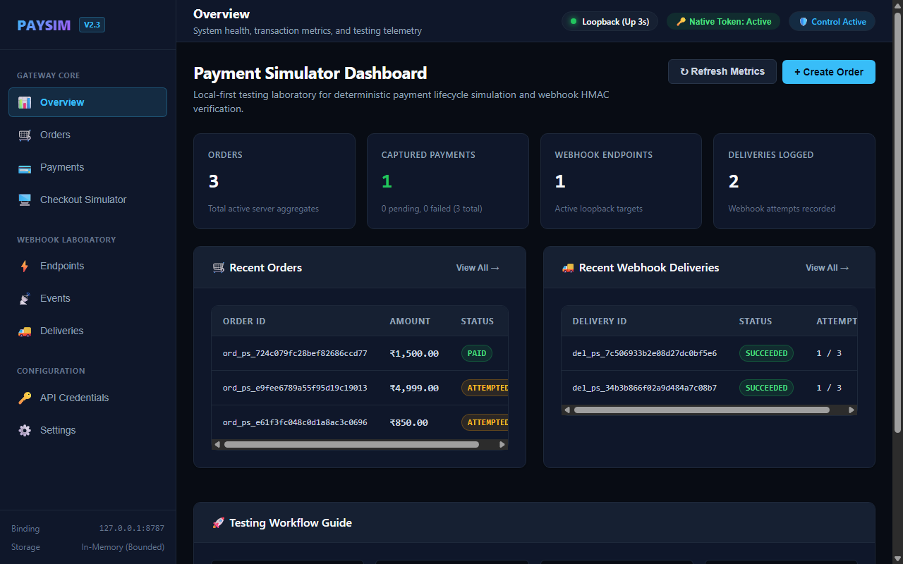
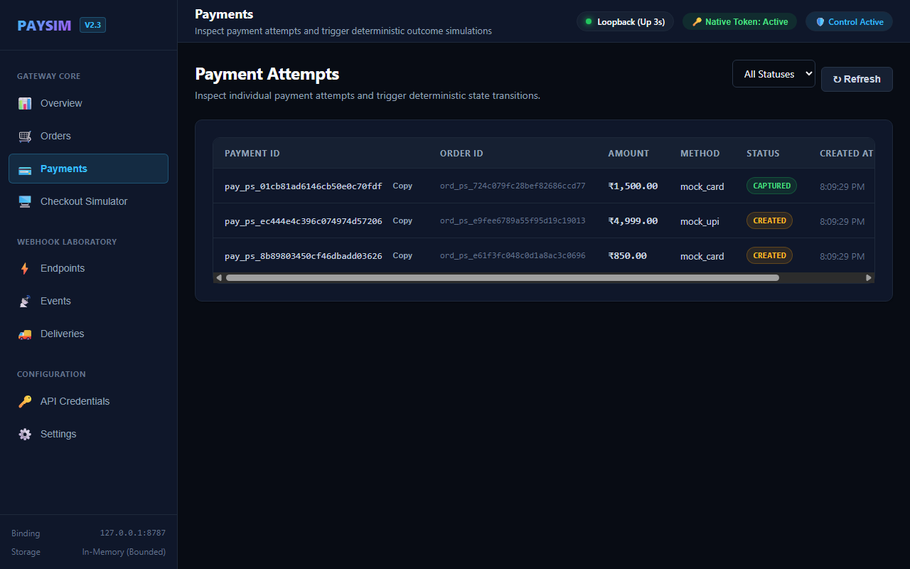
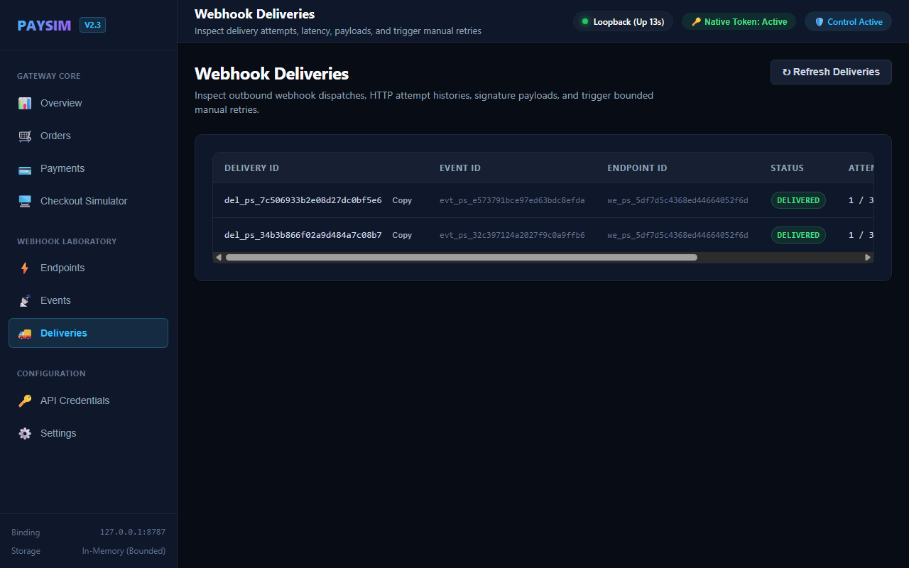
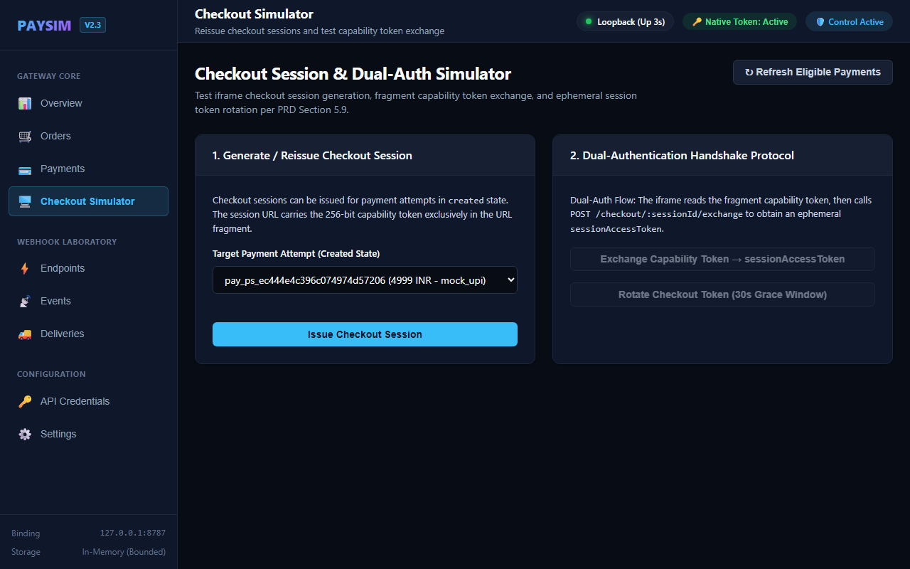
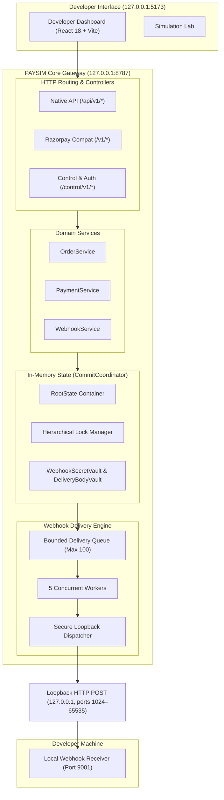

<div align="center">

# PAYSIM

**Local Payment Gateway Simulator & Webhook Testing Laboratory**

[](https://nodejs.org/)
[](https://www.typescriptlang.org/)
[](LICENSE)
[](https://vitest.dev/)
[](https://github.com/ManojDevHub1/paysim/releases/latest)

<p align="center">
  A local-first payment gateway simulator and developer testing laboratory with zero external service dependencies.<br />
  Test payment lifecycles, simulate success/failure scenarios, and receive authentic HMAC-signed webhooks through the local loopback interface.<br />
  <b>Zero merchant accounts or KYC required (local-only simulation). No external payment APIs. Zero cloud reverse tunnels. Zero databases.</b>
</p>

[Quick Start](#-quick-start) •
[Features](#-key-features) •
[Screenshots](#-product-screenshots) •
[Architecture](#-architecture) •
[Sample Receiver](#-sample-webhook-receiver) •
[Documentation](#-documentation-index)

</div>

---

> [!IMPORTANT]
> **Project Limitations & Simulation Boundary**
> PAYSIM is strictly a **local-only payment simulation and webhook testing laboratory**. It **does not** process real money, interact with real banking switches, connect to payment card networks (Visa/Mastercard), or communicate with UPI PSPs. All orders, payments, tokens, and credentials are completely synthetic and maintained exclusively in volatile in-memory storage.
>
> The phrase **"zero KYC"** denotes that developers do not need merchant onboarding or banking identity verification to test application workflows locally. PAYSIM does not provide financial services, process real transactions, or onboard real merchants, and it must never be used or presented as a way to bypass financial regulations, provider onboarding, identity checks, or production payment requirements.

---

## 💡 The Problem PAYSIM Solves

Integrating payment gateways during local development is notoriously painful:

- **KYC & Account Friction**: Setting up sandbox accounts typically requires company documentation, business verification, merchant KYC approval, and waiting periods.
- **Webhook Tunneling Overhead**: Local machines cannot receive callbacks from external payment gateways without running third-party tunneling utilities (e.g. ngrok, localtunnel), which introduce latency, flaky connections, and URL renegotiation.
- **Unreliable Edge-Case Testing**: Testing issuer declines, network timeouts, payment cancellations, or webhook retry exhaustion against real gateways is difficult or non-deterministic.
- **Database Pollution**: Local development environments get cluttered with test transactions, orphaned payment states, and expired credentials.

**PAYSIM eliminates this entirely.** It runs an entire payment gateway simulator directly on your loopback interface (`127.0.0.1`). You can create orders, simulate payment attempts, test embedded checkout flows, and receive real HTTP webhooks with cryptographic HMAC-SHA256 signatures — delivered strictly over literal loopback (`127.0.0.1` or `[::1]`).

---

## ⚡ Key Features

- **100% Local & Self-Contained**: Binds strictly to `127.0.0.1`. Performs zero outbound external internet requests and requires zero database servers.
- **Real Loopback Webhook Dispatches**: Sends authentic HTTP `POST` requests to local receiver endpoints via literal loopback addresses (e.g., `http://127.0.0.1:9001/webhook` or `http://[::1]:9001/webhook`; DNS hostnames including `localhost` are strictly rejected for SSRF safety) with timing-safe HMAC-SHA256 signatures (`X-PaySim-Signature`).
- **Deterministic Simulation Lab**: Simulate any payment outcome on demand: `success`, `failed`, `pending`, or `cancelled` with specific simulated error codes (e.g., `CARD_DECLINED`, `INSUFFICIENT_FUNDS`).
- **Dual Wire Protocol**: Supports both native PAYSIM API formats and **selected Razorpay Orders & embedded Checkout endpoint compatibility** (`/v1/orders`, `/v1/checkout/embedded`, `X-Razorpay-Signature`) for testing standard checkout integrations locally.
- **Interactive Developer Dashboard**: Modern React 18 + Vite developer interface with 9 views: Overview, Orders, Payments, Checkout Simulator, Webhooks, Deliveries, Events, Credentials, and Settings.
- **Concurrent Webhook Retry Engine**: Outbound webhook delivery engine with 5 concurrent workers, fixed retry schedule (Immediate, 500ms, 2000ms), and up to 3 manual retry allowances.
- **Safe Bootstrap Control Token**: One-time ephemeral credential generated in volatile RAM and disclosed exclusively via terminal stdout; never persisted to disk (SET-02/SET-03).
- **One-Command Dev Orchestration**: Launch both the Express backend and React dashboard with pre-flight port checks via `npm run dev`.

---

## 📸 Product Screenshots

PAYSIM includes a comprehensive React 18 dashboard running on `http://127.0.0.1:5173`.

### 1. Developer Dashboard Overview
Real-time metrics, order throughput, delivery success rates, and quick-action shortcuts:


### 2. Payments & Simulation Lab
Inspect payment attempts and trigger deterministic outcome simulations:


### 3. Webhook Delivery Inspector
Inspect raw payload byte snapshots, latency, attempt history, and cryptographic signatures:


### 4. Embedded Checkout Simulator
Test customer checkout flows with simulated card and UPI methods:


*(Additional screenshots for [Orders Management](docs/screenshots/orders_management.png), [Webhook Endpoints](docs/screenshots/webhook_endpoints.png), and [Events Explorer](docs/screenshots/events_explorer.png) are available in `docs/screenshots/`).*

---

## 🏗️ Architecture

PAYSIM follows a strict layered architecture with in-memory persistence and isolated cryptographic vaults.



For comprehensive lifecycle sequence charts and retry state machines, see **[Architecture Diagrams](docs/ARCHITECTURE_DIAGRAMS.md)**.

---

## 🧰 Technology Stack

| Layer | Technologies | Role |
|-------|--------------|------|
| **Runtime** | Node.js 24 LTS (ESM) | Core execution environment |
| **Language** | TypeScript 5.6 | Strict static typing across monorepo |
| **Backend** | Express 4.21 | HTTP server, routing, and controller pipeline |
| **Frontend** | React 18.3, Vite 5.4 | Developer dashboard SPA |
| **Validation** | Zod 3.23 | Frozen contract schemas and request validation |
| **Storage** | In-Memory (`RootState`) | Pure state machines with atomic commit coordination |
| **Security** | Native `node:crypto` | Constant-time HMAC-SHA256 & memory zeroization |
| **Testing** | Vitest 2.1 | Fast parallel test runner (546 passing tests across 49 test files) |

---

## 🚀 Quick Start

### 1. Prerequisites
- **Node.js**: `>= 24.0.0` (`node -v`)
- **npm**: `>= 10.0.0` (`npm -v`)

### 2. Installation

```bash
# Clone the repository
git clone https://github.com/ManojDevHub1/paysim.git
cd paysim

# Install dependencies across all monorepo packages
npm ci

# Verify environment diagnostics
npm run doctor
```

### 3. Launch Development Environment

```bash
# Starts both Backend (8787) and Dashboard (5173) concurrently
npm run dev
```

Open **[http://127.0.0.1:5173](http://127.0.0.1:5173)** in your browser. The one-time **Bootstrap Control Token** will be disclosed in your terminal.

---

## 📡 Sample Webhook Receiver

PAYSIM includes a standalone, zero-dependency Node.js webhook receiver in `examples/node-webhook-receiver/`:

```bash
# In a separate terminal
cd examples/node-webhook-receiver
npm start
```

### Minimal HMAC-SHA256 Verification in 25 Lines:

```javascript
import http from 'node:http';
import crypto from 'node:crypto';

const SECRET = 'sample_secret_key_1234567890abcdef';

http.createServer(async (req, res) => {
  const chunks = [];
  for await (const chunk of req) chunks.push(chunk);
  const rawBody = Buffer.concat(chunks);

  const sigHeader = (req.headers['x-paysim-signature'] || '').replace('sha256=', '').trim();
  const computed = crypto.createHmac('sha256', SECRET).update(rawBody).digest('hex');

  const isValid = sigHeader.length === computed.length &&
    crypto.timingSafeEqual(Buffer.from(sigHeader, 'hex'), Buffer.from(computed, 'hex'));

  if (!isValid) {
    res.writeHead(401, { 'Content-Type': 'application/json' });
    return res.end(JSON.stringify({ error: 'INVALID_SIGNATURE' }));
  }

  const payload = JSON.parse(rawBody.toString('utf8'));
  console.log(`[RECEIVER] Received event: ${payload.type} (ID: ${payload.id})`);
  res.writeHead(200, { 'Content-Type': 'application/json' });
  res.end(JSON.stringify({ received: true }));
}).listen(9001, '127.0.0.1');
```

---

## 🔌 API Examples

Ready-to-use HTTP request files are provided in `examples/api/`:

| File | Purpose |
|------|---------|
| [`create-order.http`](examples/api/create-order.http) | Exchange bootstrap token, rotate API credentials, and create orders |
| [`simulate-payment.http`](examples/api/simulate-payment.http) | Create payment attempts and simulate `success` or `failed` outcomes |
| [`create-webhook.http`](examples/api/create-webhook.http) | Register local webhook receiver endpoints and rotate signing secrets |
| [`replay-event.http`](examples/api/replay-event.http) | Query historical domain events and replay to active endpoints |
| [`retry-delivery.http`](examples/api/retry-delivery.http) | Inspect delivery attempts and trigger manual delivery retries |

---

## 🔒 Security Architecture

- **Strict Loopback Confinement**: Outbound webhook dispatches are strictly restricted to literal loopback addresses (`127.0.0.1` and `[::1]`) on ports `1024` through `65535`. DNS hostnames (including `localhost`), alternate numeric IP notations, LAN ranges, cloud metadata endpoints (`169.254.169.254`), broadcast addresses, and the server's own listener ports are strictly rejected at socket initiation.
- **In-Memory Cryptographic Vaults**: Webhook signing secrets and delivery payload snapshots are isolated in dedicated memory vaults (`WebhookSecretVault`, `DeliveryBodyVault`). Secrets are scrubbed with zeroes (`0x00`) upon delivery exhaustion.
- **Zero Local Secrets Persistence**: The one-time bootstrap token is generated in volatile RAM and disclosed strictly via terminal stdout (SET-02/SET-03). It is never written to disk, dotfiles, or browser storage.
- **Contract Sanitization**: Public delivery API endpoints sanitize responses through `WebhookDeliveryEntitySchema` to prevent leaking internal scheduler or attempt metadata.

For vulnerability reporting procedures, please review our **[Security Policy](SECURITY.md)**.

---

## 🧪 Testing & Quality Gates

PAYSIM includes an extensive test suite ensuring strict protocol compliance and security boundaries:

```bash
# Run environment diagnostics
npm run doctor

# Run TypeScript compilation check
npm run typecheck

# Run ESLint static analysis
npm run lint

# Execute full Vitest suite (546 passing tests across 49 test files)
npm test

# Verify production build
npm run build
```

---

## 🤝 Contributing

We welcome community contributions! Please read our **[Contributing Guidelines](CONTRIBUTING.md)** and **[Code of Conduct](CODE_OF_CONDUCT.md)** before opening issues or submitting pull requests.

---

## 📚 Documentation Index

- **[Product Requirements Document (PRD v2.3)](docs/PRD_v2.3.md)** — Authoritative normative product specification baseline.
- **[Implementation Traceability Matrix](docs/IMPLEMENTATION_TRACEABILITY.md)** — Requirement-by-requirement verification status for v1.0.0.
- **[Developer Quick Start Guide](docs/QUICK_START.md)** — Step-by-step onboarding walkthrough.
- **[Architecture Diagrams](docs/ARCHITECTURE_DIAGRAMS.md)** — Detailed Mermaid specifications and sequence charts.
- **[System Architecture](docs/SYSTEM_ARCHITECTURE.md)** — Hardened architectural specification.
- **[Architecture Decision Register](docs/ARCHITECTURE_DECISION_REGISTER.md)** — ADR-001 through ADR-011.
- **[Brand Assets & Favicon Spec](docs/BRAND_ASSETS.md)** — Visual identity tokens and SVG/ICO generation pipeline.
- **[Demonstration Storyboard](docs/DEMO_STORYBOARD.md)** — 60–90 second product demonstration script.
- **[Release Notes v1.0.0](docs/RELEASE_NOTES_v1.0.0.md)** — Version 1.0.0 release notes.
- **[Release Checklist](docs/RELEASE_CHECKLIST.md)** — Pre-release maintainer verification checklist.

---

## 📄 License

This project is licensed under the **[MIT License](LICENSE)**.

```text
Copyright (c) 2026 PAYSIM Contributors
```
