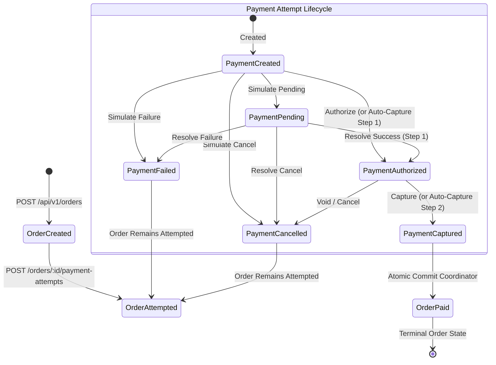
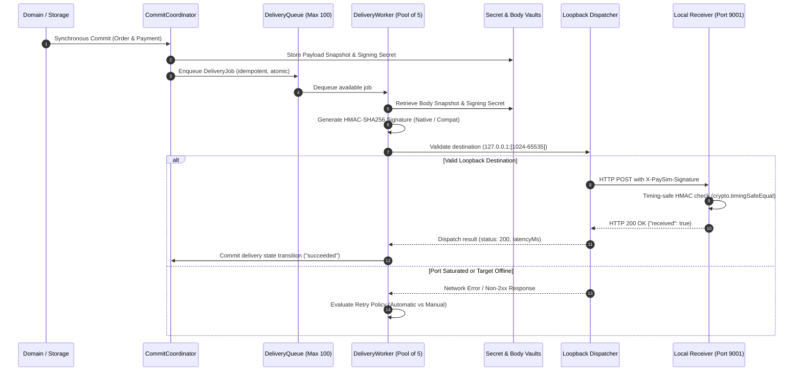
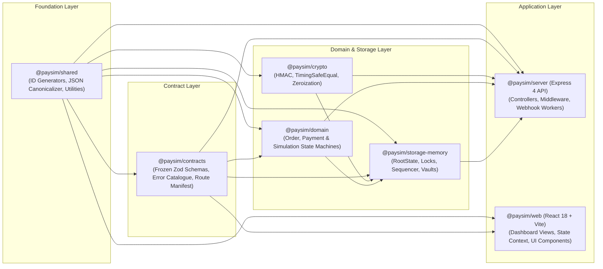

# PAYSIM Architectural Diagrams

> **Visual Architectural Specifications, Lifecycles, and Component Boundaries**
> **Normative Baseline:** PRD v2.3.0, ADR-001 through ADR-011

---

## 1. Overall System Architecture

The following diagram illustrates the relationship between the Developer Dashboard, Express API Gateway, In-Memory Storage Coordinator, Outbound Webhook Delivery Engine, and Local Receiver.

```mermaid
flowchart TD
  subgraph Frontend["Frontend Layer (127.0.0.1:5173)"]
    UI["Developer Dashboard (React 18 + Vite)"]
    SimLab["Simulation Lab Drawer"]
    IframeSim["Checkout Embedded Iframe Simulator"]
  end

  subgraph Backend["PAYSIM Core Engine (127.0.0.1:8787)"]
    subgraph Ingress["HTTP Ingress & Routing"]
      NativeAPI["Native API v1 (/api/v1/*)"]
      CompatAPI["Razorpay Compat API (/v1/*)"]
      ControlAPI["Control & Simulation API (/control/v1/*)"]
      Sanitizer["Public Contract Sanitizer (Zod)"]
    end

    subgraph ServiceLayer["Application Service Layer"]
      OrderSvc["OrderService"]
      PaymentSvc["PaymentService"]
      CheckoutSvc["CheckoutService"]
      WebhookSvc["WebhookService"]
    end

    subgraph StorageLayer["In-Memory Storage (CommitCoordinator)"]
      RootState["RootState Container (Single In-Memory Aggregate)"]
      LockMgr["5-Tier Hierarchical Lock Manager"]
      Sequencer["Monotonic BigInt Event Sequencer"]
      SecretVault["WebhookSecretVault (Isolated Memory Buffers)"]
      BodyVault["DeliveryBodyVault (Payload Byte Snapshots)"]
    end

    subgraph DeliveryEngine["Webhook Delivery Engine"]
      Queue["Bounded Delivery Queue (Max 100 Jobs)"]
      WorkerPool["5 Concurrent Workers"]
      HttpDispatcher["Secure Loopback HTTP Dispatcher"]
      RetryEngine["Fixed Retry Engine (Immediate, 500ms, 2000ms)"]
    end
  end

  subgraph LocalApp["Local Developer Environment"]
    Receiver["Local Webhook Receiver (e.g. 127.0.0.1:9001)"]
    DeveloperApp["Developer Application Backend"]
  end

  UI -->|HTTP Requests| Ingress
  SimLab -->|Simulate State| ControlAPI
  IframeSim -->|postMessage parentOrigin| UI

  Ingress --> ServiceLayer
  ServiceLayer --> StorageLayer
  ServiceLayer --> DeliveryEngine

  StorageLayer -->|Committed Canonical Event| Queue
  Queue --> WorkerPool
  WorkerPool --> HttpDispatcher
  WorkerPool <--> RetryEngine
  WorkerPool --> SecretVault
  WorkerPool --> BodyVault

  HttpDispatcher -->|POST Strict Loopback Only (127.0.0.1:[1024-65535])| Receiver
  Receiver -->|Process & Acknowledge| DeveloperApp
```

---

## 2. Payment Simulation Lifecycle

The state transitions and atomic invariants governing orders and payment attempts during simulation. In strict accordance with PRD v2.3.0 Section 8.2 and `@paysim/domain`, payment states are strictly `created`, `pending`, `authorized`, `captured`, `failed`, and `cancelled`. There is no refund state (refunds are out of scope and return `501 COMPATIBILITY_FEATURE_NOT_SUPPORTED`).



> [!NOTE]
> **No Refund State:** PAYSIM is a checkout and payment authorization simulator. Refunds (`/v1/refunds`), payouts, and subscriptions are explicitly out of scope per PRD v2.3.0 and fail closed with `501 COMPATIBILITY_FEATURE_NOT_SUPPORTED`. Terminal payment states (`captured`, `failed`, `cancelled`) are strictly immutable and permit zero subsequent transitions.

---

## 3. Webhook Delivery Lifecycle

The sequence of events from domain commit to authentic local HTTP dispatch and HMAC-SHA256 verification.



---

## 4. Retry and Secret-Retention Lifecycle

How delivery attempts, fixed backoff delays (Immediate, 500ms, 2000ms), manual retries, and in-memory secret zeroization interact without resource leaks.

```mermaid
flowchart TD
  Start["Event Committed\nJob Enqueued (status: pending)"] --> Dequeue["Worker Pool Dequeues Job\nStatus: in_progress"]
  Dequeue --> Attempt1["Attempt 1: Immediate Dispatch (0ms delay)"]

  Attempt1 -->|HTTP 2xx (Success)| Success["Status: succeeded"]
  Success --> Cleanup["Vault Cleanup:\nRelease DeliveryBodyVault Snapshot\nRelease Secret Reference"]

  Attempt1 -->|Permanent Reject\n(Redirect, Prohibited Port, Body > 64KB)| Rejected["Status: rejected\n(Non-retryable terminal state)"]
  Rejected --> Cleanup

  Attempt1 -->|Non-Retryable 4xx\n(400, 401, 403, 404, 422)| FailedNoRetry["Status: failed\n(Zero automatic retries scheduled)"]
  Attempt1 -->|Process Shutdown Abort| Interrupted["Status: interrupted\n(Zero automatic retries)"]

  Attempt1 -->|Retryable Error\n(Network Error, 408, 425, 429, 5xx)| EvalAuto1{"Automatic Attempts < 3?"}

  EvalAuto1 -->|Yes: Attempt 1 Failed| Backoff1["Fixed Delay 1 (500ms Backoff)\nStatus: failed, nextRetryAt: future"]
  Backoff1 --> Attempt2["Attempt 2 Dispatch (Worker Pool)"]

  Attempt2 -->|HTTP 2xx| Success
  Attempt2 -->|Non-Retryable 4xx| FailedNoRetry
  Attempt2 -->|Permanent Reject| Rejected
  Attempt2 -->|Retryable Error| EvalAuto2{"Automatic Attempts < 3?"}

  EvalAuto2 -->|Yes: Attempt 2 Failed| Backoff2["Fixed Delay 2 (2000ms Backoff)\nStatus: failed, nextRetryAt: future"]
  Backoff2 --> Attempt3["Attempt 3 Dispatch (Worker Pool)"]

  Attempt3 -->|HTTP 2xx| Success
  Attempt3 -->|Non-Retryable 4xx| FailedNoRetry
  Attempt3 -->|Permanent Reject| Rejected
  Attempt3 -->|Failed: 3 Attempts Exhausted| Exhausted["Status: exhausted\nAutomatic Retries Complete"]

  Backoff1 -.->|User Triggers Manual Retry| ManualSupersede["Cancel Scheduled Timer\nConsume 1 of 3 Manual Quotas"]
  Backoff2 -.->|User Triggers Manual Retry| ManualSupersede
  ManualSupersede --> ManualDispatch["Immediate Manual Dispatch\n(Single Attempt, No Auto Cycle)"]
  ManualDispatch -->|HTTP 2xx| Success
  ManualDispatch -->|Failed| FailedManual["Status: failed\n(Manual retries do not restart auto cycle)"]

  FailedNoRetry --> EvalManual{"Manual Retries Remaining?\n(Max 3 Manual Retries)"}
  Exhausted --> EvalManual
  FailedManual --> EvalManual

  EvalManual -->|Quota Available| ManualRetryReady["Manual Retry Permitted via UI / API"]
  ManualRetryReady -->|Triggered by User| ManualDispatch

  EvalManual -->|All Manual Retries Consumed| PermanentExhaustion["Permanently Exhausted\n(Retries Remaining: 0)"]
  PermanentExhaustion --> CleanupZeroize["Memory Zeroization:\nScrub Secret with 0x00 in WebhookSecretVault\nRelease DeliveryBodyVault Snapshot"]
```

---

## 5. Application Dependency Boundaries

The strict unidirectional dependency graph across all monorepo packages. Notice that contracts and core domain logic remain completely decoupled from HTTP transports and browser frameworks.


