# PAYSIM — Phase 02.3 Final Architecture Patch & Corrections

**Document Version:** 1.0.0  
**Phase:** Phase 02.3 — Final Architecture Patch  
**Status:** Complete & Approved  
**Current Normative Baseline:** PRD v2.3.0 (`docs/PRD_v2.3.md`)  
**Lead Architect:** Principal Software Architect  
**Date:** 3 November 2026  

---

## 1. Executive Summary & Scope

This document provides the definitive architectural resolutions for the remaining technical edge cases and synchronization boundaries identified in the Phase 02.2 review.

It resolves twelve technical domains:
1. **Payment Attempt Transition Model:** Formal resolution of compound vs. multi-step `created → authorized → captured` state transitions.
2. **Atomic Capacity Reservation:** Pre-flight multi-resource reservation across events, delivery intents, and idempotency records.
3. **Storage Saturated Invariants:** Eviction cascades, unevictable saturation handling, and deterministic 429 rejection contracts.
4. **Docker Host vs. Container Networking:** Native host loopback bridging versus containerized deployment limitations.
5. **WSL2 NAT vs. Mirrored Networking:** Detailed connectivity specifications for standard NAT forwarding versus Windows 11 mirrored mode.
6. **Session Access Token Storage & Re-Exchange:** Exact client/server storage models, TTL synchronization, and idempotent exchange semantics.
7. **Iframe Remount vs. Parent Page Reload:** Clear demarcation between SPA component remounting and full browser refreshes.
8. **Interrupted Unknown Webhook Semantics:** Process termination socket abortion, receiver deduplication requirements, and retry policies.
9. **Rejected Delivery State & Retry Ineligibility:** Formal distinction between `rejected` deliveries and `failed`/`exhausted` retriable deliveries.
10. **Webhook Endpoint Mode Snapshots:** Delivery-level mode immutability across endpoint configuration changes.
11. **Compatibility Secret Retention in Pending States:** Pinned version lifecycles during extended pending operations and key rotations.
12. **Concurrency & Idempotency Edge Cases:** Mutex locking on concurrent identical keys, conflicting fingerprints, and sweeper races.

---

## 2. Correction 1: Payment Transition Model (`created → authorized → captured`)

In payment gateway integrations, two distinct payment capture workflows exist:
1. **Auto-Capture (Single-Step Success):** The merchant creates an order, customer pays, and funds are authorized and captured in a single synchronous operation.
2. **Two-Step Authorization & Capture:** The merchant authorizes funds (placing a hold), and captures or cancels funds later upon fulfillment.

### 2.1 Formal Resolution in PAYSIM
The PAYSIM state machine accommodates both patterns deterministically without state corruption:

```mermaid
stateDiagram-v2
    [*] --> created : Create Payment Attempt (Emits payment.created)
    
    state "Auto-Capture Workflow (Single-Step Simulation)" as AutoCapture {
        created --> captured : Atomic Compound Transition\n(Emits payment.authorized, payment.captured, order.paid)
    }
    
    state "Two-Step Authorization Workflow (Manual Capture)" as TwoStepAuth {
        created --> authorized : Simulate Authorize Command\n(Emits payment.authorized)
        authorized --> captured : Simulate Capture Command\n(Emits payment.captured, order.paid)
        authorized --> cancelled : Simulate Void/Cancel Command\n(Emits payment.cancelled)
    }
    
    created --> pending : Simulate Pending\n(Emits payment.pending)
    pending --> captured : Resolve Success (Compound)\n(Emits payment.authorized, payment.captured, order.paid)
    pending --> failed : Resolve Failure\n(Emits payment.failed)
    pending --> cancelled : Resolve Cancel\n(Emits payment.cancelled)
    
    created --> failed : Simulate Failure\n(Emits payment.failed)
    created --> cancelled : Simulate Cancel\n(Emits payment.cancelled)
    
    captured --> [*] : Terminal State (Order is Paid)
    failed --> [*] : Terminal State
    cancelled --> [*] : Terminal State
```

* **Single-Step Success Command (`outcome: "success"`):**
  - Executes as an **atomic compound transition** within a single order mutex lock (`AsyncLock(orderId)`).
  - Validates `created` state. Mutates payment status directly to `captured`.
  - Mutates parent order status from `attempted` to `paid`.
  - Emits all three causal events in strict commit order:
    1. `payment.authorized`
    2. `payment.captured`
    3. `order.paid`
* **Two-Step Authorization Command (`outcome: "authorize"`):**
  - Mutates payment status `created → authorized`. Order remains `attempted`.
  - Emits `payment.authorized`. Payment pauses in `authorized` state.
  - Subsequent capture via `/payments/:id/capture` moves `authorized → captured`, emitting `payment.captured` and `order.paid`.
  - Subsequent void via `/payments/:id/cancel` moves `authorized → cancelled`, emitting `payment.cancelled`.

---

## 3. Correction 2 & 3: Atomic Capacity Reservation & Storage Saturation

### 3.1 Pre-Flight Multi-Resource Capacity Reservation

To eliminate partial-commit failures where an event is written but webhook deliveries cannot be created, the domain critical section executes an atomic pre-flight capacity reservation before any entity is mutated:

```mermaid
sequenceDiagram
    autonumber
    participant Controller as Payment Controller
    participant Lock as AsyncLock(orderId)
    participant Coordinator as RetentionCoordinator
    participant Domain as Domain Service
    participant Repos as In-Memory Repositories

    Controller->>Lock: acquire(orderId)
    Controller->>Domain: simulateOutcome(paymentId, "success")
    
    Note over Domain: Calculate required capacity:<br/>Events = 3 (auth, cap, order.paid)<br/>Deliveries = 3 * matchingEnabledEndpoints<br/>Idempotency = 1
    
    Domain->>Coordinator: reserveTransactionSlots({ events: 3, deliveries: N, idempotency: 1 })
    
    alt Saturated & Unevictable
        Coordinator-->>Domain: Insufficient Capacity (Cannot safely evict)
        Domain-->>Controller: ABORT: 429 RESOURCE_LIMIT_REACHED
        Controller->>Lock: release(orderId)
        Note over Controller,Repos: ZERO entities mutated; Payment remains created
    else Capacity Available or Eviction Successful
        Coordinator-->>Domain: Capacity Reserved (Slot reservation token)
        Note over Domain,Repos: Execute atomic mutations in memory
        Domain->>Repos: commit(Payment, Order, Events, Deliveries, Idempotency)
        Domain-->>Controller: 200 OK (Payment Captured)
        Controller->>Lock: release(orderId)
    end
```

### 3.2 Storage Saturated Invariants
1. **Eviction Eligibility:** An aggregate is eligible for eviction if and only if its order is `paid` (or all payment attempts are `failed`/`cancelled`), all linked checkout sessions are closed/expired, no deliveries are in-flight (`queued`/`delivering`), no deliveries are in retry-eligible status with remaining budget, and no unexpired idempotency records reference the aggregate.
2. **Unevictable Saturated Rejection Contract:** If repositories hit configured maximum caps (Orders: 2,000, Events: 2,000, Deliveries: 5,000) and no eligible records exist:
   - Inbound mutating API requests fail pre-commit with `429 RESOURCE_LIMIT_REACHED`:
     ```json
     {
       "simulated": true,
       "error": {
         "code": "RESOURCE_LIMIT_REACHED",
         "message": "In-memory event storage capacity reached (2000/2000) and no eligible records can be safely evicted",
         "requestId": "req_ps_cap_01",
         "details": [
           {
             "resource": "events",
             "limit": 2000,
             "current": 2000
           }
         ]
       }
     }
     ```
   - Asynchronous Webhook Overflow: If an event is already committed and delivery storage hits capacity without evictable records, the delivery is created in `rejected` status with `rejectionCode = "DELIVERY_STORAGE_FULL"`. The payment and order remain committed.

---

## 4. Correction 4 & 5: Docker & WSL2 Networking Specifications

### 4.1 Docker Native-Host vs. Docker-Container Networking

```text
┌────────────────────────────────────────────────────────────────────────────────────────┐
│ CONFIGURATION A: PAYSIM ON NATIVE HOST, RECEIVER IN DOCKER (SUPPORTED)                 │
│                                                                                        │
│ Developer Host (Windows / macOS / Linux)                                               │
│ ┌─────────────────────────┐          HTTP POST to 127.0.0.1:3000                       │
│ │ PAYSIM (127.0.0.1:8787) │ ──────────────────────────────────────────┐               │
│ └─────────────────────────┘                                           │               │
│                                                                       ▼               │
│                                                      Host Published Port (127.0.0.1:3000)
│                                                                       │ (docker-proxy)│
│ Docker Container                                                      ▼               │
│ ┌──────────────────────────────────────────────────┐   Container Port (3000)           │
│ │ Developer Webhook Receiver (Listening on :3000)   │ ◄────────────────┘               │
│ └──────────────────────────────────────────────────┘                                   │
│ Setup Command: docker run -p 127.0.0.1:3000:3000 my-receiver-app                       │
└────────────────────────────────────────────────────────────────────────────────────────┘

┌────────────────────────────────────────────────────────────────────────────────────────┐
│ CONFIGURATION B: PAYSIM INSIDE DOCKER CONTAINER (EXPLICITLY UNSUPPORTED ON WIN/MAC)    │
│                                                                                        │
│ On Docker Desktop (Win/Mac), container loopback (127.0.0.1) is isolated inside a VM.   │
│ Delivering to host services requires host.docker.internal (DNS resolving to 192.168.x).│
│ This violates PAYSIM's strict literal loopback IP policy.                              │
│ Linux Native with --net=host is supported; Docker Desktop containerization is BANNED.  │
└────────────────────────────────────────────────────────────────────────────────────────┘
```

### 4.2 WSL2 NAT vs. Mirrored Networking Modes

1. **WSL2 Standard NAT Mode (Default):**
   - Receiver inside WSL2 binds to `0.0.0.0:3000`.
   - Windows host accesses it via localhost forwarding (`localhostForwarding=true` in `.wslconfig`).
   - PAYSIM on Windows host sends to `http://127.0.0.1:3000/webhook` (traffic traverses Windows loopback proxy into WSL2).
   - Direct addressing of WSL2 vEthernet IP (`172.28.x.x`) is **STRICTLY REJECTED** with `422 WEBHOOK_URL_REJECTED`.
2. **WSL2 Mirrored Mode (Windows 11 23H2+ / WSL 2.0+):**
   - Configured via `[wsl2]\nnetworkingMode=mirrored` in `%USERPROFILE%\.wslconfig`.
   - WSL2 and Windows host share the identical loopback adapter.
   - PAYSIM on Windows reaching WSL2 receiver, or PAYSIM in WSL2 reaching Windows receiver, functions natively over `127.0.0.1`.

---

## 5. Correction 6 & 7: Session Token Storage & Iframe Remounting

### 5.1 Storage & Lifecycle Separation

| Context | Storage Mechanism | Lifetime / Invalidation | Transport Header |
|---|---|---|---|
| **Parent Window (Developer App)** | JavaScript memory in `window.Razorpay` instance | Retained until page refresh or modal instance destruction | Carries `#opaqueToken` fragment into iframe URL |
| **Iframe Client Window (Checkout UI)** | Module-scoped JavaScript variable (`currentAccessToken`) | 15 minutes max; bound to `CheckoutSession.expiresAt` | `Authorization: Bearer <sessionAccessToken>` |
| **Server-Side Session Store** | Process memory hash map (`CheckoutSessionRepository`) | 15 minutes max; invalidated immediately on terminal payment commit | Validated against incoming Bearer token hash |
| **Cookie Fallback** | `Set-Cookie: paysim_chk_session=...; SameSite=Lax; Path=/checkout/:id` | Secondary fallback for direct browser tab opens | Cookie header (ignored in third-party iframe) |

### 5.2 Iframe Remount vs. Parent Page Reload

```mermaid
flowchart TD
    subgraph Case1["Case 1: Iframe Remount (SPA Modal Close & Reopen)"]
        A1[User closes checkout modal] --> B1[Iframe DOM element removed]
        B1 --> C1[Parent window memory is INTACT\nwindow.Razorpay retains checkout_url#token]
        C1 --> D1[User clicks Pay again]
        D1 --> E1[Shim creates new iframe with checkout_url#token]
        E1 --> F1[Iframe calls POST /checkout/:id/exchange]
        F1 --> G1[Server returns 200 OK with active sessionAccessToken\nSession recovered; Payment remains created; No events emitted]
    end

    subgraph Case2["Case 2: Full Parent-Page Reload (Browser F5 / Hard Refresh)"]
        A2[User presses F5 on merchant page] --> B2[Parent window memory is DESTROYED]
        B2 --> C2[Merchant application reloads from backend]
        C2 --> D2{Does backend have order_id?}
        D2 -- Yes --> E2[Backend calls POST /orders/:id/checkout-sessions]
        E2 --> F2{Is session < 15m old?}
        F2 -- Yes --> G2[PAYSIM returns active checkout_url idempotently]
        F2 -- No --> H2[PAYSIM returns 410 CHECKOUT_SESSION_EXPIRED\nBackend calls reissue route for same paymentId]
        D2 -- No --> I2[Merchant creates new mock order from scratch]
    end
```



---

## 6. Correction 8 & 9: Webhook Delivery Outcomes & Retry Ineligibility

### 6.1 `interrupted_unknown` Outcome Semantics
When the server process receives SIGINT/SIGTERM while an HTTP socket connection is in-flight:
- The socket is aborted immediately via `AbortController`.
- The attempt outcome is recorded as `interrupted_unknown`.
- The parent delivery status is marked as `interrupted`.
- **Automatic Retry Policy:** Zero automatic retries occur during process shutdown.
- **Receiver Deduplication Requirement:** Because the TCP socket was severed before receiving the HTTP response, packets may have reached the receiver. Webhook receivers **must deduplicate by event ID** (`X-PaySim-Event-Id` / `X-Razorpay-Event-Id`) before executing business actions.

### 6.2 `rejected` Delivery State & Ineligibility for Manual Retry
- **Definition:** A delivery in status `rejected` represents a delivery intent that **never made an HTTP network attempt** due to pre-send validation failure (`DELIVERY_QUEUE_FULL`, `DELIVERY_STORAGE_FULL`, `DELIVERY_PAYLOAD_TOO_LARGE`, or `WEBHOOK_URL_REJECTED`).
- **Ineligibility Rule:** `rejected` deliveries **cannot be manually retried**.
- **Rationale:** A delivery rejected due to an invalid URL or oversized payload will fail identically if retried with the same snapshot.
- **Corrective Action:** The user must use **Replay** (`POST /events/:id/replay`), which evaluates the endpoint's current configuration and generates a fresh delivery record.

---

## 7. Correction 10 & 11: Mode Snapshots & Secret Retention across Pending States

### 7.1 Webhook Endpoint Mode Immutability
When an event matches an enabled endpoint, the resulting `WebhookDelivery` snapshots the endpoint's mode (`native` or `compatibility`):
- Delivery request body is serialized deterministically using `delivery.mode` and stored in `DeliveryBodyVault`.
- Subsequent `PATCH /webhook-endpoints/:id` changing `mode` increments `configVersion` and applies **only** to future events and Replay.
- Retries strictly reuse the delivery's snapshotted body bytes and headers (`X-PaySim-Signature` for Native, `X-Razorpay-Signature` for Compatibility).

### 7.2 Compatibility Secret Retention during Asynchronous Pending States
If a payment attempt created under compatibility key version $V_1$ enters `pending`:
1. Developer rotates key to $V_2$ in Settings.
2. Inbound API requests using $V_1$ are immediately rejected with `401 UNAUTHORIZED`.
3. $V_1$'s raw secret bytes in `CompatibilitySecretVault` are **pinned** to the pending attempt.
4. $V_1$'s buffer remains in memory throughout the pending duration (minutes or hours).
5. When the developer resolves the payment to `success`:
   - PAYSIM signs the synthetic callback using $V_1$'s secret bytes.
   - Payment status commits to `captured`.
   - The retention evaluator detects zero non-terminal attempts remaining for $V_1$.
   - $V_1$'s secret buffer is zeroized via `buffer.fill(0)` and evicted from the vault.

---

## 8. Correction 12: Concurrency & Idempotency Edge Cases

```text
┌────────────────────────────────────────────────────────────────────────────────────────┐
│ CONCURRENCY SCENARIO A: SIMULTANEOUS REQUESTS WITH IDENTICAL KEY & IDENTICAL BODY       │
│                                                                                        │
│ Thread 1 (Key: k1) ──► Acquires AsyncLock("idemp:k1") ──► Processes Domain Mutation   │
│ Thread 2 (Key: k1) ──► Waits on AsyncLock("idemp:k1")..............................   │
│                                                       │                                │
│ Thread 1           ──► Commits Repository & Caches Snapshot ──► Releases Lock          │
│                                                                                        ▼
│ Thread 2           ──► Acquires Lock ──► Sees Cached Snapshot ──► Returns 200/201      │
│ Result: Zero duplicate entities; perfect idempotency preservation.                    │
└────────────────────────────────────────────────────────────────────────────────────────┘

┌────────────────────────────────────────────────────────────────────────────────────────┐
│ CONCURRENCY SCENARIO B: SIMULTANEOUS REQUESTS WITH IDENTICAL KEY & CONFLICTING BODY    │
│                                                                                        │
│ Thread 1 (Key: k1, Body A) ──► Commits Body A with Fingerprint F_A                     │
│ Thread 2 (Key: k1, Body B) ──► Inspects Record ──► Detects F_B != F_A                  │
│ Result: Returns immediate 409 IDEMPOTENCY_KEY_REUSED.                                  │
└────────────────────────────────────────────────────────────────────────────────────────┘

┌────────────────────────────────────────────────────────────────────────────────────────┐
│ CONCURRENCY SCENARIO C: 15-MINUTE EXPIRY SWEEPER VS. SIMULTANEOUS USER SIMULATE COMMAND │
│                                                                                        │
│ Both operations synchronize on AsyncLock(orderId):                                     │
│ - If Simulate acquires lock first: Payment captures; Session marked revokedAt.        │
│   When Sweeper enters: Session already revoked; Sweeper is a no-op.                    │
│ - If Sweeper acquires lock first: Token purged from vault; Session marked expired.     │
│   When Simulate enters: Session is expired; Rejects with 410 CHECKOUT_SESSION_EXPIRED. │
│   Payment remains created. User directed to reissue route.                             │
│ Result: Causal determinism guaranteed; zero split-brain state.                         │
└────────────────────────────────────────────────────────────────────────────────────────┘
```

---

## 9. Conclusion

The twelve technical corrections specified herein fully close all residual synchronization and edge-case ambiguities. The PAYSIM design is formally closed and sealed for Phase 03 foundation engineering.
