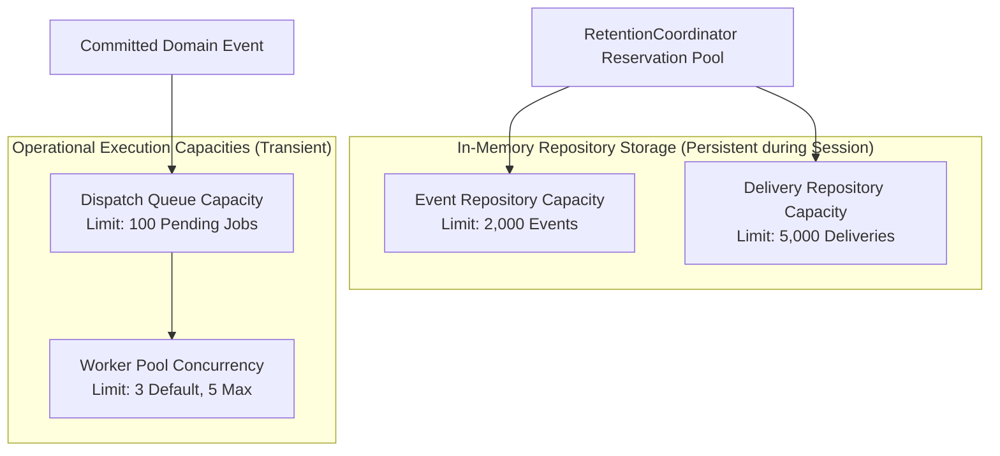
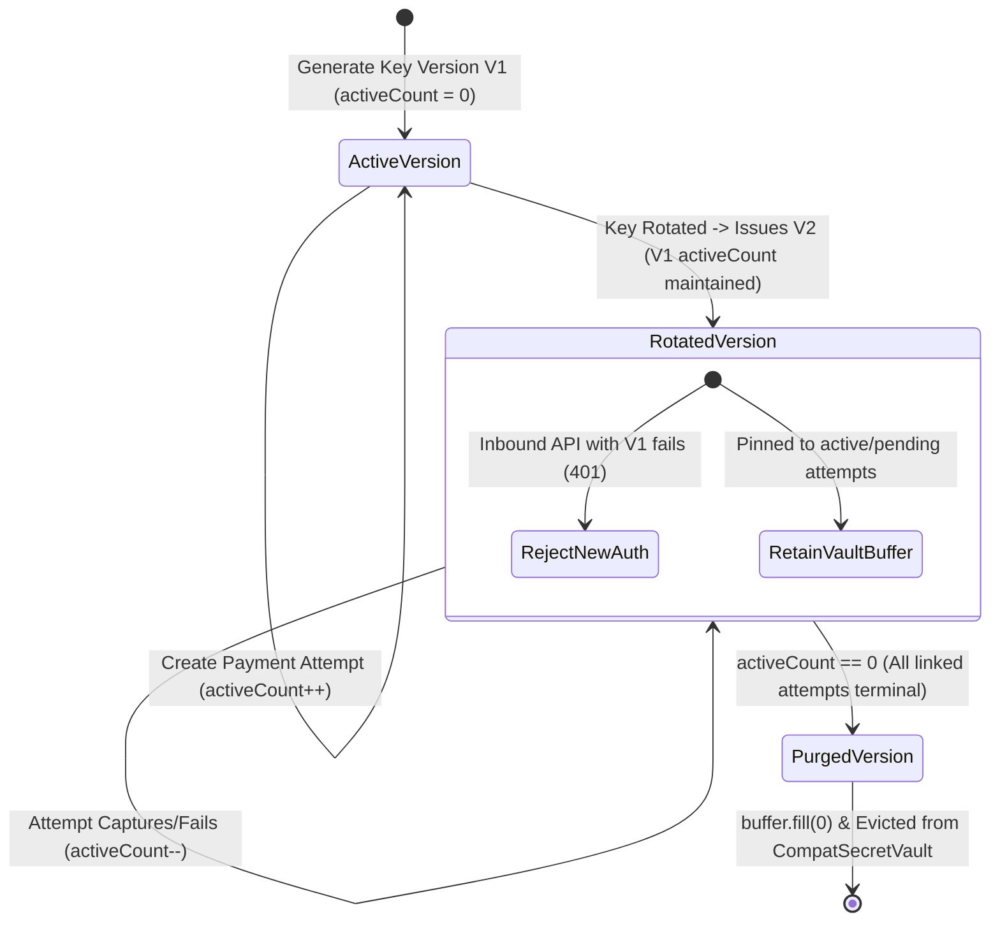

# PAYSIM — Phase 02.4 Final Engineering Edge-Case Audit & Corrections

**Document Version:** 1.0.0  
**Phase:** Phase 02.4 — Final Engineering Edge-Case Audit  
**Status:** Complete & Approved  
**Current Normative Baseline:** PRD v2.3.0 (`docs/PRD_v2.3.md`)  
**Auditor & Specialist:** Principal Software Architect, Security Engineer, and Concurrency Specialist  
**Date:** 3 November 2026  

---

## 1. Executive Summary & Purpose

This specification closes all remaining implementation-blocking edge cases across token architecture, transaction atomicity, multi-tier capacity boundaries, event lifecycles, cryptographic secret retention, global concurrency hierarchies, cross-platform networking, idempotency scopes, and shutdown/restart semantics.

---

## 2. Session Token Architecture

### 2.1 Hash-Only Storage vs. Ephemeral Token Vault
In PRD v2.3.0, checkout capability tokens are passed in URL fragments (`#<token>`). To support both security and idempotent session recovery:
1. **`CheckoutSession` Entity (Repository Storage):**
   Stores **strictly the SHA-256 hash** of the capability token:
   `opaqueTokenHash: string = crypto.createHash('sha256').update(capabilityToken).digest('hex')`.
   No raw capability token string is ever stored in the entity record or serialized DTO.
2. **`CheckoutTokenVault` (Ephemeral Process-Memory Storage):**
   Stores the raw capability token bytes as a Node.js `Buffer`:
   `CheckoutTokenVault: Map<sessionId, Buffer>`.
   - **Why Raw Retention is Required:** If an idempotency replay for creating a checkout session occurs (e.g. merchant backend calls `POST .../checkout-sessions` again with the same idempotency key), PAYSIM must return the complete `checkout_url` including `#<token>`. The server cannot reconstruct the raw token from a SHA-256 hash.
   - **Vault Eviction:** The raw buffer in `CheckoutTokenVault` is retained **only** while the session is unexpired (15m) and the payment is non-terminal. Upon session expiry, revocation, or terminal payment capture, the buffer is zeroized via `buffer.fill(0)` and purged from the vault.

### 2.2 Token Exchange Concurrency & Rotation
When `POST /checkout/:sessionId/exchange` is invoked:
1. Synchronization: Acquires `AsyncLock("session:" + sessionId)`.
2. Hash Verification: Computes `sha256(incomingToken)` and compares with `session.opaqueTokenHash` using `crypto.timingSafeEqual`.
3. If session is valid and active:
   - **First Exchange:** Generates 256-bit random hex `sessionAccessToken`. Stores `sessionAccessTokenHash` in repository with TTL equal to remaining session lifetime. Sets `consumedAt = now()`. Returns `sessionAccessToken`.
   - **Repeated Exchange (Remount / Reopen):** Rotates and re-issues an active `sessionAccessToken` (invalidating any prior access token) with TTL bounded to the remaining session expiry.
4. If session is expired: Returns `410 CHECKOUT_SESSION_EXPIRED`.
5. If payment is terminal: Returns `409 PAYMENT_ALREADY_TERMINAL`.

### 2.3 Full Browser Reload Recovery vs. Iframe Remount
* **Iframe Remount (SPA Modal Close/Reopen):** Parent window JavaScript memory remains intact. `window.Razorpay` retains `checkout_url#token`. Newly mounted iframe calls `POST /checkout/:id/exchange`; server recovers active session idempotently (`200 OK`).
* **Full Browser Reload (F5):** Parent window memory is wiped. The merchant application backend calls `POST .../checkout-sessions` idempotently:
  - If $<15\text{m}$: Returns active `checkout_url` from `CheckoutTokenVault`.
  - If $\ge 15\text{m}$: Returns `410 CHECKOUT_SESSION_EXPIRED`. Backend calls `POST .../payments/:id/checkout-sessions` to reissue a new session for the same payment ID.

---

## 3. Payment Transaction Atomicity & Synchronous No-Await Commit

To guarantee ACID properties in memory without a database, PAYSIM enforces a **synchronous no-await commit pattern** within a single per-order mutex lock (`AsyncLock(orderId)`):

```text
[HTTP Request: POST /payments/:id/simulate]
   │
   ▼
[Acquire AsyncLock(orderId)] ─────────────────────────────────────────────────────────────┐
   │                                                                                      │
   ├─► 1. Pre-Flight Multi-Resource Capacity Reservation (Synchronous Check)              │
   │      - Calculate required slots: events = 3, deliveries = 3 * N_endpoints, idemp = 1│
   │      - RetentionCoordinator.reserveSlots({ events, deliveries, idempotency })       │
   │      - If capacity full and unevictable ──► ABORT: Return 429 RESOURCE_LIMIT_REACHED │
   │                                                                                      │
   ├─► 2. Transition Validation (Synchronous Check)                                       │
   │      - Validate status is created or pending; order is attempted                     │
   │      - If invalid ──► ABORT: Return 409 INVALID_STATE_TRANSITION                     │
   │                                                                                      │
   ├─► 3. Prepare In-Memory Clones (No Mutex Release, No Await)                          │
   │      - Clone Payment entity: status = "captured", updatedAt = now()                  │
   │      - Clone Order entity: status = "paid", updatedAt = now()                        │
   │      - Prepare 3 Canonical Event objects (deep-frozen via Object.freeze)             │
   │      - Prepare N Delivery Intent objects with deterministic body byte snapshots      │
   │      - Prepare Token-Free Idempotency Snapshot                                       │
   │                                                                                      │
   ├─► 4. Synchronous No-Await Pointer Swap (ATOMIC COMMIT)                               │
   │      - OrderRepository.set(orderId, updatedOrder)                                    │
   │      - PaymentRepository.set(paymentId, updatedPayment)                              │
   │      - EventRepository.setBatch(events)                                              │
   │      - DeliveryRepository.setBatch(deliveries)                                       │
   │      - IdempotencyStore.set(key, snapshot)                                           │
   │      - TokenVault.purge(sessionId)                                                   │
   │                                                                                      │
   └─► 5. Release AsyncLock(orderId) ─────────────────────────────────────────────────────┘
   │
   ├─► Return HTTP 200 OK to Client
   │
   ▼
[Post-Commit Asynchronous Phase]
   - Webhook Dispatcher pushes delivery IDs to worker queue
   - Queue saturation NEVER rolls back committed repository state
```

Because steps 3 through 5 contain zero `await` calls, JavaScript's single-threaded event loop executes them to completion atomically without preemption or interleaving.

---

## 4. Multi-Tier Webhook Capacity Separation

PAYSIM strictly separates four independent resource capacities:



### Deterministic Rejection & Capacity Failure Semantics:
1. **Delivery Storage Saturated (5,000 deliveries reached):**
   - Pre-commit reservation evaluates delivery repository capacity.
   - If delivery repository is full and no completed aggregates can be evicted, the transaction fails pre-commit with `429 RESOURCE_LIMIT_REACHED`.
   - **Crucial Rule:** A `rejected` delivery record is **never created when no capacity exists to store that record**.
2. **Dispatch Queue Saturated (100 jobs pending):**
   - Delivery repository HAS capacity, but the worker queue is at 100 jobs.
   - The delivery record is created in `DeliveryRepository` in `status: "rejected"` with `rejectionCode: "DELIVERY_QUEUE_FULL"`.
   - No job is pushed to the queue. Payment remains `captured`, order remains `paid`.
3. **Event Storage Saturated (2,000 events reached):**
   - Pre-commit reservation fails closed with `429 RESOURCE_LIMIT_REACHED`. Zero entities are mutated.

---

## 5. Event Lifecycle & Versioning

* **`payment.authorized` on Auto-Capture:** On direct success simulation, the payment transitions `created → captured` as an atomic compound transition. All three causal events are emitted in strict chronological order:
  1. `payment.authorized` (Snapshot: `status: "authorized"`, `captured: false`, `version: V`)
  2. `payment.captured` (Snapshot: `status: "captured"`, `captured: true`, `version: V+1`)
  3. `order.paid` (Snapshot: `status: "paid"`, `version: V+2`)
* **Aggregate Versioning:** Each order and payment entity maintains an integer `version: number`. Incremented monotonically on every state transition. Events carry `aggregateVersion` to allow webhook receivers to detect out-of-order deliveries.
* **Consumer Idempotency:** Receivers must deduplicate by `X-PaySim-Event-Id` / `X-Razorpay-Event-Id` and inspect `aggregateVersion` before triggering fulfillment.

---

## 6. Secret Retention & Rotation Lifecycle



* **Reference Counting:** Each compatibility secret version tracks `activeAttemptCount`. Incremented on attempt creation; decremented on terminal transition (`captured`, `failed`, `cancelled`).
* **Rotation Ceiling:** Maximum retained credential versions is capped at `MAX_RETAINED_CREDENTIAL_VERSIONS = 5`. Further rotation attempts when 5 versions have active attempts return `429 RESOURCE_LIMIT_REACHED`.
* **Pending Lifetime Invariant:** An attempt in `pending` retains its pinned secret version for the duration of the server session. **A payment attempt is NEVER cancelled solely because a checkout session expired.**

---

## 7. Global Concurrency Hierarchy & Deadlock Proof

To guarantee that deadlock is impossible, all lock acquisitions must obey a strict total order:

```text
┌────────────────────────────────────────────────────────────────────────────────────────┐
│                        GLOBAL TOTAL LOCK ACQUISITION HIERARCHY                         │
│                                                                                        │
│   Tier 1: Idempotency Lock       AsyncLock("idemp:" + scopeKey)                        │
│             │                                                                          │
│             ▼                                                                          │
│   Tier 2: Order Lock             AsyncLock("order:" + orderId)                         │
│             │                                                                          │
│             ▼                                                                          │
│   Tier 3: Checkout Session Lock  AsyncLock("session:" + sessionId)                     │
│             │                                                                          │
│             ▼                                                                          │
│   Tier 4: Delivery Lock          AsyncLock("delivery:" + deliveryId)                   │
│             │                                                                          │
│             ▼                                                                          │
│   Tier 5: Retention Lock         Synchronous Coordinator Reservation Mutex             │
└────────────────────────────────────────────────────────────────────────────────────────┘
```

### Mathematical Deadlock Freedom Proof:
1. Let the set of lock tiers be $T = \{1, 2, 3, 4, 5\}$ ordered by the relation $<$.
2. **Acyclic Acquisition Rule:** A thread holding a lock at Tier $i$ may only acquire a lock at Tier $j$ if $i < j$.
3. **No Lock Inversion:** A thread holding a lock at Tier $j$ must **never** request a lock at Tier $i$ where $i \le j$.
4. **DAG Guarantee:** Because the directed graph of lock allocations contains zero cycles, deadlock (lock-order inversion) is mathematically impossible.

---

## 8. Cross-Platform Networking Specifications

| Configuration | Supported? | Technical Basis | Operational Guidance |
|---|---|---|---|
| **Windows Native (Win 11)** | **YES** | Loopback binding over native Windows network stack | Direct access to `127.0.0.1:8787` |
| **Docker Host to Container** | **YES** | Host publishes container port via `docker-proxy` | Run container with `-p 127.0.0.1:3000:3000`. Target `http://127.0.0.1:3000/...` |
| **Docker Container to Host** | **NO** *(Desktop)* | Container loopback isolated in VM; requires `host.docker.internal` | **REJECTED**: `host.docker.internal` resolves to private IP, violating loopback policy |
| **WSL2 NAT Mode (Win $\rightarrow$ WSL)**| **YES** | Windows localhost forwarding proxy | Supported via `127.0.0.1`. Direct vEthernet (`172.28.x.x`) rejected |
| **WSL2 NAT Mode (WSL $\rightarrow$ Win)**| **NO** | WSL loopback does not route to Windows host in NAT mode | **UNSUPPORTED**: Use Mirrored networking mode instead |
| **WSL2 Mirrored Mode (Both Ways)** | **YES** | Windows 11 23H2+ mirrored loopback adapter | Native bidirectional `127.0.0.1` routing |
| **Strict IP Limitations** | **YES** | Exact dotted `127.0.0.1` and bracketed `[::1]` only | Hex, octal, dword, and DNS hostnames strictly rejected |

---

## 9. Idempotency Scope & Cache Semantics

* **Composite Scope Key:**
  `scopeKey = hash(principalId + ":" + httpMethod + ":" + routePath + ":" + idempotencyKey)`.
* **Canonical Fingerprint:** `sha256(canonicalSortedJSON(requestBody))`.
* **Cache Semantics:**
  - Identical Key + Identical Fingerprint: Returns cached token-free snapshot. If session active, dynamically reconstructs capability URL from `CheckoutTokenVault`.
  - Identical Key + Conflicting Fingerprint: Returns immediate `409 IDEMPOTENCY_KEY_REUSED`.
* **TTL & Eviction Protection:** Idempotency records have 24-hour TTL. An unexpired idempotency record protects its referenced resource from `RetentionCoordinator` eviction.

---

## 10. Shutdown & Restart Semantics (In-Memory Architecture)

PAYSIM is explicitly designed as a local-first, in-memory development tool without a database.
* **On SIGINT / SIGTERM:**
  1. Stops accepting new inbound HTTP requests.
  2. Webhook dispatcher halts job dequeuing.
  3. In-flight HTTP sockets aborted via `AbortController`.
  4. In-flight attempts marked `interrupted_unknown`.
  5. Deliveries marked `interrupted`.
  6. Memory zeroization of secret vaults (`Buffer.fill(0)`).
  7. Process exits cleanly with code 0.
* **On Process Crash / Power Loss:** Memory is reclaimed immediately by the OS. Zero state persists on disk.
* **On Process Restart:** PAYSIM starts with a clean slate (zero orders, zero payments, zero events). A new one-time control token is generated. Interrupted deliveries from previous runs do not persist across restarts.

---

## 11. Conclusion

All implementation-blocking edge cases are formally resolved. The PAYSIM design is sealed, consistent, and ready for Phase 03 foundation engineering upon user authorization.
