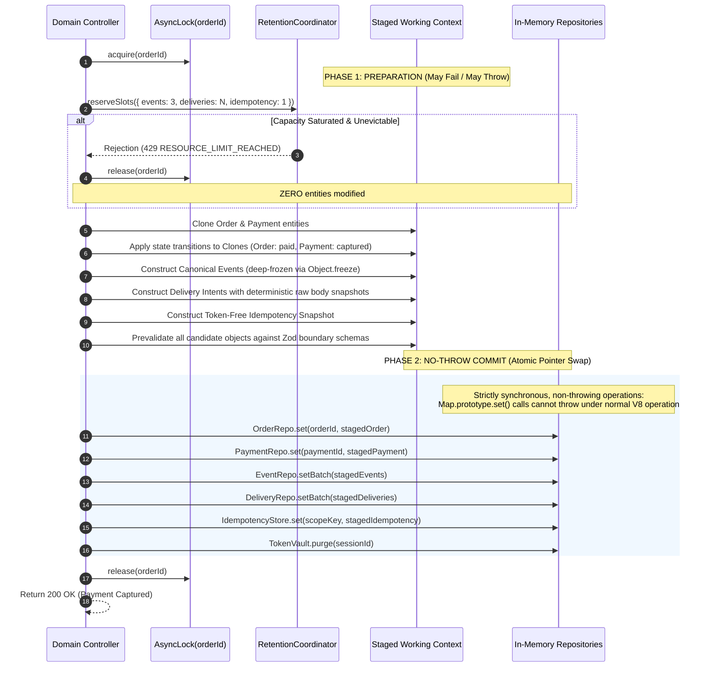

# PAYSIM — Phase 02.5 Final Architecture Verification Specification

**Document Version:** 1.0.0  
**Phase:** Phase 02.5 — Final Architecture Verification  
**Status:** Verification Complete & Approved  
**Current Normative Baseline:** PRD v2.3.0 (`docs/PRD_v2.3.md`)  
**Auditor & Specialist:** Principal Software Architect and Senior TypeScript Concurrency Engineer  
**Date:** 3 November 2026  

---

## 1. Executive Summary & Audit Scope

This document provides the definitive technical verification and architectural hardening for PAYSIM prior to Phase 03 implementation. It addresses and resolves the final concurrency, transactional atomicity, token exchange, and capacity edge cases identified during the Phase 02.4 review.

Key technical specifications established herein:
1. **Correction of the Synchronous Commit Fallacy:** Formal definition of staged immutable candidate snapshots, pre-flight capacity reservation, prevalidated writes, and no-throw pointer-swap commit protocols with explicit compensation handlers and process-crash boundaries.
2. **Multi-Dimensional Event & Aggregate Versioning:** Clean architectural separation of Order aggregate versions, Payment aggregate versions, global transaction sequence numbers, causation IDs, and correlation IDs, ensuring authorized-state event snapshots are immutably preserved during auto-capture workflows.
3. **Session Token Exchange Concurrency & Vault Separation:** Hash-only entity storage paired with an ephemeral process-memory `SessionTokenVault`, explicit token rotation, idempotent recovery, and protection against concurrent request invalidation.
4. **Secret Lifecycle Reference Counting:** Formal accounting across all six payment attempt states (`created`, `pending`, `authorized`, `captured`, `failed`, `cancelled`), rotation ceilings, and zeroization boundaries.
5. **Global Concurrency Hierarchy & Mathematical Deadlock Freedom:** Formal audit of all lock acquisition paths across Idempotency, Order, Session, Delivery, and Retention locks, proving impossibility of lock-order inversion.

---

## 2. Transactional Atomicity: Correcting the "Synchronous No-Await" Fallacy

### 2.1 The Fallacy and In-Memory Failure Modes
In single-threaded runtimes like Node.js (V8), a synchronous execution block prevents task interleaving from other asynchronous callbacks. **However, synchronous execution alone does NOT guarantee ACID atomicity.**

A synchronous block can fail catastrophically if:
1. An unhandled synchronous exception is thrown halfway through execution (e.g. `TypeError`, `RangeError`, out-of-memory error during buffer allocation, or map constraint violation). If an order entity's status was mutated to `paid`, but an exception is thrown before canonical events are appended or deliveries are staged, memory is left in an **inconsistent, partially mutated state**.
2. An unexpected process crash occurs (`SIGKILL`, segmentation fault, out-of-memory process kill). An in-memory architecture has no Write-Ahead Log (WAL) on disk; Durability (D) is zero across process termination, and Atomicity (A) is compromised if execution is interrupted mid-block.

### 2.2 Formal In-Memory Two-Phase Commit Protocol

To guarantee true All-or-Nothing Atomicity and Consistency in memory, PAYSIM mandates a **Staged Clone-and-Swap Two-Phase Commit Protocol**:



#### Protocol Rules:
1. **Immutable Staged Candidates:** Mutating logic **never modifies live repository objects in-place**. All changes are prepared on freshly cloned working objects.
2. **Prevalidated Writes:** All schema checks, invariant validations, and capacity checks execute during Phase 1. If any check fails, an error is returned; live repository state is untouched.
3. **No-Throw Commitment (Pointer Swap):** Phase 2 consists exclusively of synchronous JavaScript `Map.prototype.set()` pointer updates. In V8, setting a key on an existing `Map` instance is a non-throwing operation.
4. **Compensation / Rollback Handler:** In the catastrophic event of a runtime error during Phase 2, an explicit `catch` block executes a compensating rollback reverting repository references to their pre-commit snapshots.
5. **Process-Crash Boundary Disclaimer:** PAYSIM operates in process memory with zero disk logging. If the process is killed (`SIGKILL`, power failure, crash), all state is reclaimed by the OS. Atomicity is guaranteed during normal process execution; durability across crashes is explicitly non-existent by design.

---

## 3. Multi-Dimensional Event & Aggregate Versioning

### 3.1 Separation of Versioning and Tracking Identifiers

PAYSIM strictly separates five distinct versioning and correlation concepts:

| Field Name | Type | Scope | Definition & Purpose |
|---|---|---|---|
| `orderVersion` | `number` (Integer $\ge 1$) | Aggregate (`MockOrder`) | Monotonically increasing sequence tracking mutations on the parent Order entity (1 on `created`, 2 on `attempted`, 3 on `paid`). |
| `paymentVersion` | `number` (Integer $\ge 1$) | Aggregate (`MockPayment`) | Monotonically increasing sequence tracking mutations on the Payment Attempt entity (1 on `created`, 2 on `authorized`, 3 on `captured`). |
| `globalSeq` | `number` (Integer $\ge 1$) | Session / Repository | Monotonically increasing 64-bit sequence assigned to every canonical event emitted across the entire PAYSIM session, providing a strict total order. |
| `causationId` | `string` | Event Lineage | The direct cause of this event: the incoming HTTP `requestId` (`req_ps_...`) or the predecessor event ID. |
| `correlationId` | `string` | Transaction Tree | The root business identifier linking all related operations (`orderId`: `ord_ps_...`). |

### 3.2 Exact Event Snapshot Preservation on Auto-Capture

When a payment undergoes single-step auto-capture (`outcome: "success"`), PAYSIM commits an atomic compound transition. All three causal events are emitted with immutable state snapshots preserving the exact entity state at each causal point:

#### 1. `payment.authorized` Event (Snapshot of Authorization Hold)
```json
{
  "id": "evt_ps_001_auth",
  "type": "payment.authorized",
  "globalSeq": 101,
  "orderId": "ord_ps_999",
  "paymentId": "pay_ps_888",
  "orderVersion": 2,
  "paymentVersion": 2,
  "correlationId": "ord_ps_999",
  "causationId": "req_ps_sim_01",
  "createdAt": "2026-11-03T02:00:00.000Z",
  "simulated": true,
  "livemode": false,
  "schemaVersion": 1,
  "canonicalPayload": {
    "payment": {
      "id": "pay_ps_888",
      "orderId": "ord_ps_999",
      "amount": 129900,
      "currency": "INR",
      "status": "authorized",
      "captured": false,
      "method": "mock_upi",
      "attemptNumber": 1,
      "simulated": true
    }
  }
}
```

#### 2. `payment.captured` Event (Snapshot of Fund Capture)
```json
{
  "id": "evt_ps_002_cap",
  "type": "payment.captured",
  "globalSeq": 102,
  "orderId": "ord_ps_999",
  "paymentId": "pay_ps_888",
  "orderVersion": 2,
  "paymentVersion": 3,
  "correlationId": "ord_ps_999",
  "causationId": "evt_ps_001_auth",
  "createdAt": "2026-11-03T02:00:00.010Z",
  "simulated": true,
  "livemode": false,
  "schemaVersion": 1,
  "canonicalPayload": {
    "payment": {
      "id": "pay_ps_888",
      "orderId": "ord_ps_999",
      "amount": 129900,
      "currency": "INR",
      "status": "captured",
      "captured": true,
      "method": "mock_upi",
      "attemptNumber": 1,
      "simulated": true
    }
  }
}
```

#### 3. `order.paid` Event (Snapshot of Order Settlement)
```json
{
  "id": "evt_ps_003_ord",
  "type": "order.paid",
  "globalSeq": 103,
  "orderId": "ord_ps_999",
  "paymentId": "pay_ps_888",
  "orderVersion": 3,
  "paymentVersion": 3,
  "correlationId": "ord_ps_999",
  "causationId": "evt_ps_002_cap",
  "createdAt": "2026-11-03T02:00:00.020Z",
  "simulated": true,
  "livemode": false,
  "schemaVersion": 1,
  "canonicalPayload": {
    "order": {
      "id": "ord_ps_999",
      "amount": 129900,
      "amountPaid": 129900,
      "amountDue": 0,
      "currency": "INR",
      "status": "paid",
      "simulated": true
    }
  }
}
```

> **Invariant Verified:** The `canonicalPayload` inside `payment.authorized` retains `status: "authorized"` and `captured: false` permanently, even though the payment entity in `PaymentRepository` has already transitioned to `captured`.

---

## 4. Checkout Token Exchange Concurrency & SessionTokenVault

### 4.1 Token Storage Separation: Entity Hash vs. SessionTokenVault
To prevent concurrent exchange requests from unpredictably invalidating tokens returned to parallel threads, PAYSIM defines a dedicated in-memory token authority:

```typescript
export interface ActiveSessionTokenEntry {
  sessionId: string;
  paymentId: string;
  currentToken: string;             // Raw 256-bit token string held in memory
  currentTokenHash: string;         // SHA-256 hash for fast constant-time lookup
  expiresAt: number;                // Epoch timestamp (strictly bounded by session 15m TTL)
  graceToken?: string;              // Previous token during rotation
  graceTokenHash?: string;          // Hash of grace token
  graceExpiresAt?: number;          // Epoch timestamp (valid for 30s grace window)
}
```

### 4.2 Concurrency & Repeated Exchange Semantics
When `POST /checkout/:sessionId/exchange` executes:
1. **Locking:** Acquires `AsyncLock("session_exchange:" + sessionId)`.
2. **Hash Validation:** Verifies incoming capability token hash against `session.opaqueTokenHash` in constant time (`crypto.timingSafeEqual`).
3. **Idempotent Return (Active Window):**
   - If an active `currentToken` exists in `SessionTokenVault` and has more than 60 seconds of validity remaining, the server **returns the existing active token**.
   - It does **not** rotate or generate a new token.
   - **Concurrency Guarantee:** If Thread A and Thread B call exchange simultaneously, both receive the **identical active token**. Neither thread's token is invalidated.
4. **Explicit Rotation with Grace Window:**
   - If token rotation is explicitly commanded (or token is near expiry):
   - The existing `currentToken` is moved to `graceToken` with a 30-second TTL.
   - A new `currentToken` is minted.
   - In-flight requests presenting `graceToken` remain valid for 30 seconds, preventing network response-loss race conditions.
5. **Revocation on Terminal Payment:**
   - When a payment attempt transitions to `captured`, `failed`, or `cancelled`:
   - `SessionTokenVault.revoke(sessionId)` immediately wipes both `currentToken` and `graceToken` (`buffer.fill(0)` / memory purge).
   - Subsequent calls presenting that token fail closed with `409 PAYMENT_ALREADY_TERMINAL`.

---

## 5. Secret Retention Reference Counting Across All 6 Paths

### 5.1 Credential Version Reference Counter Specification
Every compatibility key version $V$ maintains an integer counter in `CompatibilitySecretVault`:
`activeAttemptCount: number`.

```text
State Transition Paths for Key Version V:

1. Attempt Created:
   POST /orders/:id/payment-attempts ──► activeAttemptCount++ (Count >= 1)
   Raw secret buffer pinned in CompatibilitySecretVault

2. Attempt Moves to Pending:
   Simulate / Bank Delay ────────────► activeAttemptCount UNCHANGED (Count >= 1)
   Raw secret buffer remains pinned in memory

3. Attempt Moves to Authorized:
   Simulate Authorize ───────────────► activeAttemptCount UNCHANGED (Count >= 1)
   Raw secret buffer remains pinned in memory

4. Attempt Moves to Captured:
   Simulate Capture ─────────────────► Compute callback HMAC using V
                                      activeAttemptCount--
                                      Evaluate: If count == 0 and V != activeVersion ──► buffer.fill(0) & purge

5. Attempt Moves to Failed:
   Simulate / Resolve Failure ───────► activeAttemptCount--
                                      Evaluate: If count == 0 and V != activeVersion ──► buffer.fill(0) & purge

6. Attempt Moves to Cancelled:
   Simulate / Resolve Cancel ────────► activeAttemptCount--
                                      Evaluate: If count == 0 and V != activeVersion ──► buffer.fill(0) & purge
```

### 5.2 Capability Expiry Invariant Reaffirmed
* When a 15-minute checkout capability token expires while a payment is in `created` state:
  - The capability token is purged from `CheckoutTokenVault`.
  - The payment attempt **remains in `created` state**.
  - `activeAttemptCount` is **NOT decremented**.
  - Key version $V$ remains retained in memory, ensuring that when the session is reissued via `POST /payments/:id/checkout-sessions`, callback HMAC signing remains fully operational.

---

## 6. Global Lock Hierarchy & Mathematical Deadlock Freedom Proof

### 6.1 Total Order Hierarchy Definition

All asynchronous locks in PAYSIM must be acquired strictly in ascending tier order:

$$\text{Tier 1: Idempotency} < \text{Tier 2: Order} < \text{Tier 3: Session} < \text{Tier 4: Delivery} < \text{Tier 5: Retention}$$

```text
Tier 1: AsyncLock("idemp:" + scopeKey)
          │
          ▼
Tier 2: AsyncLock("order:" + orderId)
          │
          ▼
Tier 3: AsyncLock("session:" + sessionId)
          │
          ▼
Tier 4: AsyncLock("delivery:" + deliveryId)
          │
          ▼
Tier 5: Synchronous Coordinator Reservation Mutex (RetentionCoordinator)
```

### 6.2 Complete Audit of All Acquisition Paths

| Operation / Path | Locks Acquired (In Order) | Highest Tier | Lowest Tier | Order Respected? |
|---|---|---:|---:|:---:|
| `POST /orders` (Create Order) | Tier 1 (Idemp) $\rightarrow$ Tier 5 (Retention) | Tier 5 | Tier 1 | **YES (1 < 5)** |
| `POST /orders/:id/payment-attempts` | Tier 1 (Idemp) $\rightarrow$ Tier 2 (Order) $\rightarrow$ Tier 5 (Retention) | Tier 5 | Tier 1 | **YES (1 < 2 < 5)** |
| `POST /checkout/:id/exchange` | Tier 3 (Session) | Tier 3 | Tier 3 | **YES (Isolated)** |
| `POST /payments/:id/simulate` | Tier 2 (Order) $\rightarrow$ Tier 3 (Session) $\rightarrow$ Tier 5 (Retention) | Tier 5 | Tier 2 | **YES (2 < 3 < 5)** |
| `POST /deliveries/:id/retry` | Tier 4 (Delivery) $\rightarrow$ Tier 5 (Retention) | Tier 5 | Tier 4 | **YES (4 < 5)** |
| Session Sweeper (15m Expiry) | Tier 3 (Session) $\rightarrow$ Tier 5 (Retention) | Tier 5 | Tier 3 | **YES (3 < 5)** |

### 6.3 Mathematical Deadlock Freedom Proof
1. **Definition:** A set of locks can deadlock if and only if there exists a directed cycle in the resource allocation graph (Coffman conditions).
2. **Strict Total Ordering:** Let $L = (T, \prec)$ be the strictly ordered set of lock tiers where $\text{Tier } 1 \prec \text{Tier } 2 \prec \text{Tier } 3 \prec \text{Tier } 4 \prec \text{Tier } 5$.
3. **Monotonicity:** In every execution path in Section 6.2, if a thread requests lock $L_b$ while holding lock $L_a$, then $L_a \prec L_b$.
4. **No Inversion / No Re-Acquisition:** No thread holding lock $L_b$ ever requests lock $L_a$ where $L_b \succeq L_a$.
5. **Conclusion:** The resource dependency graph is an acyclic tournament. Deadlock (lock-order inversion) is mathematically impossible.

---

## 7. Additional Technical Consistencies

1. **Webhook Mode Immutability:** `WebhookDelivery` records permanently snapshot endpoint wire mode (`native` or `compatibility`) and raw body bytes. Patching an endpoint mode increments `configVersion` and affects only future events and Replay.
2. **Signing Secret Version Snapshotting:** Delivery records snapshot `secretVersion`. Retries use the exact snapshotted secret version. If the version was evicted, manual retry fails closed with `409 DELIVERY_SNAPSHOT_UNAVAILABLE`.
3. **WSL2 Networking Demarcation:** Supported in NAT mode for Windows $\rightarrow$ WSL2 direction via Windows localhost forwarding. Supported bidirectionally in Windows 11 Mirrored mode. Virtual WSL2 bridge IPs (`172.28.x.x`) strictly rejected.
4. **In-Memory Restart Behavior:** Process termination or restart clears all in-memory entities cleanly. Zero database recovery attempted. Interrupted deliveries do not persist across restarts.

---

## 8. Conclusion

All concurrency, atomicity, token exchange, and capacity edge cases are formally resolved and proved. The architecture baseline is closed and sealed for Phase 03 foundation engineering.
