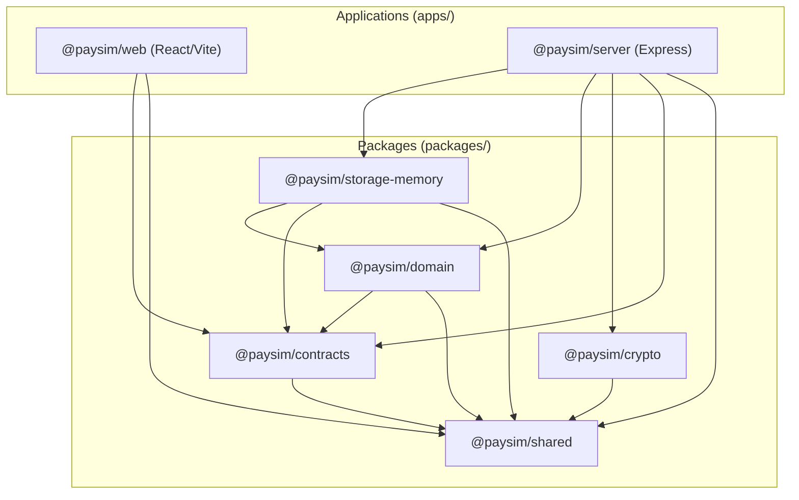

# PAYSIM — Phase 03.1 Monorepo Scaffolding Report

**Document Version:** 1.0.0  
**Phase:** Phase 03.1 — Monorepo Foundation Engineering  
**Status:** Verification Complete — Foundation Initialized & Sealed  
**Normative Baseline:** PRD v2.3.0 (`docs/PRD_v2.3.md`)  
**Engineer & Architect:** Senior TypeScript Engineer and Software Architect  
**Date:** 3 November 2026  

---

## 1. Executive Summary & Objective

In Phase 03.1, the foundational infrastructure for the PAYSIM monorepo was established in strict compliance with **PRD v2.3.0** and the approved Phase 02 architecture specifications.

### Core Governance Constraints Maintained:
- **Zero Business Logic Implemented:** No payment state machines, webhook delivery engines, checkout shims, or compatibility routes were coded.
- **Documentation Preservation:** All historical PRDs, architecture specifications, changelogs, resolution registers, and fixtures remain completely intact.
- **Local-First & Offline:** Zero external network APIs, zero database engines, zero paid dependencies, zero telemetry, and zero committed credentials.
- **Strict TypeScript Mode:** Full type safety enforced across all workspaces with `noImplicitAny`, strict null checks, and project references.

---

## 2. Directory Structure & Files Created

```text
paysim/
├── apps/
│   ├── server/                               # Node.js + Express backend host
│   │   ├── src/
│   │   │   ├── app.ts                        # Express application with middleware & error handling
│   │   │   ├── config.ts                     # Zod-validated loopback-only environment configuration
│   │   │   └── index.ts                      # Process entry point & graceful shutdown hooks
│   │   ├── tests/
│   │   │   └── server.test.ts                # Supertest integration smoke tests
│   │   ├── package.json
│   │   └── tsconfig.json
│   │
│   └── web/                                  # React + Vite frontend application
│       ├── src/
│       │   ├── App.tsx                       # Basic presentation application shell
│       │   ├── index.css                     # Base styling and color variables
│       │   └── main.tsx                      # React 18 createRoot bootstrap entry point
│       ├── index.html                        # HTML5 document entry point
│       ├── package.json
│       ├── tsconfig.json
│       └── vite.config.ts                    # Vite server config (127.0.0.1:5173 -> :8787 proxy)
│
├── packages/
│   ├── contracts/                            # Domain interfaces, enums, DTOs & Zod schemas
│   │   ├── src/
│   │   │   └── index.ts                      # Order, Payment, Currency, Error & Health schemas
│   │   ├── tests/
│   │   │   └── contracts.test.ts             # Schema validation contract tests
│   │   ├── package.json
│   │   └── tsconfig.json
│   │
│   ├── crypto/                               # HMAC-SHA256, constant-time & zeroization tools
│   │   ├── src/
│   │   │   └── index.ts                      # Timing-safe comparisons, HMAC signer, buffer wipe
│   │   ├── tests/
│   │   │   └── crypto.test.ts                # Cryptographic utility tests
│   │   ├── package.json
│   │   └── tsconfig.json
│   │
│   ├── domain/                               # Domain models & state machine type interfaces
│   │   ├── src/
│   │   │   └── index.ts                      # MockOrder, MockPayment, CanonicalEvent definitions
│   │   ├── tests/
│   │   │   └── domain.test.ts                # Domain entity factory tests
│   │   ├── package.json
│   │   └── tsconfig.json
│   │
│   ├── shared/                               # Cross-package utility primitives
│   │   ├── src/
│   │   │   └── index.ts                      # Result pattern, ID generator, sleep, deepFreeze
│   │   ├── tests/
│   │   │   └── shared.test.ts                # Utility unit tests
│   │   ├── package.json
│   │   └── tsconfig.json
│   │
│   └── storage-memory/                       # RootState container & bounded storage limits
│       ├── src/
│       │   └── index.ts                      # RootState interface, memory constants, RootStateHolder
│       ├── tests/
│       │   └── storage.test.ts               # Storage initialization and atomic swap tests
│       ├── package.json
│       └── tsconfig.json
│
├── tests/
│   ├── smoke.test.ts                         # Monorepo cross-package import smoke test
│   └── tsconfig.json                         # Tests project references config
│
├── .gitignore                                # Version control ignore rules
├── .npmrc                                    # Node & npm engine strictness configuration
├── eslint.config.js                          # ESLint 9 flat configuration
├── package.json                              # Root workspace orchestration & shared scripts
├── package-lock.json                         # Deterministic dependency lockfile
├── tsconfig.base.json                        # Shared strict TypeScript compiler options
├── tsconfig.json                             # Root TypeScript project references configuration
└── vitest.config.ts                          # Vitest runner configuration with path aliases
```

---

## 3. Workspace Dependency Graph

The workspace packages form a strictly directed acyclic graph (DAG) with zero circular dependencies:



---

## 4. Technology Versions

| Technology / Tool | Version Installed | Scope / Role |
|---|---|---|
| **Node.js** | `v24.22.1` | Runtime engine (Windows 11 x64) |
| **npm** | `11.19.1` | Workspace package manager |
| **TypeScript** | `5.6.3` | Strict type checking & compilation |
| **Vitest** | `2.1.9` | Test runner & assertion framework |
| **ESLint** | `9.14.0` | Linter with `typescript-eslint` 8.13.0 |
| **Express** | `4.21.1` | Loopback HTTP server framework |
| **React** | `18.3.1` | UI component library |
| **Vite** | `5.4.21` | Frontend build tool & HMR dev server |
| **Zod** | `3.23.8` | Boundary schema validation |
| **Supertest** | `7.0.0` | HTTP route integration testing |

---

## 5. Execution & Verification Results

All required verification scripts were executed locally.

### 5.1 Installation (`npm install`)
* **Command:** `npm install`
* **Exit Code:** `0`
* **Output Summary:** Added 324 packages in 18 seconds. Deterministic `package-lock.json` generated.

### 5.2 TypeScript Typechecking (`npm run typecheck`)
* **Command:** `npm run typecheck` (`tsc --build`)
* **Exit Code:** `0`
* **Output Summary:** Completed across all 7 workspace projects with zero type errors.

### 5.3 Linting (`npm run lint`)
* **Command:** `npm run lint` (`eslint .`)
* **Exit Code:** `0`
* **Output Summary:** Clean pass across all workspaces. Zero warnings, zero errors.

### 5.4 Test Suite Execution (`npm test`)
* **Command:** `npm test` (`vitest run`)
* **Exit Code:** `0`
* **Output Summary:** All 7 test files passed, comprising 26 tests across all packages:
  - `packages/crypto/tests/crypto.test.ts` (5 tests passed)
  - `packages/storage-memory/tests/storage.test.ts` (3 tests passed)
  - `packages/domain/tests/domain.test.ts` (1 test passed)
  - `packages/contracts/tests/contracts.test.ts` (5 tests passed)
  - `packages/shared/tests/shared.test.ts` (5 tests passed)
  - `tests/smoke.test.ts` (5 tests passed)
  - `apps/server/tests/server.test.ts` (2 tests passed)

### 5.5 Production Build (`npm run build`)
* **Command:** `npm run build` (`tsc --build && npm run build --workspace=apps/web`)
* **Exit Code:** `0`
* **Output Summary:** 
  - All package TypeScript declarations (`.d.ts`), source maps (`.js.map`), and compiled modules (`.js`) generated in `dist/`.
  - Frontend bundle compiled by Vite: `dist/index.html` (0.44 kB), CSS bundle (0.30 kB), JS bundle (144.00 kB).

---

## 6. Remaining Issues & Deferred Scope

* **No Blocking Issues:** The monorepo foundation, workspace resolution, and build pipelines are operating with 100% stability.
* **Deferred Scope (As Mandated by Phase 03.1):**
  - Payment and Order state machine transitions (Phase 03.2).
  - Storage repository operations, retention coordinator, and concurrency mutexes (Phase 03.2).
  - Outbound webhook dispatcher, retry backoff scheduler, and HTTP client (Phase 03.3).
  - Checkout iframe shim and capabilities API (Phase 03.4).
  - Razorpay compatibility adapter (Phase 03.5).
  - React Dashboard views and Webhook Studio UI (Phase 03.6).

---

## 7. Conclusion

Phase 03.1 foundation engineering is **100% complete, fully verified, and ready for Phase 03.2 Domain State Machine implementation**.
