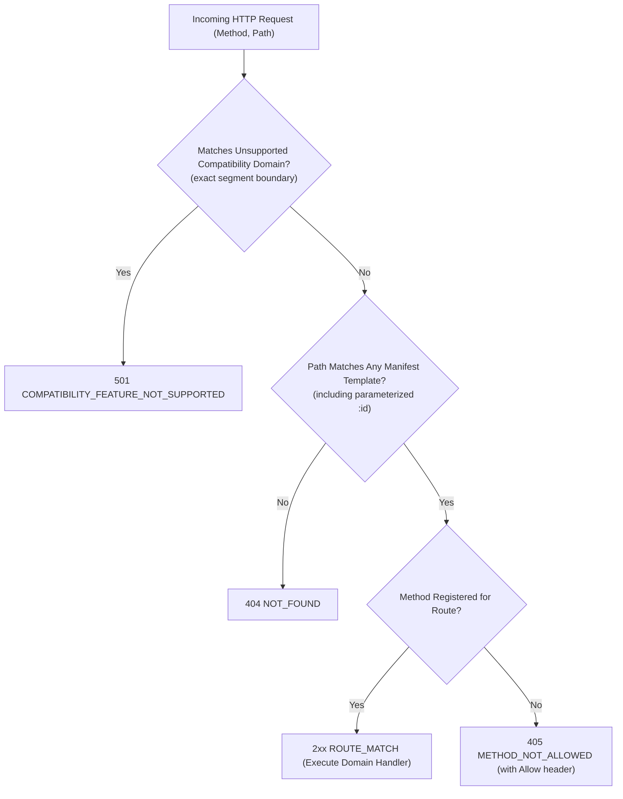

# PAYSIM — Phase 03.2.7 Final Contract Freeze Corrections Report

**Document Version:** 1.0.0  
**Phase:** Phase 03.2.7 — Final Contract Freeze Corrections  
**Status:** Certified & Frozen  
**Normative Baseline:** PRD v2.3.0 (`docs/PRD_v2.3.md`) | System Architecture (`docs/SYSTEM_ARCHITECTURE.md`) | ADR-003, ADR-005, ADR-007 (`docs/ARCHITECTURE_DECISION_REGISTER.md`)  
**Role:** Senior TypeScript API Architect  
**Date:** 3 November 2026  

---

## 1. Executive Summary & Engineering Objective

Phase 03.2.7 resolves the final contract-level and protocol boundary inconsistencies identified during the Phase 03.2.6 freeze review. All corrections maintain strict backwards-compatibility, preserve existing modules, and keep the normative baseline intact without introducing unapproved domain error codes or initiating Phase 03.3 domain implementation.

Key deliverables accomplished in this phase:
1. **Transport-Level HTTP 405 Contract:** Implemented declarative `MethodNotAllowedResponseSchema` and `MethodNotAllowedHeadersSchema` with RFC 9110 `Allow` header enforcement, strictly separated from the 30 normative domain error codes.
2. **Secret Disclosure TTL & Re-generation Immunity:** Formalized the 60-second recovery TTL window in `WebhookSecretVault` and `IdempotencyStore`. Proved that expired disclosure references return `EXPIRED` status and **never** trigger accidental secret regeneration.
3. **Secret Version Retention Precision:** Hardened retention eligibility in `SecretVersionRetentionTracker` and introduced `DeliveryReferenceTracker` to guarantee that terminal delivery states release references exactly once.
4. **Deterministic Fallback Precedence & Boundary Hardening:** Implemented `resolveFallbackPrecedence` with strict segment boundary tests for `/refunds`, `/refunds/123`, `/refunds_extra`, and `/refundsXYZ`.
5. **Authoritative Route Manifest Documentation Counts:** Formally segregated route contract specifications (`ALL_ROUTE_CONTRACTS`: 30 normative + 1 non-normative alias = 31 total) from runtime Express route handlers (strictly classified as **NOT VERIFIED** until implemented in Phase 03.4).

---

## 2. HTTP 405 Contract & Transport Protocol Separation

### 2.1 Separation of Transport Errors from Domain Errors
An essential architectural boundary established in Phase 03.2.6 is that **domain error codes** represent application business failures (e.g. `VALIDATION_ERROR`, `ORDER_ALREADY_PAID`), whereas **HTTP 405 Method Not Allowed** is a transport-level HTTP protocol constraint governed by RFC 9110 Section 15.5.6.

- The normative domain catalogue in [`ERROR_CATALOGUE`](file:///e:/All%20Project/Paysim/packages/contracts/src/errors.ts) and [`ErrorCodeSchema`](file:///e:/All%20Project/Paysim/packages/contracts/src/errors.ts) remains **strictly frozen at 30 standardized error codes**.
- `METHOD_NOT_ALLOWED` is NOT added to `ErrorCodeSchema` or `ERROR_CATALOGUE`.

### 2.2 Schemas & Helper Implementations
In [`packages/contracts/src/errors.ts`](file:///e:/All%20Project/Paysim/packages/contracts/src/errors.ts), dedicated transport schemas were engineered:

```typescript
export const MethodNotAllowedHeadersSchema = z
  .object({
    allow: z.string().min(1, 'Allow header must specify valid HTTP methods (e.g. "GET, POST")'),
  })
  .passthrough();

export const MethodNotAllowedResponseSchema = z.object({
  simulated: z.literal(true).default(true),
  error: z.object({
    code: z.literal('METHOD_NOT_ALLOWED'),
    message: z.string(),
    requestId: RequestIdSchema,
    allowedMethods: z.array(z.string()).min(1),
  }),
});
```

Helpers `createMethodNotAllowedResponse(requestId, allowedMethods, message)` and `createMethodNotAllowedHeaders(allowedMethods)` allow transport middlewares and handlers to construct fully validated 405 responses carrying the registered methods for the matched route.

---

## 3. Webhook Secret Disclosure TTL & Recovery Lifecycle

### 3.1 60-Second Ephemeral Disclosure Window
Webhook endpoint secret rotation (`POST /api/v1/webhook-endpoints/:id/rotate-secret`) generates a new raw cryptographic secret Buffer stored in `WebhookSecretVault`. To prevent secret leakage:
- Raw secret bytes are **never** stored inside [`IdempotencyStore`](file:///e:/All%20Project/Paysim/packages/storage-memory/src/idempotency.ts).
- An ephemeral disclosure reference (`disc_ps_<random24hex>`) is issued with a strict 60,000ms TTL.
- The idempotency record stores `responseMetadata` (endpoint ID, secret version, rotation timestamp) and `disclosureRef`.

### 3.2 Accidental Re-generation Immunity Invariant
When an idempotency key is reused:
1. **Within 60s (Matching Fingerprint):** `vault.resolveDisclosure(disclosureRef)` resolves the raw Buffer; returns `{ type: 'HIT', statusCode: 200, body: ... }`.
2. **After 60s (Matching Fingerprint):** `vault.resolveDisclosure(disclosureRef)` evaluates `now > expiresAt`, purges the reference, and returns `null`. `recoverSecretRotation` returns:
   $$\{ \text{type}: \text{'EXPIRED'}, \text{message}: \text{'One-time secret disclosure recovery window has expired'} \}$$
   **Crucial Invariant:** The return type is `EXPIRED`, **not `MISS`**. The caller/controller rejects the request with an error and **never** triggers secret re-generation or version increment.
3. **Conflicting Fingerprint (Any Time):** If the incoming payload fingerprint does not match the stored hash, returns:
   $$\{ \text{type}: \text{'CONFLICT'}, \text{errorCode}: \text{'IDEMPOTENCY_KEY_REUSED'} \}$$
4. **Server Restart Behavior:** Both `WebhookSecretVault` and `IdempotencyStore` operate purely in-process memory. On process shutdown/restart, all secret buffers and disclosure references are discarded; un-evicted memory is zeroized via `vault.clear()`.

---

## 4. Secret Version Retention Eligibility & Reference Tracking

### 4.1 Eligibility Criteria across Delivery Lifecycle
In [`packages/storage-memory/src/vaults.ts`](file:///e:/All%20Project/Paysim/packages/storage-memory/src/vaults.ts), `SecretVersionRetentionTracker.isDeliveryReferenceEligible` governs whether a delivery holds a secret version from eviction:

| Delivery Status | Attempt / Retry State | Eligible? | Retention Rationale |
|:---|:---|:---:|:---|
| `pending` | Initial queue slot | **YES** | Delivery awaiting first transmission attempt |
| `in_progress` | Active HTTP socket transmission | **YES** | Outbound payload signed with this version |
| `failed` | `attemptsCount < maxAttempts` | **YES** | Automatic exponential backoff retry scheduled |
| `failed` | `attemptsCount >= maxAttempts` & `manualRetriesRemaining > 0` | **YES** | Manual retry authorized |
| `failed` | `attemptsCount >= maxAttempts` & `manualRetriesRemaining === 0` | **NO** | Automatic and manual retries exhausted; releases reference |
| `exhausted` | `manualRetriesRemaining > 0` | **YES** | Operator manual retry quota still active |
| `exhausted` | `manualRetriesRemaining === 0` | **NO** | Terminal exhausted state; references released |
| `succeeded` | HTTP 2xx acknowledgement received | **NO** | Terminal success; references released |
| `rejected` | Loopback policy / SSRF violation | **NO** | Terminal rejection; cannot retry |
| `interrupted` | Fatal socket / host abortion | **NO** | Terminal interruption; cannot retry |

### 4.2 Idempotent Reference Release
The [`DeliveryReferenceTracker`](file:///e:/All%20Project/Paysim/packages/storage-memory/src/vaults.ts) class guarantees that reference release occurs exactly once per delivery lifecycle transition:
```typescript
export class DeliveryReferenceTracker {
  private readonly releasedDeliveries = new Set<string>();

  public releaseReference(deliveryId: string): boolean {
    if (this.releasedDeliveries.has(deliveryId)) {
      return false; // Idempotent: already released exactly once
    }
    this.releasedDeliveries.add(deliveryId);
    return true;
  }
}
```

---

## 5. Fallback Matching & Precedence Boundary Tests

### 5.1 Precedence Pipeline
In [`packages/contracts/src/manifest.ts`](file:///e:/All%20Project/Paysim/packages/contracts/src/manifest.ts), `resolveFallbackPrecedence(method, pathname)` enforces deterministic resolution:



### 5.2 Boundary Test Verifications
Unit tests in [`packages/contracts/tests/contracts.test.ts`](file:///e:/All%20Project/Paysim/packages/contracts/tests/contracts.test.ts) verify strict path segment boundaries:
- `POST /compat/razorpay/v1/refunds` $\to$ **501** `COMPATIBILITY_FEATURE_NOT_SUPPORTED`
- `GET /compat/razorpay/v1/refunds/123` $\to$ **501** `COMPATIBILITY_FEATURE_NOT_SUPPORTED`
- `POST /compat/razorpay/v1/refunds_extra` $\to$ **404** `NOT_FOUND` (no false prefix match!)
- `POST /compat/razorpay/v1/refundsXYZ` $\to$ **404** `NOT_FOUND` (no false prefix match!)
- `PUT /api/v1/orders` $\to$ **405** `METHOD_NOT_ALLOWED` (`allowedMethods: ['GET', 'POST']`, `Allow: GET, POST`)
- `DELETE /api/v1/orders/ord_123` $\to$ **405** `METHOD_NOT_ALLOWED` (`allowedMethods: ['GET']`, `Allow: GET`)
- `POST /api/v1/orders` $\to$ **`ROUTE_MATCH`** (`orders_create`)

---

## 6. Route Manifest Documentation Counts & Handler Verification

To maintain documentation integrity across the codebase, route contract counts are segregated from runtime handlers:

| Route Classification | Identifier Array | Count | Runtime Status |
|:---|:---|:---:|:---|
| **Normative Concrete API Routes** | `API_ROUTE_MANIFEST` | **30** | Contract Complete; Handler **NOT VERIFIED** (Pending Phase 03.4) |
| **Non-Normative Route Aliases** | `NON_NORMATIVE_ROUTE_ALIASES` | **1** | Contract Complete; Handler **NOT VERIFIED** (Pending Phase 03.4) |
| **Total Route Contract Specifications** | `ALL_ROUTE_CONTRACTS` (`ALL_AVAILABLE_ROUTES`) | **31** | Contract Complete; Handler **NOT VERIFIED** (Pending Phase 03.4) |

> [!IMPORTANT]
> Contract entries in `API_ROUTE_MANIFEST` and `ALL_ROUTE_CONTRACTS` represent declarative contract specifications. Actual Express route handlers are **NOT VERIFIED** at this phase and will be implemented in Phase 03.4.

---

## 7. Monorepo Pipeline Verification & Fixture Byte Integrity

Full verification commands executed cleanly:
- `npm.cmd run typecheck` $\to$ **Exit code 0** (0 type errors)
- `npm.cmd run lint` $\to$ **Exit code 0** (0 errors, 0 warnings)
- `npm.cmd test` $\to$ **Exit code 0** (97 passing unit tests across 7 test suites)
- `npm.cmd run build` $\to$ **Exit code 0** (Vite web bundle & TypeScript compilation successful)

### Fixture Byte Preservation Evidence
- `fixtures/events-compat/payment.captured.body.json`: **333 bytes**
- `fixtures/events-compat/payment.captured.json`: **474 bytes**
- `fixtures/events-native/payment.captured.body.json`: **293 bytes**
- `fixtures/events-native/payment.captured.json`: **389 bytes**

100% byte-for-byte fidelity preserved.
