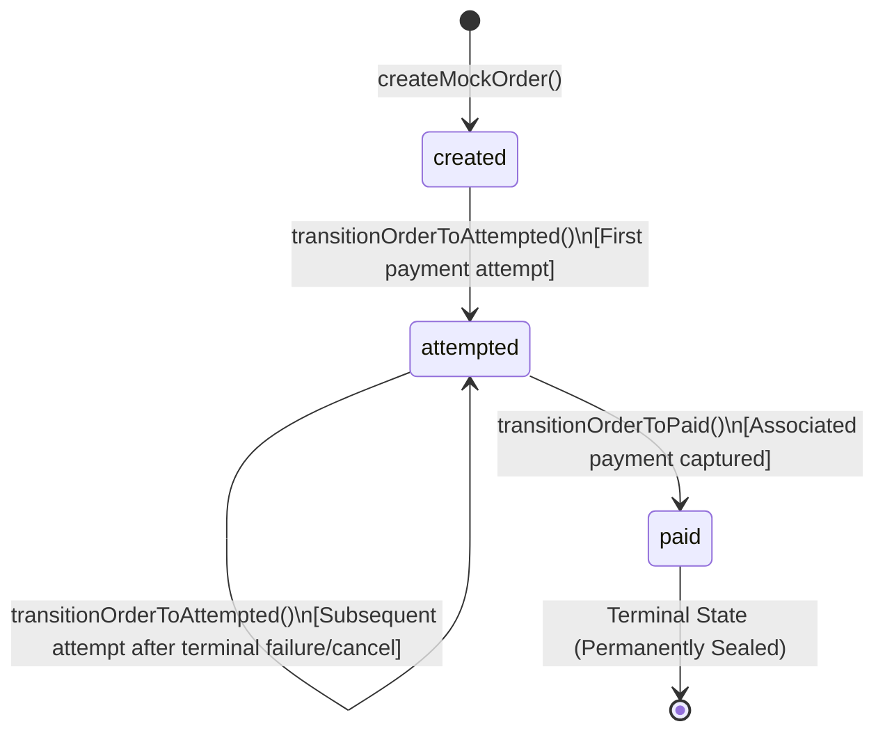
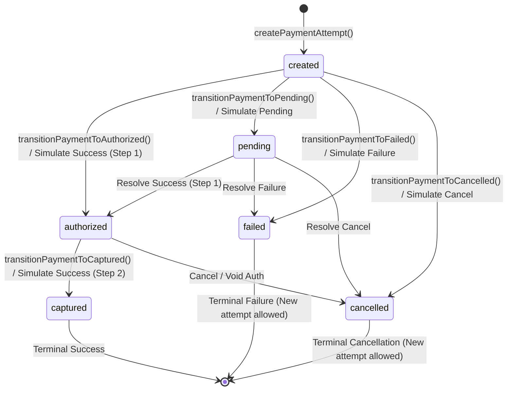
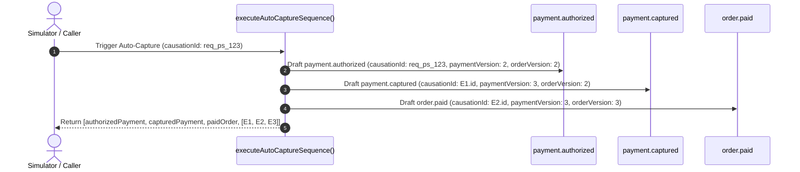
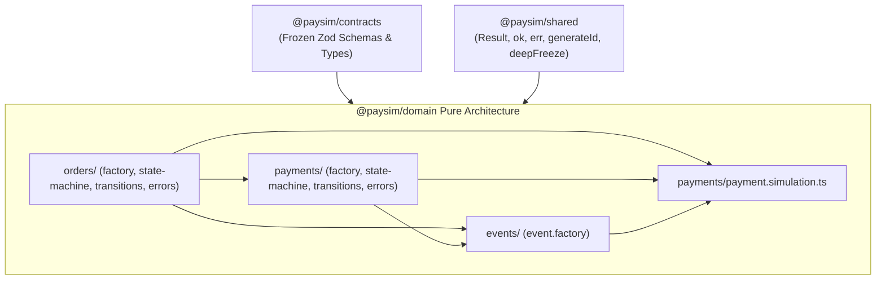

# PAYSIM — Phase 03.3.1 Order & Payment Domain Engine Report

**Document Version:** 1.0.0  
**Phase:** Phase 03.3.1 — Order & Payment Domain Engine  
**Status:** Complete & Certified  
**Role:** Senior TypeScript Domain Engineer and Financial Simulation Systems Architect  
**Date:** 3 November 2026  
**Normative Baseline:** PRD v2.3.0 (`docs/PRD_v2.3.md`) | System Architecture (`docs/SYSTEM_ARCHITECTURE.md`) | ADR-003, ADR-005, ADR-007, ADR-008 (`docs/ARCHITECTURE_DECISION_REGISTER.md`)  

---

## 1. Executive Summary & Objective

Phase 03.3.1 implements pure, deterministic Order and Payment domain business logic within the [`@paysim/domain`](file:///e:/All%20Project/Paysim/packages/domain) package. In accordance with strict domain-driven architecture:
- All domain operations are implemented as **pure functions** returning explicit `Result<T, E>` types.
- Entities are modelled as **deep-frozen immutable snapshots** (`MockOrder`, `MockPayment`).
- Zero dependencies on Express, HTTP routers, storage repositories, or external network APIs.
- The shared [`@paysim/contracts`](file:///e:/All%20Project/Paysim/packages/contracts) package serves as the immutable type authority.
- The atomic compound **Auto-Capture Sequence** produces the three canonical events (`payment.authorized`, `payment.captured`, `order.paid`) in strict causal order while preserving point-in-time state snapshots and monotonic versioning (`orderVersion`, `paymentVersion`).

---

## 2. Files Created and Modified

```
packages/domain/
├── package.json
├── tsconfig.json
├── src/
│   ├── index.ts                           # Aggregate domain package root export
│   ├── orders/
│   │   ├── index.ts                       # Order domain exports
│   │   ├── order.errors.ts                # Typed OrderDomainError hierarchy
│   │   ├── order.factory.ts               # Pure factory for initial MockOrder
│   │   ├── order.state-machine.ts         # Order state transition predicate & assertions
│   │   └── order.transitions.ts           # Order transition functions (attempted, paid)
│   ├── payments/
│   │   ├── index.ts                       # Payment domain exports
│   │   ├── payment.errors.ts              # Typed PaymentDomainError hierarchy
│   │   ├── payment.factory.ts             # Pure factory for initial MockPayment
│   │   ├── payment.state-machine.ts       # Payment state transition predicate & assertions
│   │   ├── payment.transitions.ts         # Payment individual step transitions
│   │   └── payment.simulation.ts          # Compound auto-capture, simulation & resolution
│   └── events/
│       ├── index.ts                       # Event domain exports
│       └── event.factory.ts               # DomainEventDraft builder & snapshot serializers
└── tests/
    ├── domain.test.ts                     # Backward-compatibility smoke test
    ├── orders.test.ts                     # Comprehensive order domain unit tests (17 tests)
    ├── payments.test.ts                   # Comprehensive payment domain unit tests (16 tests)
    └── simulation.test.ts                 # Compound auto-capture & simulation tests (15 tests)
```

---

## 3. Order State Machine

According to PRD Section 8.1 & 8.2 and System Architecture Section 10.1:



### 3.1 Transition Rules & Invariants
1. **Creation:** `createMockOrder(params)` initializes an order in `created` status with `version: 1`, `amountPaid: 0`, `amountDue: amount`, and `paymentAttemptIds: []`.
2. **First Attempt:** Moves `created` $\to$ `attempted`, increments `orderVersion` from 1 to 2, and records the `paymentId`.
3. **Subsequent Attempts:** While in `attempted`, adding a new attempt increments `orderVersion` and appends `paymentId`. If the `paymentId` is already present, the transition is idempotent.
4. **Order Paid:** Moves `attempted` $\to$ `paid`, sets `amountPaid = amount`, `amountDue = 0`, and increments `orderVersion`.
5. **Paid Order Immutability:** Once in `paid`, the order is permanently sealed. Any subsequent attempt creation, capture, or status mutation returns `409 ORDER_ALREADY_PAID`.
6. **Prohibited Transitions:** Direct transitions `created` $\to$ `paid`, `attempted` $\to$ `created`, or from `paid` fail closed with `INVALID_STATE_TRANSITION` or `ORDER_ALREADY_PAID`.

---

## 4. Payment State Machine

According to PRD Section 8.1 & 8.2 and System Architecture Section 10.2:



### 4.1 Transition Rules & Invariants
1. **Attempt Concurrency Constraint:** Exactly one active (non-terminal: `created`, `pending`, `authorized`) payment attempt can exist per order at any time. Creating an attempt while another is active returns `409 ACTIVE_PAYMENT_ATTEMPT_EXISTS`.
2. **Paid Order Guard:** Creating a payment attempt against an order in `paid` status returns `409 ORDER_ALREADY_PAID`.
3. **Cross-Aggregate Ownership:** All payment operations assert that `payment.orderId === order.id`, failing closed with `PaymentOrderMismatchError` if violated.
4. **Terminal State Immutability:** Payments in terminal states (`captured`, `failed`, `cancelled`) reject all subsequent transitions with `PaymentTerminalStateError` or `PaymentAlreadyCapturedError`.
5. **Two-Step Authorization:** `authorized` preserves `captured: false`; `captured` preserves `captured: true`. Direct transition from `created` $\to$ `captured` without passing through `authorized` is rejected.

---

## 5. Supported Simulation Outcomes & Resolution

In [`packages/domain/src/payments/payment.simulation.ts`](file:///e:/All%20Project/Paysim/packages/domain/src/payments/payment.simulation.ts):

| Command | Initial Status | Target Status | Order Status | Emitted Events |
|:---|:---|:---|:---|:---|
| `simulatePaymentOutcome(success)` | `created` | `authorized` $\to$ `captured` | `attempted` $\to$ `paid` | `payment.authorized`, `payment.captured`, `order.paid` |
| `simulatePaymentOutcome(pending)` | `created` | `pending` | `attempted` (Unchanged) | `payment.pending` |
| `simulatePaymentOutcome(failed)` | `created` | `failed` | `attempted` (Unchanged) | `payment.failed` |
| `simulatePaymentOutcome(cancelled)` | `created` | `cancelled` | `attempted` (Unchanged) | `payment.cancelled` |
| `resolvePendingPayment(success)` | `pending` | `authorized` $\to$ `captured` | `attempted` $\to$ `paid` | `payment.authorized`, `payment.captured`, `order.paid` |
| `resolvePendingPayment(failed)` | `pending` | `failed` | `attempted` (Unchanged) | `payment.failed` |
| `resolvePendingPayment(cancelled)` | `pending` | `cancelled` | `attempted` (Unchanged) | `payment.cancelled` |
| `captureAuthorizedPayment()` | `authorized` | `captured` | `attempted` $\to$ `paid` | `payment.captured`, `order.paid` |

---

## 6. Compound Auto-Capture Sequence & Event Snapshot Behavior

When auto-capture executes via `executeAutoCaptureSequence`:
1. **Authorized Payment Snapshot:**
   - `status = 'authorized'`
   - `captured = false`
   - `paymentVersion = payment.version + 1` (e.g. 2)
2. **Captured Payment Snapshot:**
   - `status = 'captured'`
   - `captured = true`
   - `paymentVersion = authorizedPayment.version + 1` (e.g. 3)
3. **Paid Order Snapshot:**
   - `status = 'paid'`
   - `amountPaid = order.amount`
   - `amountDue = 0`
   - `orderVersion = order.version + 1` (e.g. 3)
4. **Three Canonical Event Drafts (Strict Causal Ordering):**



- **Correlation ID:** All three events carry `correlationId = order.id`.
- **Causation Chaining:** `E1.causationId = triggerRequestId`; `E2.causationId = E1.id`; `E3.causationId = E2.id`.
- **Contract Schema Validation:** All event drafts strictly validate against contracts [`NativeWebhookEventSchema`](file:///e:/All%20Project/Paysim/packages/contracts/src/events-native.ts#L61-L71) and [`WireCanonicalEventSchema`](file:///e:/All%20Project/Paysim/packages/contracts/src/versioning.ts#L24-L37).

---

## 7. Domain Dependency Graph



- **Acyclic DAG:** Zero cyclic module imports.
- **Pure Isolation:** No imports of `@paysim/storage-memory`, Express, or database drivers.

---

## 8. Test Coverage & Execution Evidence

Comprehensive Vitest tests implemented in `packages/domain/tests/`:
- [`orders.test.ts`](file:///e:/All%20Project/Paysim/packages/domain/tests/orders.test.ts): **17 unit tests** covering valid creation, input constraint violations (overflow, currency, lengths), state transitions, invalid transition rejections, and paid order immutability.
- [`payments.test.ts`](file:///e:/All%20Project/Paysim/packages/domain/tests/payments.test.ts): **16 unit tests** covering attempt creation, all 4 mock payment methods, active attempt concurrency checks, paid order rejection, state machine legality, individual step transitions, and terminal state immutability.
- [`simulation.test.ts`](file:///e:/All%20Project/Paysim/packages/domain/tests/simulation.test.ts): **15 unit tests** covering compound auto-capture, causal chaining, snapshot invariants, `simulatePaymentOutcome` (all 4 outcomes), `resolvePendingPayment`, explicit two-step capture, and cross-aggregate ownership validation.
- [`domain.test.ts`](file:///e:/All%20Project/Paysim/packages/domain/tests/domain.test.ts): **1 backward-compatibility test**.

### Monorepo Quality Gate Verification
```
> paysim-monorepo@1.0.0 typecheck
> tsc --build
[Exit 0 - 0 errors]

> paysim-monorepo@1.0.0 lint
> eslint .
[Exit 0 - 0 errors, 0 warnings]

> paysim-monorepo@1.0.0 test
> vitest run
 RUN  v2.1.9 E:/All Project/Paysim

 ✓ packages/crypto/tests/crypto.test.ts (5 tests) 4ms
 ✓ packages/shared/tests/shared.test.ts (7 tests) 25ms
 ✓ packages/storage-memory/tests/storage.test.ts (21 tests) 9ms
 ✓ apps/server/tests/server.test.ts (2 tests) 31ms
 ✓ packages/contracts/tests/contracts.test.ts (56 tests) 33ms
 ✓ packages/domain/tests/domain.test.ts (1 test) 4ms
 ✓ packages/domain/tests/payments.test.ts (16 tests) 6ms
 ✓ tests/smoke.test.ts (5 tests) 4ms
 ✓ packages/domain/tests/orders.test.ts (17 tests) 9ms
 ✓ packages/domain/tests/simulation.test.ts (15 tests) 10ms

 Test Files  10 passed (10)
      Tests  145 passed (145)
   Duration  797ms

> paysim-monorepo@1.0.0 build
> tsc --build && npm run build --workspace=apps/web
[Exit 0 - Clean Vite production bundle]
```

### Fixture Byte Integrity
- `fixtures/events-compat/payment.captured.body.json`: **333 bytes**
- `fixtures/events-compat/payment.captured.json`: **474 bytes**
- `fixtures/events-native/payment.captured.body.json`: **293 bytes**
- `fixtures/events-native/payment.captured.json`: **389 bytes**

---

## 9. Remaining Limitations & Boundaries

1. **Storage Repositories & State Swaps:** In-memory repositories (`OrderRepository`, `PaymentRepository`, `EventRepository`) and monolithic atomic pointer swaps (`RootStateHolder.commit`) belong to subsequent storage engineering tasks.
2. **Concurrent Transaction Safety:** Multi-aggregate concurrency locking (same-tier lexicographical locking) will be orchestrated by application services in Phase 03.3.2.
3. **Webhook Dispatcher:** Dispatch queue, retry backoff scheduler, and socket sender belong to the webhook engine phase.
4. **HTTP Controllers & Routes:** Express route handlers and middleware pipelines belong to Phase 03.4.
