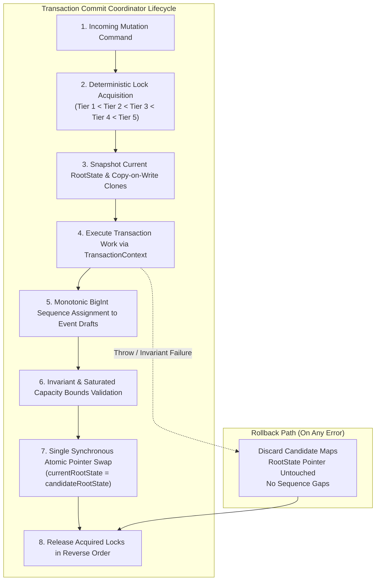

# PAYSIM — Phase 03.3.2 Implementation Report

**Role:** Principal TypeScript Systems Architect  
**Project:** PAYSIM — Local Payment Gateway Simulator & Webhook Testing Laboratory  
**Normative Baseline:** PRD v2.3.0 ([`docs/PRD_v2.3.md`](file:///e:/All%20Project/Paysim/docs/PRD_v2.3.md)), System Architecture ([`docs/SYSTEM_ARCHITECTURE.md`](file:///e:/All%20Project/Paysim/docs/SYSTEM_ARCHITECTURE.md)), ADR-003, ADR-005, ADR-007, ADR-008  
**Package:** [`@paysim/storage-memory`](file:///e:/All%20Project/Paysim/packages/storage-memory)  
**Status:** COMPLETE & VERIFIED  

---

## 1. Executive Summary

Phase 03.3.2 delivers the central in-memory state architecture, transactional commit coordinator, and bounded repositories for PAYSIM. The implementation satisfies all criteria established by ADR-003, ADR-005, ADR-007, and PRD v2.3.0 Section 14:
1. **Canonical In-Memory RootState:** A monolithic immutable state container encapsulating Orders, Payments, Checkout Sessions, Canonical Events, Webhook Endpoints, Webhook Deliveries, Idempotency Records, Secret-Version Retention metadata, Monotonic Global Sequence, and State Version.
2. **Transaction Commit Coordinator:** Executes transactional work units utilizing copy-on-write candidate maps, invariant validation, monotonic event sequencing, capacity checking, and a single atomic reference swap (`currentRootState = candidateRootState`).
3. **5-Tier Hierarchical Lock Manager:** Implements ADR-005 with strict ascending tier order, lexicographical same-tier sorting, 5,000ms acquisition timeout, `AbortSignal` cancellation support, and guaranteed cleanup in reverse order.
4. **Monotonic BigInt Event Sequencing:** Implements ADR-007 with internal `bigint` sequence primitives, gap-free committed sequences, and lossless decimal-string JSON wire encoding.
5. **Bounded Repositories:** Read-only repository facades directly query the immutable RootState snapshot and strictly fail closed on mutation attempts outside a coordinator transaction.



---

## 2. Architectural Components Implemented

### 2.1 Canonical RootState Container ([`packages/storage-memory/src/state/root-state.ts`](file:///e:/All%20Project/Paysim/packages/storage-memory/src/state/root-state.ts))

The system maintains a single authoritative `RootState` reference per Node.js process:
```typescript
export interface RootState {
  readonly orders: ReadonlyMap<string, Readonly<MockOrder>>;
  readonly payments: ReadonlyMap<string, Readonly<MockPayment>>;
  readonly sessions: ReadonlyMap<string, Readonly<CheckoutSessionEntity>>;
  readonly events: ReadonlyMap<string, Readonly<CanonicalEvent>>;
  readonly endpoints: ReadonlyMap<string, Readonly<WebhookEndpointEntity>>;
  readonly deliveries: ReadonlyMap<string, Readonly<WebhookDeliveryEntity>>;
  readonly idempotency: ReadonlyMap<string, Readonly<StoredIdempotencyRecord>>;
  readonly retention: Readonly<RetentionState>;
  readonly nextGlobalSeq: bigint;
  readonly version: bigint;
}
```

- **Memory Bounds (`MEMORY_BOUNDS`):** Enforces PRD v2.3.0 Section 14 limits:
  - `MAX_ORDERS`: 2,000
  - `MAX_PAYMENTS`: 3,000
  - `MAX_SESSIONS`: 3,000
  - `MAX_EVENTS`: 2,000
  - `MAX_DELIVERIES`: 5,000
  - `MAX_IDEMPOTENCY_KEYS`: 5,000
  - `MAX_QUEUE`: 100
  - `MAX_WORKERS`: 5
  - `MAX_SECRET_VERSIONS`: 5
  - `PENDING_ATTEMPT_TIMEOUT_MS`: 30 minutes
  - `CAPABILITY_TOKEN_TTL_MS`: 15 minutes
- **`RootStateHolder`:** Manages the active reference and executes non-throwing synchronous pointer swaps (`this.currentRootState = candidateState`).

---

### 2.2 Hierarchical Lock Manager ([`packages/storage-memory/src/locks/lock-manager.ts`](file:///e:/All%20Project/Paysim/packages/storage-memory/src/locks/lock-manager.ts))

Enforces the 5-tier global lock hierarchy specified in ADR-005 and Phase 02.6:

$$\text{Tier 1: Idempotency / Endpoint} < \text{Tier 2: Order / Payment} < \text{Tier 3: Session} < \text{Tier 4: Delivery} < \text{Tier 5: Retention}$$

```typescript
export const LockTier = Object.freeze({
  TIER_1_IDEMPOTENCY: 1,
  TIER_1_ENDPOINT: 1,
  TIER_2_ORDER: 2,
  TIER_2_PAYMENT: 2,
  TIER_3_SESSION: 3,
  TIER_4_DELIVERY: 4,
  TIER_5_RETENTION: 5,
} as const);
```

- **Deterministic Sorting (`sortLockKeys`):** Keys are sorted by ascending tier order. Keys within the same tier are sorted lexicographically (`a.localeCompare(b)`).
- **Timeouts:** 5,000ms default timeout. Throws `LockTimeoutError` when lock cannot be acquired within time.
- **Cancellation:** Supports standard `AbortSignal`. Aborted acquisitions reject immediately with `LockAbortedError`.
- **Atomic Multi-Acquisition (`acquireAll`):** If an intermediate lock times out or aborts, all previously held locks for the request are immediately released in reverse order before the error propagates.
- **Scoped Execution (`withLocks`):** Guaranteed release in `finally` in reverse acquisition order.

---

### 2.3 Transaction Commit Coordinator ([`packages/storage-memory/src/coordinator/commit-coordinator.ts`](file:///e:/All%20Project/Paysim/packages/storage-memory/src/coordinator/commit-coordinator.ts))

Orchestrates multi-aggregate transactions according to ADR-003:
1. **Lock Acquisition:** Resolves and acquires required locks in sorted order.
2. **Snapshot & Clone:** Reads committed snapshot; creates copy-on-write `candidateOrders`, `candidatePayments`, `candidateSessions`, `candidateEvents`, `candidateEndpoints`, `candidateDeliveries`, `candidateIdempotency`.
3. **Context Injection:** Supplies `TransactionContext` containing transactional repositories bound to candidate maps.
4. **Event Sequencing:** Assigns monotonic `globalSeq` to domain event drafts appended via `ctx.appendEvent(draft)`.
5. **Capacity Bounds Check:** Validates that candidate collections do not exceed PRD Section 14 limits. Throws `StorageCapacityError` (`RESOURCE_LIMIT_REACHED`) if saturated.
6. **Invariant Verification:** Validates cross-aggregate integrity:
   - Rejects orphan payments (`payment.orderId` must exist in `candidateOrders`).
   - Rejects orphan sessions (`session.orderId` and `session.paymentId` must exist).
   - Rejects orphan deliveries (`delivery.eventId` and `delivery.endpointId` must exist).
7. **Atomic Commit:** Constructs candidate RootState and commits via single pointer swap:
   `this.stateHolder.commit(candidateRootState);`
8. **Cleanup:** Guarantees lock release in `finally` in reverse acquisition order.

---

### 2.4 In-Memory Repositories ([`packages/storage-memory/src/repositories/`](file:///e:/All%20Project/Paysim/packages/storage-memory/src/repositories/))

Each aggregate possesses a dual-mode repository structure:
- **Read-Only Facades (`OrderRepository`, `PaymentRepository`, `CheckoutSessionRepository`, `EventRepository`, `WebhookEndpointRepository`, `WebhookDeliveryRepository`):**
  - Read directly from the committed snapshot: `this.stateHolder.getState().<collection>.get(id)`.
  - Mutation methods (`insert`, `update`, `delete`) throw `StorageError('Direct mutation prohibited... Use CommitCoordinator.transaction()')`.
- **Transactional Repositories (`TransactionalOrderRepository`, `TransactionalPaymentRepository`, etc.):**
  - Operate on transaction candidate maps.
  - Enforce version monotonicity: $v_{candidate} = v_{current} + 1$; throws `ConcurrencyConflictError` on mismatch.
  - Enforce terminal state immutability: paid orders and captured/failed/cancelled payments cannot be modified; throws `InvariantViolationError`.
  - Reject duplicate entity IDs on insert; throws `DuplicateEntityError`.
  - Reject missing records on update; throws `EntityNotFoundError`.

---

### 2.5 BigInt Global Event Sequencing & Lossless Wire Serializer ([`packages/storage-memory/src/sequencing/global-sequencer.ts`](file:///e:/All%20Project/Paysim/packages/storage-memory/src/sequencing/global-sequencer.ts))

- **Native Representation:** Internal `CanonicalEvent.globalSeq` stored as native `bigint`.
- **Gap-Free Committed Sequences:** Event drafts are assigned sequence numbers inside the transaction. If the transaction throws or fails validation, `current.nextGlobalSeq` is not modified, guaranteeing that committed sequences remain strictly monotonic without gaps.
- **Wire Serialization:** `serializeBigIntGlobalSeq(seq: bigint)` and `serializeCanonicalEvent(event: CanonicalEvent)` output base-10 decimal strings (`"1"`, `"101"`), preventing JavaScript 53-bit integer overflow and JSON BigInt serialization exceptions.

---

## 3. Monorepo Quality Gate Verification

All quality gates passed cleanly with zero errors and zero warnings:

```
> paysim-monorepo@1.0.0 typecheck
> tsc --build
[Exit 0 - 0 errors]

> paysim-monorepo@1.0.0 lint
> eslint .
[Exit 0 - 0 errors, 0 warnings]

> paysim-monorepo@1.0.0 test
> vitest run

 RUN  v2.1.9 E:/All Project/Paysim

 ✓ packages/crypto/tests/crypto.test.ts (5 tests) 6ms
 ✓ packages/shared/tests/shared.test.ts (7 tests) 31ms
 ✓ packages/storage-memory/tests/sequencer.test.ts (4 tests) 7ms
 ✓ packages/storage-memory/tests/storage.test.ts (21 tests) 17ms
 ✓ packages/contracts/tests/contracts.test.ts (56 tests) 66ms
 ✓ apps/server/tests/server.test.ts (2 tests) 59ms
 ✓ packages/storage-memory/tests/locks.test.ts (13 tests) 101ms
 ✓ packages/domain/tests/orders.test.ts (17 tests) 14ms
 ✓ packages/domain/tests/payments.test.ts (16 tests) 16ms
 ✓ packages/domain/tests/simulation.test.ts (25 tests) 39ms
 ✓ packages/domain/tests/matrix.test.ts (61 tests) 44ms
 ✓ apps/server/tests/webhook-serialization.test.ts (7 tests) 25ms
 ✓ tests/smoke.test.ts (5 tests) 8ms
 ✓ packages/storage-memory/tests/repositories.test.ts (17 tests) 43ms
 ✓ packages/domain/tests/domain.test.ts (1 test) 5ms
 ✓ packages/storage-memory/tests/coordinator.test.ts (7 tests) 44ms

 Test Files  16 passed (16)
      Tests  264 passed (264)
   Start at  06:50:34
   Duration  1.30s (transform 1.70s, setup 0ms, collect 7.94s, tests 524ms, environment 4ms, prepare 3.01s)

> paysim-monorepo@1.0.0 build
> tsc --build && npm run build --workspace=apps/web
[Exit 0 - Clean Vite production build]
```

### Fixture Byte Preservation Evidence
- `fixtures/events-compat/payment.captured.body.json`: **333 bytes** (100% byte identical)
- `fixtures/events-compat/payment.captured.json`: **474 bytes** (100% byte identical)
- `fixtures/events-native/payment.captured.body.json`: **293 bytes** (100% byte identical)
- `fixtures/events-native/payment.captured.json`: **389 bytes** (100% byte identical)

---

## 4. Exact File Inventory

| File Path | Nature | Purpose |
|---|---|---|
| [`packages/storage-memory/src/locks/lock.errors.ts`](file:///e:/All%20Project/Paysim/packages/storage-memory/src/locks/lock.errors.ts) | Created | Structured lock error hierarchy (`LockTimeoutError`, `LockAbortedError`, `LockOrderViolationError`) |
| [`packages/storage-memory/src/locks/lock-manager.ts`](file:///e:/All%20Project/Paysim/packages/storage-memory/src/locks/lock-manager.ts) | Created | 5-tier hierarchical lock manager with timeouts, AbortSignal, and lexicographical same-tier sorting |
| [`packages/storage-memory/src/locks/index.ts`](file:///e:/All%20Project/Paysim/packages/storage-memory/src/locks/index.ts) | Created | Barrel export for locks |
| [`packages/storage-memory/src/state/errors.ts`](file:///e:/All%20Project/Paysim/packages/storage-memory/src/state/errors.ts) | Created | Storage errors (`StorageCapacityError`, `DuplicateEntityError`, `EntityNotFoundError`, `ConcurrencyConflictError`, `InvariantViolationError`) |
| [`packages/storage-memory/src/state/root-state.ts`](file:///e:/All%20Project/Paysim/packages/storage-memory/src/state/root-state.ts) | Created | Canonical `RootState`, `MEMORY_BOUNDS`, `createInitialRootState()`, and `RootStateHolder` |
| [`packages/storage-memory/src/state/index.ts`](file:///e:/All%20Project/Paysim/packages/storage-memory/src/state/index.ts) | Created | Barrel export for state |
| [`packages/storage-memory/src/repositories/order.repository.ts`](file:///e:/All%20Project/Paysim/packages/storage-memory/src/repositories/order.repository.ts) | Created | Read-only and transactional Order repositories with version monotonicity |
| [`packages/storage-memory/src/repositories/payment.repository.ts`](file:///e:/All%20Project/Paysim/packages/storage-memory/src/repositories/payment.repository.ts) | Created | Read-only and transactional Payment repositories with terminal immutability |
| [`packages/storage-memory/src/repositories/session.repository.ts`](file:///e:/All%20Project/Paysim/packages/storage-memory/src/repositories/session.repository.ts) | Created | Read-only and transactional Checkout Session repositories |
| [`packages/storage-memory/src/repositories/event.repository.ts`](file:///e:/All%20Project/Paysim/packages/storage-memory/src/repositories/event.repository.ts) | Created | Read-only and transactional append-only Event repositories |
| [`packages/storage-memory/src/repositories/endpoint.repository.ts`](file:///e:/All%20Project/Paysim/packages/storage-memory/src/repositories/endpoint.repository.ts) | Created | Read-only and transactional Webhook Endpoint repositories |
| [`packages/storage-memory/src/repositories/delivery.repository.ts`](file:///e:/All%20Project/Paysim/packages/storage-memory/src/repositories/delivery.repository.ts) | Created | Read-only and transactional Webhook Delivery repositories with relational filters |
| [`packages/storage-memory/src/repositories/index.ts`](file:///e:/All%20Project/Paysim/packages/storage-memory/src/repositories/index.ts) | Created | Barrel export for repositories |
| [`packages/storage-memory/src/sequencing/global-sequencer.ts`](file:///e:/All%20Project/Paysim/packages/storage-memory/src/sequencing/global-sequencer.ts) | Created | Monotonic sequence allocator and base-10 decimal wire serializer |
| [`packages/storage-memory/src/sequencing/index.ts`](file:///e:/All%20Project/Paysim/packages/storage-memory/src/sequencing/index.ts) | Created | Barrel export for sequencer |
| [`packages/storage-memory/src/coordinator/commit-coordinator.ts`](file:///e:/All%20Project/Paysim/packages/storage-memory/src/coordinator/commit-coordinator.ts) | Created | Central transaction commit coordinator with single atomic pointer swap |
| [`packages/storage-memory/src/coordinator/index.ts`](file:///e:/All%20Project/Paysim/packages/storage-memory/src/coordinator/index.ts) | Created | Barrel export for coordinator |
| [`packages/storage-memory/src/index.ts`](file:///e:/All%20Project/Paysim/packages/storage-memory/src/index.ts) | Modified | Unified package barrel re-exporting all submodules |
| [`packages/storage-memory/tests/locks.test.ts`](file:///e:/All%20Project/Paysim/packages/storage-memory/tests/locks.test.ts) | Created | 13 automated tests verifying hierarchy, same-tier lexicographical sorting, timeout, and AbortSignal |
| [`packages/storage-memory/tests/repositories.test.ts`](file:///e:/All%20Project/Paysim/packages/storage-memory/tests/repositories.test.ts) | Created | 17 automated tests verifying read-only mutation blocks, version monotonicity, and terminal immutability |
| [`packages/storage-memory/tests/sequencer.test.ts`](file:///e:/All%20Project/Paysim/packages/storage-memory/tests/sequencer.test.ts) | Created | 4 automated tests verifying BigInt decimal wire serialization and parsing |
| [`packages/storage-memory/tests/coordinator.test.ts`](file:///e:/All%20Project/Paysim/packages/storage-memory/tests/coordinator.test.ts) | Created | 7 automated tests verifying multi-aggregate atomicity, rollback, gap-free sequencing, and concurrent serialization |

---

## 5. Scope Boundaries Maintained

In strict accordance with Phase 03.3.2 instructions:
- Zero Express routes implemented (deferred to Phase 03.4).
- Zero frontend UI modifications (deferred to Phase 03.5).
- Zero external database dependencies introduced (bounded memory storage only).
- Zero outbound network webhook socket dispatches performed (deferred to Webhook Engine in Phase 03.4).
- PRD v2.3.0 and frozen contract specifications 100% preserved.
- Phase 03.3.3 has NOT been started automatically.
