# PAYSIM — System Architecture Specification

**Document Version:** 1.1.0  
**Status:** Approved Architectural Baseline (Phase 02 / Hardened for v2.3.0)  
**Normative Baseline Specification:** PRD v2.3.0 (`docs/PRD_v2.3.md`)  
**Historical Predecessors:** PRD v2.2.0 (`docs/PRD.md`), PRD v2.1, PRD v2.0, PRD v1.0  
**Target Runtime:** Node.js 24.x LTS (Maintenance) and Node.js 26.x LTS (Active)  
**Classification:** Internal Technical Architecture & Engineering Blueprint  
**Last Updated:** November 2026  

---

## Executive Architectural Summary

PAYSIM is an offline-capable, local-first payment workflow simulator and webhook testing laboratory. It enables full-stack developers to build, test, and debug payment integrations without payment provider accounts, financial KYC, real money movement, or paid third-party APIs.

This document establishes the production-grade architectural blueprint for PAYSIM. It enforces strict separation of concerns across a modular monolith composed of two distinct API surfaces (PAYSIM Native API and Razorpay-Style Compatibility Adapter), a shared domain core, bounded in-memory state storage, isolated cryptographic vaults, and an asynchronous outbound loopback webhook delivery engine.

---

## 1. System Architecture Overview

### 1.1 Architectural Philosophy and Tenets

PAYSIM is engineered around five non-negotiable architectural tenets:

1. **Zero External Dependencies at Runtime (Local-First):** PAYSIM requires no database engine (PostgreSQL, MongoDB, SQLite), no cache or message broker (Redis, RabbitMQ), and no external payment gateways or SaaS services. It functions completely offline once dependencies are installed.
2. **Strict Non-Financial Boundary (Zero KYC & Simulation-Only):** PAYSIM does not move money, process bank transactions, issue real UPI intents, or collect real payment credentials (PAN, CVV, UPI PIN, OTP). Every data model, API response, UI screen, and webhook payload is explicitly marked with `simulated: true` and `livemode: false`.
3. **Modular Monolith Architecture:** The codebase is organized as a unified monorepo with strict package boundaries. Domain business rules, state machines, and event builders are isolated from HTTP transport frameworks and UI libraries.
4. **Dual Interface Parity over Unified Domain Core:** Native and Compatibility layers serve as distinct protocol adapters that map down to the exact same domain services, state machines, and repositories. State logic is never duplicated.
5. **Secure Loopback Confinement:** Inbound listeners bind exclusively to loopback interfaces (`127.0.0.1` or `::1`). Outbound webhook dispatching is strictly confined to literal loopback IP destinations with no DNS resolution, no redirects, and no proxy traversal.

### 1.2 System Boundaries & Context

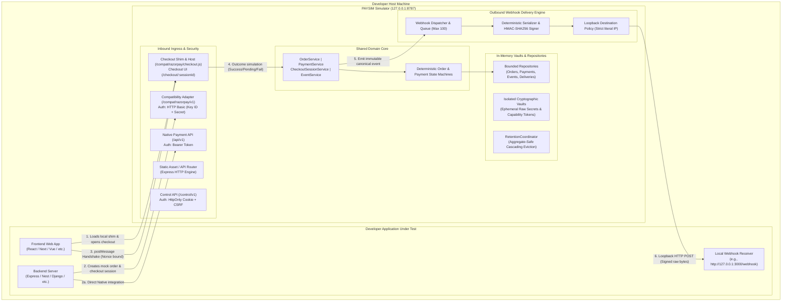

---

## 2. High-Level Architecture Diagram

```mermaid
graph TD
    User([Developer / Browser]) -->|HTTP Loopback :5173 / :8787| WebUI[PAYSIM React Dashboard SPA]
    User -->|Opens Checkout Modal| CheckoutFrame[PAYSIM-Hosted Checkout Iframe]
    
    subgraph ServerMonolith["PAYSIM Server Monolith (apps/server)"]
        HTTPRouter[Express HTTP Ingress & Security Middleware]
        
        subgraph AdaptersLayer["Protocol Adapters & Controllers"]
            ControlCtrl[Control Controller\n/control/v1]
            NativeCtrl[Native API Controller\n/api/v1]
            CompatCtrl[Razorpay Compat Controller\n/compat/razorpay/v1]
            CheckoutCtrl[Checkout Host Controller\n/checkout & /compat/.../checkout.js]
        end
        
        subgraph DomainLayer["Pure Domain Core (packages/domain)"]
            OrderSvc[Order Service]
            PaymentSvc[Payment Service]
            SessionSvc[Checkout Session Service]
            EventSvc[Event Service]
            StateMachine[Order & Payment State Machine Engine]
        end
        
        subgraph StorageLayer["Memory & Vault Storage (packages/storage-memory)"]
            OrderRepo[(Order Repository)]
            PaymentRepo[(Payment Repository)]
            EventRepo[(Canonical Event Repository)]
            DeliveryRepo[(Delivery & Attempt Repository)]
            IdempotencyRepo[(Idempotency Store)]
            
            subgraph VaultIsolation["Cryptographic Ephemeral Vaults"]
                TokenVault[(Capability Token Vault)]
                CompatVault[(Compatibility Secret Vault)]
                WebhookVault[(Webhook Secret Vault)]
                BodyVault[(Delivery Body Byte Vault)]
            end
            
            RetentionCoord[Retention Coordinator]
        end
        
        subgraph OutboundEngine["Outbound Webhook Subsystem (packages/webhook-engine)"]
            WebhookDispatcher[Webhook Dispatcher]
            BoundedQueue[Bounded Priority Queue\nMax 100 Jobs / 5 Workers]
            DeterministicSerializer[Deterministic Serializer\n(Native & Compat Wire Modes)]
            HMACSigner[HMAC-SHA256 Signer]
            DestinationValidator[Loopback Target Policy Validator]
            HTTPClient[Loopback HTTP Agent\nNo-Redirect / No-Proxy]
        end
    end

    WebUI -->|Cookie + CSRF| ControlCtrl
    CheckoutFrame -->|Same-Origin Session Cookie| CheckoutCtrl
    ExternalBackend([Developer Backend App]) -->|Bearer Token| NativeCtrl
    ExternalBackend -->|Basic Auth| CompatCtrl
    
    HTTPRouter --> ControlCtrl
    HTTPRouter --> NativeCtrl
    HTTPRouter --> CompatCtrl
    HTTPRouter --> CheckoutCtrl
    
    ControlCtrl --> DomainLayer
    NativeCtrl --> DomainLayer
    CompatCtrl --> DomainLayer
    CheckoutCtrl --> DomainLayer
    
    DomainLayer --> StateMachine
    StateMachine --> StorageLayer
    DomainLayer --> StorageLayer
    
    EventSvc -->|Enqueue on Commit| WebhookDispatcher
    WebhookDispatcher --> BoundedQueue
    BoundedQueue --> DeterministicSerializer
    DeterministicSerializer --> BodyVault
    DeterministicSerializer --> HMACSigner
    HMACSigner --> WebhookVault
    HMACSigner --> DestinationValidator
    DestinationValidator --> HTTPClient
    HTTPClient -->|Literal Loopback HTTP POST| LocalReceiver([Developer Webhook Receiver])

    RetentionCoord -.-> OrderRepo
    RetentionCoord -.-> PaymentRepo
    RetentionCoord -.-> EventRepo
    RetentionCoord -.-> DeliveryRepo
    RetentionCoord -.-> VaultIsolation
```

---

## 3. Technology Stack

The technology stack is explicitly locked according to PRD Section 15.4:

| Layer | Technology | Version / Constraint | Architectural Justification |
|---|---|---|---|
| **Language** | TypeScript | `^5.6.x` (Strict Mode) | Strict typing across contracts, domain models, and controllers. Disallows `noImplicitAny`, enforces `exactOptionalPropertyTypes`. |
| **Runtime** | Node.js | `24.x LTS` & `26.x LTS` | Long-Term Support baseline; tested offline on Windows 11, macOS, and Linux. Built-in `node:crypto` and `node:test`/`vitest`. |
| **Backend Framework** | Node.js + Express | `^4.21.x` / `^5.x` | Industry-standard HTTP transport, robust middleware pipeline, streaming request body capture, local static asset serving. |
| **Frontend Framework** | React | `^18.3.x` | Declarative UI component model, functional architecture, strict hook rules, zero external telemetry. |
| **Frontend Tooling** | Vite | `^5.4.x` | Ultra-fast HMR dev server with built-in loopback proxying to API server at `127.0.0.1:8787`. |
| **Styling** | Tailwind CSS | `^3.4.x` | Utility-first CSS compiled entirely ahead of time; zero remote web fonts, zero CDN dependencies at runtime. |
| **Schema Validation** | Zod | `^3.23.x` | Runtime boundary schema validation for all HTTP payloads, query params, headers, and environment configs. |
| **Cryptography** | `node:crypto` | Native Module | Cryptographically secure random tokens (`randomBytes`), timing-safe comparisons (`timingSafeEqual`), HMAC-SHA256, scrypt hashing. |
| **Unit / Contract Tests**| Vitest | `^2.1.x` | Native TypeScript test runner with ESM/CommonJS compatibility and snapshot testing. |
| **HTTP Integration Tests**| Supertest | `^7.0.x` | Route-level integration test harness testing Express apps without opening live network sockets. |
| **Browser / E2E Tests** | Playwright | `^1.48.x` | Cross-browser verification of Checkout iframe handshake, modal lifecycle, and dashboard interactions. |
| **Package Manager** | npm Workspaces | Node built-in | Native monorepo workspace orchestration; single locked `package-lock.json`. |

---

## 4. Monorepo Folder Structure

The monorepo follows the standard enterprise workspaces structure defined in PRD Section 15.3 and STEP 4:

```text
paysim/
├── apps/
│   ├── web/                              # React + Vite Single-Page Application (Dashboard & Checkout UI)
│   │   ├── src/
│   │   │   ├── components/               # Atomic and composite UI components (Cards, Tables, Drawers)
│   │   │   ├── views/                    # 9 Core Views: Overview, Lab, WebhookStudio, Events, etc.
│   │   │   ├── checkout/                 # Simulated Checkout modal interface & mock payment selectors
│   │   │   ├── hooks/                    # React hooks for API interaction and event streams
│   │   │   ├── services/                 # API client wrappers connecting to /control/v1 and /api/v1
│   │   │   └── types/                    # Frontend presentation types
│   │   ├── index.html                    # Dashboard HTML entry point
│   │   ├── checkout.html                 # Isolated checkout iframe host entry point
│   │   ├── vite.config.ts                # Vite config (loopback binding :5173, backend proxy :8787)
│   │   └── package.json
│   │
│   └── server/                           # Node.js + Express Server Entry Point & Process Host
│       ├── src/
│       │   ├── bin/                      # CLI entry point (`paysim dev`, `paysim start`)
│       │   ├── config/                   # Zod-validated environment config and data limit profiles
│       │   ├── middleware/               # Host/Origin checks, rate limiters, error envelopes, logging
│       │   ├── routes/                   # Ingress mounting for /api/v1, /compat/razorpay/v1, /control/v1
│       │   ├── server.ts                 # Express initialization and static asset mounting
│       │   └── index.ts                  # Process startup, graceful shutdown handlers, port listener
│       └── package.json
│
├── packages/
│   ├── contracts/                        # Pure TypeScript domain contracts, DTOs, enums, error codes
│   │   ├── src/
│   │   │   ├── orders.ts                 # Order status, entity contracts, creation payloads
│   │   │   ├── payments.ts               # Payment status, method enums, simulation command payloads
│   │   │   ├── events.ts                 # Canonical event envelope, supported event type unions
│   │   │   ├── webhooks.ts               # Webhook endpoint, delivery, attempt, and mode DTOs
│   │   │   ├── errors.ts                 # ErrorCatalogue union, StandardErrorEnvelope definition
│   │   │   └── index.ts
│   │   └── package.json
│   │
│   ├── domain/                           # Pure Domain Layer: State machines, business rules, entities
│   │   ├── src/
│   │   │   ├── state-machine/            # Order and Payment Attempt state transitions & validations
│   │   │   ├── services/                 # OrderService, PaymentService, CheckoutSessionService, EventService
│   │   │   ├── serializers/              # Mode-specific deterministic serializers (Native & Compat)
│   │   │   ├── validators/               # Amount, currency, receipt, and metadata domain validators
│   │   │   └── index.ts
│   │   └── package.json
│   │
│   ├── adapters-native/                  # Native API Transport Layer (/api/v1)
│   │   ├── src/
│   │   │   ├── controllers/              # OrderController, PaymentController, EventController, DeliveryController
│   │   │   ├── middleware/               # Bearer auth validation (scrypt verification), Idempotency middleware
│   │   │   ├── routes.ts                 # Express router mapping /api/v1 paths
│   │   │   └── index.ts
│   │   └── package.json
│   │
│   ├── adapters-compat/                  # Razorpay-Style Compatibility Adapter (/compat/razorpay/v1)
│   │   ├── src/
│   │   │   ├── controllers/              # CompatOrdersController, CompatCheckoutSessionController
│   │   │   ├── middleware/               # HTTP Basic Auth validator (PAYSIM Key ID + Secret)
│   │   │   ├── shim/                     # Serves `/compat/razorpay/checkout.js` with window.Razorpay shim
│   │   │   ├── routes.ts                 # Express router for compatibility routes
│   │   │   └── index.ts
│   │   └── package.json
│   │
│   ├── webhook-engine/                   # Outbound Webhook Delivery Subsystem
│   │   ├── src/
│   │   │   ├── dispatcher.ts             # WebhookDispatcher: In-memory queue, concurrency controller
│   │   │   ├── signer.ts                 # HMAC-SHA256 calculation over exact raw bytes
│   │   │   ├── policy.ts                 # LoopbackDestinationPolicy (Strict literal IP, port checking)
│   │   │   ├── sender.ts                 # Loopback HTTP Agent (timeout, redirect rejection, read caps)
│   │   │   ├── retry-manager.ts          # Automatic 3-attempt backoff and bounded manual retry manager
│   │   │   └── index.ts
│   │   └── package.json
│   │
│   ├── storage-memory/                   # Bounded In-Memory Storage & Vault Subsystem
│   │   ├── src/
│   │   │   ├── repositories/             # Thread-safe in-memory maps for Orders, Payments, Events, Deliveries
│   │   │   ├── vaults/                   # Isolated SecretVault, TokenVault, DeliveryBodyVault
│   │   │   ├── idempotency/              # IdempotencyStore with canonical SHA-256 fingerprinting
│   │   │   ├── coordinator.ts            # RetentionCoordinator: Aggregate-safe eviction hierarchy
│   │   │   └── index.ts
│   │   └── package.json
│   │
│   └── sdk/                              # Developer Integration Helpers & Testing SDK
│       ├── src/
│       │   ├── bridge.ts                 # Node bridge for backend test harness & checkout session creation
│       │   ├── verification.ts           # Timing-safe HMAC callback & webhook signature verification helper
│       │   └── index.ts
│       └── package.json
│
├── docs/                                 # Architectural and Normative Documentation
│   ├── PRD.md                            # Normative Specification (v2.2.0 baseline)
│   ├── PRD_v2.2_CHANGELOG.md             # Formal Changelog for v2.2.0
│   ├── PRD_v2.2_RESOLUTION_REGISTER.md   # Traceability Register for v2.2 Audit Findings
│   ├── PRD_v2.2_VALIDATION_REPORT.md     # Consistency & Fixture Validation Report
│   ├── SYSTEM_ARCHITECTURE.md            # This System Architecture Document
│   ├── ARCHITECTURE_DECISION_REGISTER.md # Architectural Decision Records (ADRs)
│   ├── ARCHITECTURE_VALIDATION_REPORT.md # Architecture Compliance Report
│   └── README.md                         # Documentation Index & Roadmap
│
├── fixtures/                             # Normative Reference Test Data
│   ├── events-native/                    # Native Event Fixtures
│   │   ├── payment.captured.json         # Formatted semantic reference JSON
│   │   └── payment.captured.body.json    # Exact compact deterministic UTF-8 bytes
│   └── events-compat/                    # Compatibility Event Fixtures
│       ├── payment.captured.json         # Formatted semantic reference JSON
│       └── payment.captured.body.json    # Exact compact deterministic UTF-8 bytes
│
├── tests/                                # Multi-Package Integration, Contract & E2E Suites
│   ├── contract/                         # Exact byte matching against committed fixtures (V22-13, V22-17)
│   ├── regression-v22/                   # Formal test suite for PRD v2.2 cases (V22-01 to V22-22)
│   ├── integration/                      # Route-level and multi-service end-to-end integration tests
│   └── e2e/                              # Playwright tests for Web UI and Checkout iframe handshake
│
├── package.json                          # Monorepo root workspace definition
├── tsconfig.base.json                    # Strict TypeScript compiler options
└── README.md                             # Repository root guide
```

---

## 5. Frontend Architecture

### 5.1 Architecture Overview

The frontend (`apps/web`) is a React SPA powered by Vite. It contains two isolated execution contexts served from the PAYSIM local server:

1. **Dashboard Control Interface (`/`):** The administrative console where developers monitor mock transactions, inspect canonical events, register webhook endpoints, manage local API credentials, and simulate payment workflows.
2. **Checkout UI (`/checkout/:sessionId`):** The isolated simulation modal host designed to be embedded in an iframe inside the developer's client application.

### 5.2 Control Plane Security & State Management

The dashboard interacts with the server strictly via the Control API (`/control/v1`).
- **Authentication:** Authenticated via an `HttpOnly`, `SameSite=Strict` cookie scoped exclusively to `/control/v1`. On initial start, the user exchanges the terminal-printed one-time control token via `POST /control/v1/session/exchange`.
- **CSRF Defense:** Every mutating control request (`POST`, `PATCH`, `DELETE`) requires the `X-PaySim-CSRF` header containing the ephemeral token issued at session exchange. The CSRF token is stored purely in React application memory—**never** in `localStorage`, `sessionStorage`, or cookies.
- **Client State:** Managed via a lightweight reactive state store (e.g. Zustand) holding session summaries, active filters, and ephemeral inspector data. No business records or sensitive credentials persist across browser reloads or server restarts.

### 5.3 Simulated Checkout UI Architecture

The Checkout interface (`/checkout/:sessionId`) is served directly by PAYSIM to simulate customer-facing checkout interactions:
- **Zero Third-Party Assets:** Operates entirely offline. Bundles all SVGs, icons, and fonts locally.
- **Persistent Simulation Warnings:** Displays an unclosable warning: *"PAYSIM SIMULATION — NOT A REAL PAYMENT. NO MONEY MOVES."*
- **Outcome Selectors:** Clear interactive developer controls allowing explicit selection of deterministic payment outcomes: `Success`, `Pending`, `Failure`, and `Cancel`.
- **Safe QR Representation:** Any simulated QR displayed for UPI flows is rendered as an SVG diagram with an overlaid watermark: *"NOT PAYABLE — FOR DEMO USE ONLY"*. The SVG contains no valid `upi://` URI or banking payload.
- **No Sensitive Credential Collection:** The UI contains zero input fields for real card numbers, expiry dates, CVVs, UPI PINs, netbanking passwords, or OTPs.

---

## 6. Backend Architecture

### 6.1 Layered Pipeline & Request Lifecycle

The backend (`apps/server`) runs as a single-process Node.js HTTP service using Express. Requests pass through a structured 5-layer pipeline:

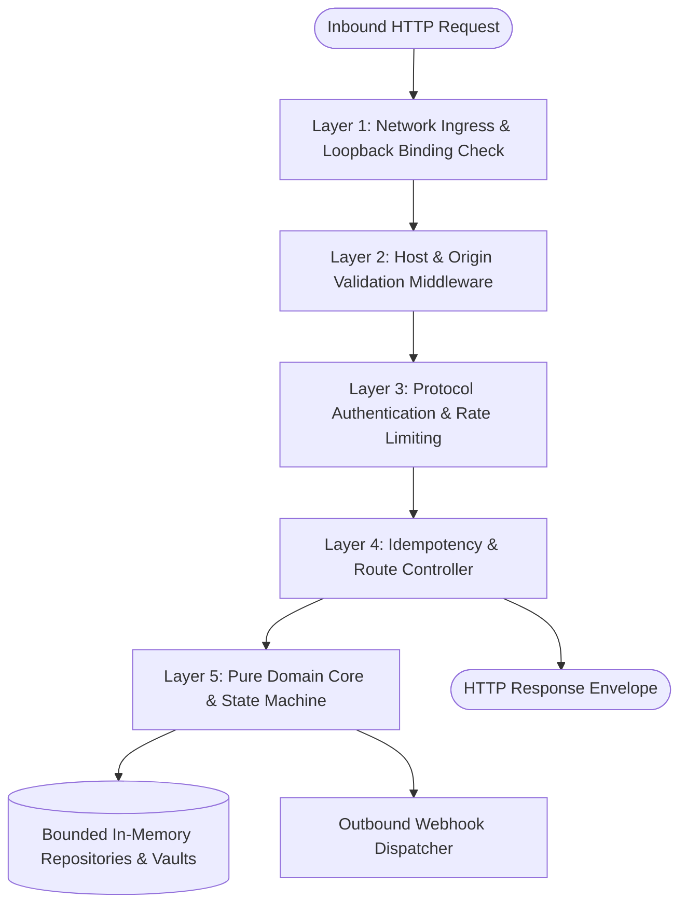

- **Layer 1 (Network Ingress):** Binds strictly to `127.0.0.1` or `::1`. Rejects any non-loopback bind at startup.
- **Layer 2 (Host & Origin Check):** Validates the `Host` header against `127.0.0.1:<port>` or `[::1]:<port>`. Rejects unrecognized origins. Parses request bodies while preserving the unparsed `Buffer` for idempotency fingerprinting and signature verification.
- **Layer 3 (Authentication & Rate Limiting):**
  - `/control/v1`: Validates control session cookie + `X-PaySim-CSRF`.
  - `/api/v1`: Validates `Authorization: Bearer <token>` via salted scrypt verifier.
  - `/compat/razorpay/v1`: Validates `Authorization: Basic <base64>` via salted scrypt verifier.
  - Applies in-memory token-bucket rate limiters per credential/session.
- **Layer 4 (Idempotency & Controller):** Computes canonical request fingerprint for mutating routes. Returns cached snapshots on replay. Dispatches requests to the appropriate domain service.
- **Layer 5 (Domain Core & In-Memory Storage):** Executes business rules inside an in-process per-order critical section. Atomically updates entity states and appends canonical events. Enqueues matching webhook deliveries.

### 6.2 In-Process Concurrency & Mutex Locking

To guarantee that concurrent asynchronous operations never induce race conditions, the backend implements an in-memory key-based mutex (`AsyncLock`):
- All mutating commands for a given `orderId` (e.g. creating payment attempts, simulating capture, resolving pending states) must acquire a lock for that `orderId`.
- The critical section encompasses: state validation -> order/payment transition -> canonical event generation -> repository commit -> event queueing.
- This prevents parallel active payment attempts, double captures, and conflicting terminal outcomes without needing a database transaction engine.

---

## 7. Native Payment API Architecture

### 7.1 Overview & Conventions

The Native API (`/api/v1`) is PAYSIM's first-class, branded RESTful interface:
- **Base URL:** `http://127.0.0.1:8787/api/v1`
- **Authentication:** `Authorization: Bearer <PAYSIM_TEST_TOKEN>`
- **Identifiers:** Prefixed opaque string identifiers:
  - Orders: `ord_ps_<random>`
  - Payments: `pay_ps_<random>`
  - Checkout Sessions: `chk_ps_<random>`
  - Events: `evt_ps_<random>`
  - Deliveries: `del_ps_<random>`
- **Currency & Monetary Amounts:** Integer paise only (`amount: 129900` for ₹1,299.00). Floating-point values, negative numbers, and amounts exceeding `MAX_ORDER_AMOUNT_PAISE` (100,000,000 paise / ₹10,00,000) are rejected with `422 VALIDATION_ERROR`.

### 7.2 Native Route Catalogue

| Method | Path | Summary & Domain Action | Priority |
|---|---|---|---|
| `GET` | `/health` | Unauthenticated loopback health, version, and simulation status | P0 |
| `GET` | `/orders` | Cursor-paginated list of orders (supports status/time filters) | P0 |
| `POST` | `/orders` | Idempotent mock order creation | P0 |
| `GET` | `/orders/:orderId` | Retrieve order entity and payment attempt IDs | P0 |
| `POST` | `/orders/:orderId/payment-attempts` | Idempotently create payment attempt & 15-minute checkout session | P0 |
| `POST` | `/payments/:paymentId/checkout-sessions`| Reissue a checkout session for an existing `created` payment attempt | P0 |
| `GET` | `/payments` | Cursor-paginated list of payment attempts | P0 |
| `GET` | `/payments/:paymentId` | Retrieve payment attempt entity and current state | P0 |
| `POST` | `/payments/:paymentId/simulate` | Apply deterministic outcome (`success`, `pending`, `failed`, `cancelled`) | P0 |
| `POST` | `/payments/:paymentId/resolve` | Resolve an existing `pending` or `authorized` payment attempt | P0 |
| `GET` | `/events` | Cursor-paginated list of canonical events | P0 |
| `GET` | `/events/:eventId` | Retrieve immutable canonical event by ID | P0 |
| `GET` | `/deliveries` | Cursor-paginated list of webhook deliveries | P0 |
| `GET` | `/deliveries/:deliveryId` | Retrieve delivery details and network attempt log | P0 |
| `POST` | `/deliveries/:deliveryId/retry` | Manually retry an eligible `failed` or `exhausted` delivery | P0 |
| `POST` | `/events/:eventId/replay` | Replay canonical event to user-selected enabled endpoints | P0 |

---

## 8. Razorpay Compatibility Adapter

### 8.1 Architectural Scope & Invariants

The Compatibility Adapter (`/compat/razorpay/v1`) allows developers to exercise Razorpay-style backend and checkout integrations without modifying application business logic:
- **Base URL:** `http://127.0.0.1:8787/compat/razorpay`
- **Authentication:** HTTP Basic Auth (`Authorization: Basic <base64(key_id:key_secret)>`). Rejects any real Razorpay credentials; only accepts PAYSIM-generated credentials (`ps_test_...`).
- **Credential Ownership Enforcement:** Every order created via compatibility mode binds an internal `ownerCredentialId`. Compatibility requests can only access orders created under the authenticating credential ID. Attempting to access an order owned by another credential returns `404 NOT_FOUND` to prevent resource harvesting.
- **Unsupported Routes (Fail-Closed):** Any Razorpay API outside the supported subset (refunds, payouts, subscriptions, virtual accounts, transfers, invoices) returns `501 COMPATIBILITY_FEATURE_NOT_SUPPORTED`. It **never** proxies traffic to public Razorpay infrastructure.

### 8.2 Compatibility Route Catalogue

| Method | Route | Description |
|---|---|---|
| `POST` | `/v1/orders` | Create compatibility mock order (returns `id: "order_ps_..."`, `amount`, `status: "created"`, `receipt`, `notes`). |
| `GET` | `/v1/orders/:orderId` | Retrieve compatibility order representation. Validates credential ownership. |
| `POST` | `/v1/orders/:orderId/checkout-sessions` | **PAYSIM Extension:** Atomically creates one payment attempt and bound 15-minute checkout session. Requires `parent_origin`. Returns `checkout_url`. |
| `POST` | `/v1/payments/:paymentId/checkout-sessions`| **PAYSIM Extension:** Reissues a checkout session for an existing `created` payment attempt. Validates ownership and state. |

---

## 9. Payment Simulation Engine

### 9.1 Deterministic Simulation Model

The Payment Simulation Engine executes developer-selected simulation outcomes without connecting to real banking or payment networks:
- **Available Mock Methods:** `mock_upi`, `mock_card`, `mock_wallet`.
- **Supported Simulation Commands:**
  1. `success`: Triggers an atomic transition from `created` -> `authorized` -> `captured`. Simultaneously transitions the parent order from `attempted` -> `paid`. Emits `payment.authorized`, `payment.captured`, and `order.paid` in strict commit order.
  2. `pending`: Transitions payment from `created` -> `pending`. Emits `payment.pending`. The parent order remains `attempted`.
  3. `failed`: Transitions payment from `created` -> `failed`. Emits `payment.failed`. The order remains `attempted`, permitting subsequent attempts.
  4. `cancelled`: Transitions payment from `created` -> `cancelled`. Emits `payment.cancelled`. The order remains `attempted`.

### 9.2 Pending Payment Resolution Workflow

Payments in `pending` state do not expire automatically. They remain pending until the developer resolves them via the dashboard or API:
- `Resolve to Success`: Payment moves `pending` -> `authorized` -> `captured`; Order moves `attempted` -> `paid`. Emits `payment.authorized`, `payment.captured`, `order.paid`.
- `Resolve to Failure`: Payment moves `pending` -> `failed`. Emits `payment.failed`.
- `Resolve to Cancellation`: Payment moves `pending` -> `cancelled`. Emits `payment.cancelled`.

---

## 10. Order and Payment State Machines

### 10.1 Order State Machine

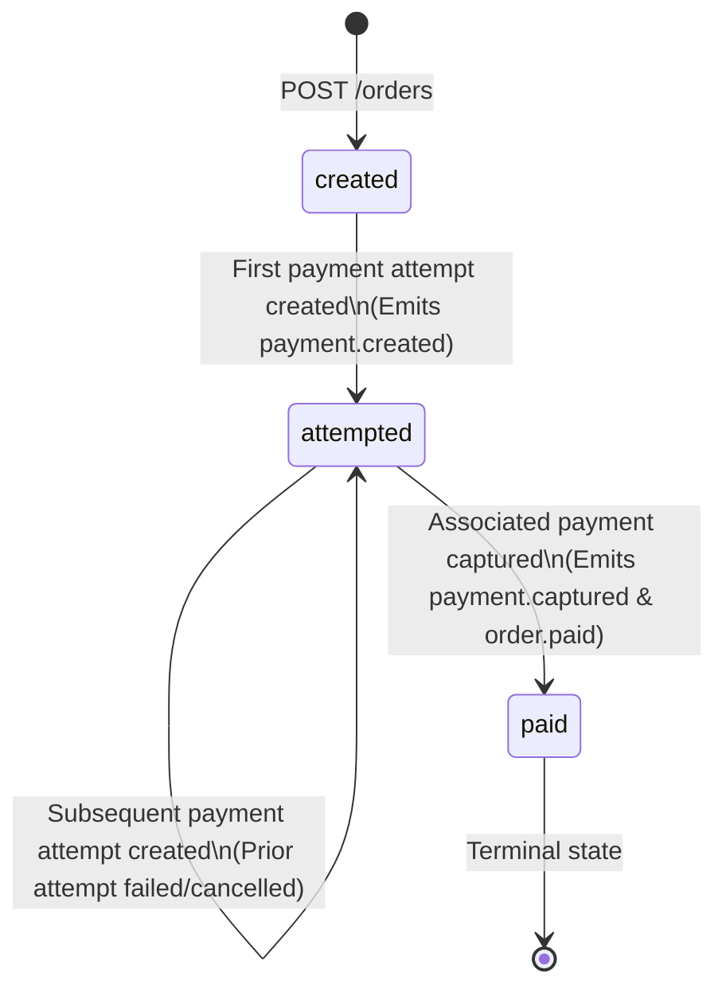

### 10.2 Payment Attempt State Machine

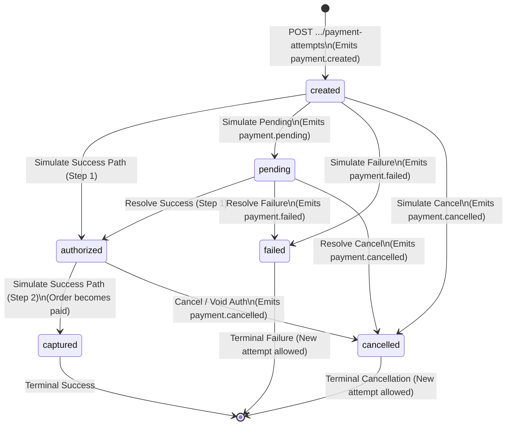

### 10.3 State Transition Invariants & Rules

1. **Attempt Concurrency Constraint:** Exactly one active (non-terminal: `created`, `pending`, `authorized`) payment attempt can exist per order at any time. Attempting to start a new attempt while another is active yields `409 ACTIVE_PAYMENT_ATTEMPT_EXISTS`.
2. **Paid Order Immutability:** Once an order enters `paid`, it is permanently sealed. Subsequent attempt creations or capture commands return `409 ORDER_ALREADY_PAID`.
3. **Checkout Capability Expiry Invariant:** When a checkout session's 15-minute capability token expires, the associated payment attempt **remains in its current state** (e.g. `created`). Expiry invalidates only the capability to open the checkout UI. It does **not** cancel the payment, mutate order state, or emit any domain event. A new checkout session can be reissued for the same payment ID via the reissue routes.
4. **Synchronous Commit & Asynchronous Dispatch:** State transitions, timestamp updates, and canonical event records are committed synchronously within the domain layer before any webhook delivery is enqueued. Outbound delivery failures never rollback a committed domain transaction.

---

## 11. Mock UPI Checkout Architecture

### 11.1 Simulation Safety Controls

The Mock UPI checkout workflow reproduces the developer-facing UX of a UPI payment flow while enforcing strict security barriers:
- **Zero Real UPI Network Interactions:** Never generates or issues `upi://pay` deep links, intent URIs, collect requests, or VPA validations.
- **Educational Flow Branches:** The checkout UI provides illustrative simulation tabs representing standard UPI user journeys:
  - *Collect Request Simulation:* Simulates a collect notification pushed to a phone. Developer clicks "Approve", "Decline", or "Simulate Timeout".
  - *Static / Dynamic QR Simulation:* Displays an illustrative QR diagram with visible *"NOT PAYABLE"* warning overlays.
- **Strict Input Masking:** Any VPA entered by the user (e.g. `test@paysim`) is strictly validated against a dummy format regex and never transmitted to real PSPs or banking switches.

---

## 12. Checkout JavaScript Compatibility Shim

### 12.1 Script Distribution & Constructor Interface

The compatibility shim is served locally at:
`http://127.0.0.1:8787/compat/razorpay/checkout.js`

It exposes `window.Razorpay` to mimic the classic browser integration pattern:

```typescript
interface RazorpayOptions {
  key: string;                                 // PAYSIM Key ID (e.g. ps_test_key_...)
  order_id: string;                            // PAYSIM Order ID
  checkout_url: string;                        // Mandatory PAYSIM extension URL
  amount: number;                              // Amount in paise
  currency: "INR";                             // Currency (INR only)
  name?: string;                               // Merchant label
  description?: string;                        // Order description
  handler?: (response: RazorpaySuccessResponse) => void;
  modal?: {
    ondismiss?: () => void;
  };
  notes?: Record<string, unknown>;
  theme?: { color?: string };
  paysim?: {
    strictOptions?: boolean;                   // Fails if unknown options supplied
  };
}
```

### 12.2 Parent-to-Iframe Security Protocol & Handshake

```mermaid
sequenceDiagram
    autonumber
    actor DeveloperApp as Developer Parent Page (http://127.0.0.1:3000)
    participant Shim as window.Razorpay Shim
    participant Iframe as PAYSIM Checkout Iframe (http://127.0.0.1:8787)
    participant Server as PAYSIM Local Server

    DeveloperApp->>Shim: new Razorpay(options).open()
    Note over Shim: Verifies window.location.origin matches parentOrigin in checkout_url
    Shim->>Iframe: Creates <iframe> pointing to checkout_url#opaqueToken
    Note over Iframe: Extracts opaqueToken from fragment; strips fragment from URL bar
    Iframe->>Server: POST /checkout/:sessionId/exchange { token: opaqueToken }
    Note over Server: Validates token against TokenVault; consumes atomically;<br/>Sets HttpOnly, SameSite=Strict cookie scoped to /checkout/:sessionId
    Server-->>Iframe: 200 OK (Session Established)

    Iframe->>DeveloperApp: postMessage(paysim.checkout.hello, targetOrigin: parentOrigin)
    DeveloperApp->>Iframe: postMessage(paysim.checkout.ready, nonce: sessionNonce)
    
    Note over Iframe: User interacts with simulator; selects "Success"
    Iframe->>Server: POST /api/v1/payments/:id/simulate { outcome: "success" }
    Server-->>Iframe: 200 OK (Payment Captured)

    Iframe->>DeveloperApp: postMessage(paysim.checkout.complete, callbackData, targetOrigin)
    Note over DeveloperApp: Shim invokes options.handler(syntheticCallbackResponse)
```

- **Fragment Token Transport:** The opaque one-time capability token is passed exclusively in the URL fragment (`#<token>`). Fragments are never sent to the server in HTTP request headers or logged in server access logs.
- **Immediate Fragment Scrubbing:** The iframe JavaScript reads `window.location.hash`, caches the token in memory, and strips the hash immediately using `window.history.replaceState`.
- **One-Time Token Exchange:** The iframe exchanges the token via same-origin `POST /checkout/:sessionId/exchange`. On success, an `HttpOnly`, `SameSite=Strict` cookie is issued, scoped exclusively to `/checkout/:sessionId`. The capability token is permanently consumed and removed from `TokenVault`.
- **Strict `postMessage` Boundary:** Handshakes and callback notifications use concrete `targetOrigin` values. Wildcard (`*`) destinations are strictly prohibited. Messages must match the per-session cryptographic nonce.

---

## 13. Webhook Engine

### 13.1 Webhook Dispatcher & Bounded Queue Model

Webhook delivery is entirely decoupled from the domain transaction:

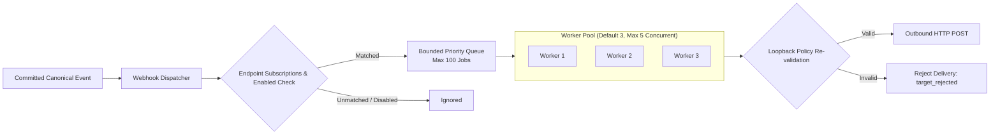

- **Queue Limits & Backpressure:** The delivery queue holds a maximum of 100 jobs. If the queue is saturated, the delivery is rejected with `DELIVERY_QUEUE_FULL`. Backpressure never blocks or rolls back payment domain commits.
- **Worker Concurrency:** Runs with default concurrency of 3, bounded to a maximum of 5 concurrent outbound socket connections.

### 13.2 Delivery & Attempt Data Model

- **Webhook Delivery:** Represents the intent to deliver one specific canonical event to one specific endpoint. Holds the immutable snapshot of the serialized request body bytes, endpoint configuration version, delivery mode, and secret version.
- **Delivery Attempt:** Represents an individual HTTP socket execution. Tracks exact start/end timestamps, HTTP status code, sanitized response headers, duration, and truncated response preview (max 16 KB).

---

## 14. Native and Compatibility Webhook Serialization

### 14.1 Deterministic Serialization Algorithm

To ensure cryptographic HMAC verification succeeds regardless of runtime or JSON parser differences, PAYSIM implements a strict deterministic serialization specification:

1. **Type Whitelist:** Accepts only JSON primitives (string, finite number, boolean, null), plain objects, and arrays. Rejects `undefined`, functions, symbols, BigInt, Date instances, `NaN`, and `Infinity`.
2. **Recursive Key Sorting:** Object keys are sorted recursively by UTF-16 code units using `Array.prototype.sort()`'s default comparator.
3. **Compact Formatting:** Serialized with zero insignificant whitespace (`JSON.stringify(sortedObj)` with no indentation).
4. **Encoding & Line Ending:** Encoded strictly as UTF-8 without a trailing newline.
5. **Exact Byte Snapshotting:** The exact resulting `Buffer` is stored in the `DeliveryBodyVault`. All retries reuse this exact byte sequence.

### 14.2 Wire Format Envelopes

#### Native Delivery Envelope (`mode: "native"`)
```json
{"createdAt":"2026-11-03T00:00:00.000Z","data":{"object":{"amount":129900,"currency":"INR","id":"pay_ps_fixture_001","method":"mock_upi","orderId":"ord_ps_fixture_001","simulated":true,"status":"captured"}},"id":"evt_ps_fixture_001","livemode":false,"simulated":true,"type":"payment.captured"}
```

#### Razorpay Compatibility Envelope (`mode: "compatibility"`)
```json
{"contains":["payment"],"created_at":1793664000,"entity":"event","event":"payment.captured","id":"evt_ps_fixture_001","livemode":false,"payload":{"payment":{"entity":{"amount":129900,"captured":true,"currency":"INR","id":"pay_ps_fixture_001","order_id":"order_ps_fixture_001","simulated":true,"status":"captured"}}},"simulated":true}
```

---

## 15. HMAC Signature Architecture

### 15.1 Signature Header Specifications

- **Native Webhook Delivery:**
  - Header: `X-PaySim-Signature: sha256=<hex_digest>`
  - Event ID Header: `X-PaySim-Event-Id: evt_ps_...`
  - Formula: `HMAC-SHA256(endpointSecretBytes, exactSerializedRawBytes)`
- **Razorpay Compatibility Delivery:**
  - Header: `X-Razorpay-Signature: <hex_digest>` (lowercase hex without prefix)
  - Event ID Header: `X-Razorpay-Event-Id: evt_ps_...`
  - Formula: `HMAC-SHA256(endpointSecretBytes, exactSerializedRawBytes)`
- **Synthetic Checkout Callback Signature:**
  - Response Field: `razorpay_signature: <hex_digest>`
  - Formula: `HMAC-SHA256(compatKeySecretBytes, order_id + "|" + payment_id)`

### 15.2 Verification Contract & Best Practices

All PAYSIM verification helpers (`packages/sdk`) and documentation examples mandate:
1. Capture raw HTTP request bytes before JSON parsing.
2. Validate hex string length (64 characters for SHA-256).
3. Compute expected digest using secret bytes.
4. Execute constant-time comparison via `crypto.timingSafeEqual`.
5. Parse JSON payload only after signature verification passes.

---

## 16. Retry and Replay Engine

### 16.1 Semantics: Retry vs. Replay

```mermaid
flowchart TD
    subgraph RetryOperation["Manual / Automatic Retry (Same Delivery)"]
        D1[Delivery del_01\nStatus: failed / exhausted] --> CheckSnap{Snapshot & Secret\nVersion Available?}
        CheckSnap -- Yes --> ReuseBytes[Reuse Exact Serialized Raw Bytes\n& Original Secret Version]
        CheckSnap -- No --> ErrorSnap[Reject: DELIVERY_SNAPSHOT_UNAVAILABLE\nOffer Replay]
        ReuseBytes --> NewAttempt[Append New DeliveryAttempt Record]
    end

    subgraph ReplayOperation["Replay Operation (New Delivery)"]
        E1[Canonical Event evt_01] --> SelectEP[Developer Selects Enabled Endpoint]
        SelectEP --> FetchMode[Inspect Selected Endpoint's Current Mode & Secret]
        FetchMode --> NewSerialization[Serialize Canonical Event under Current Mode]
        NewSerialization --> NewDelivery[Create Brand New WebhookDelivery Record\n(del_02) with Fresh Retry Budget]
    end
```

### 16.2 Retry Policies & Attempt Budgets

1. **Automatic Retry Policy:**
   - Attempt 1: Immediate on event dispatch.
   - Attempt 2: After 500 ms backoff (for retryable HTTP status: 408, 425, 429, 5xx, or connection timeout/reset).
   - Attempt 3: After 2000 ms backoff.
   - Max Automatic Attempts: 3. If Attempt 3 fails, delivery status becomes `exhausted`.
2. **Manual Retry Policy:**
   - Allowed only for deliveries in `failed` or `exhausted` status.
   - Bounded to a maximum of 3 manual retry operations per delivery. Each manual retry triggers one immediate network attempt with zero automatic backoff cycles.
   - Requires that the original endpoint secret version is still retained in the `WebhookSecretVault`.
3. **Replay Policy:**
   - Creates an independent delivery record. The canonical event's ID and timestamp remain completely unchanged. The delivery receives its own 3-attempt automatic retry budget.

---

## 17. Authentication and Authorization

### 17.1 Three-Tiered Credential Architecture

| Tier | Credential Type | Client Usage | Server-Side Storage | Invalidation / Expiry |
|---|---|---|---|---|
| **Tier 1: Dashboard Control** | One-Time Control Token | Initial dashboard login via `/control/v1/session/exchange` | Scrypt hash in memory; consumed atomically | Consumed immediately; session cookie has 30m idle / 8h absolute TTL |
| **Tier 2: Native Developer API** | Bearer Token (`ps_test_...`) | `Authorization: Bearer <token>` on `/api/v1` | Salted scrypt verifier hash only | Invalidated immediately upon manual rotation |
| **Tier 3: Compatibility Adapter** | Basic Key Pair (`key_id`, `key_secret`) | HTTP Basic Auth on `/compat/razorpay/v1` | Salted scrypt verifier hash + raw bytes in `CompatSecretVault` | Rotation disables old version for new requests; retains vault bytes while attempts active |

### 17.2 Strict Boundary Separation

- Control tokens cannot authenticate against Developer APIs (`/api/v1` or `/compat/razorpay/v1`).
- Developer API tokens cannot authenticate against Control APIs (`/control/v1`).
- Compatibility credentials can only access orders matching their internal `ownerCredentialId`.

---

## 18. Secret Management

### 18.1 Ephemeral In-Memory Vaults

Raw cryptographic secrets are stored exclusively inside memory-isolated Vault instances holding Node.js `Buffer` objects:

1. **`WebhookSecretVault`:** Maps `(endpointId, secretVersion)` -> `Buffer` (Signing secret bytes).
2. **`CompatibilitySecretVault`:** Maps `(credentialId, version)` -> `Buffer` (Key secret bytes for callback HMAC).
3. **`CheckoutTokenVault`:** Maps `sessionId` -> `Buffer` (Opaque capability token bytes).
4. **`DeliveryBodyVault`:** Maps `bodySnapshotRef` -> `Buffer` (Immutable serialized body bytes).

### 18.2 Credential Rotation & Secret Lifecycle

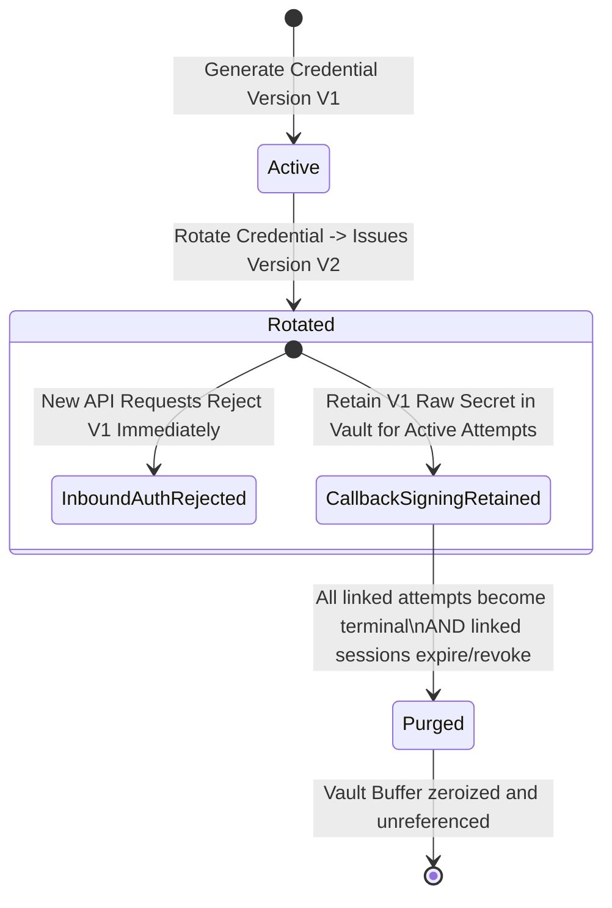

- **Immediate Auth Rejection:** When credential V1 is rotated to V2, any incoming API request using V1 is rejected with `401 UNAUTHORIZED`.
- **Ephemeral Retention for Callbacks:** If a payment attempt was created under V1 and is still in a non-terminal state (`created`, `pending`, `authorized`), its V1 secret bytes remain in `CompatibilitySecretVault` so a synthetic checkout callback signature can be produced.
- **Automated Vault Purging:** Once all payment attempts linked to V1 reach terminal status (`captured`, `failed`, `cancelled`) and their checkout sessions expire, V1 secret bytes are scrubbed from memory.

### 18.3 Zero Leakage Safeguards

- Secrets are revealed **once** upon creation in the UI/terminal.
- Server logs, debug traces, and error envelopes strip `Authorization`, `Cookie`, `Set-Cookie`, `X-PaySim-Signature`, `X-Razorpay-Signature`, and secret fields via automated redaction middleware.
- Secrets are never placed in URL paths, query parameters, or client `localStorage`.

---

## 19. In-Memory Storage Architecture

### 19.1 Repository Capacities and Limits

All application entities are held in bounded, thread-safe in-memory repositories:

| Repository / Vault | Entity Type | Default Maximum Capacity | Overflow / Capacity Policy |
|---|---|---:|---|
| `OrderRepository` | `MockOrder` | 2,000 orders | Evicts oldest completed aggregate; otherwise rejects new orders |
| `PaymentRepository` | `MockPayment` | 3,000 attempts | Evicted only in tandem with parent order aggregate |
| `CheckoutSessionRepository`| `CheckoutSession` | 3,000 sessions | Expired/consumed sessions pruned after token vault eviction |
| `EventRepository` | `MockEvent` | 2,000 events | Evicts unreferenced events only; never evicts active delivery targets |
| `DeliveryRepository` | `WebhookDelivery` | 5,000 deliveries | Completed delivery + attempts + body snapshot evicted together |
| `IdempotencyStore` | `IdempotencyRecord` | 5,000 keys | Purges expired entries (TTL 24h); rejects with `429 IDEMPOTENCY_STORE_FULL` |
| `WebhookEndpointRepository`| `WebhookEndpoint` | 10 endpoints | Rejects creation with `429 RESOURCE_LIMIT_REACHED` |
| `DeliveryQueue` | In-flight Job | 100 jobs | Rejects delivery with `DELIVERY_QUEUE_FULL`; preserves domain commit |

### 19.2 Retention Coordinator & Cascading Eviction Graph

Eviction is strictly orchestrated by the `RetentionCoordinator` to prevent dangling references or memory leaks:

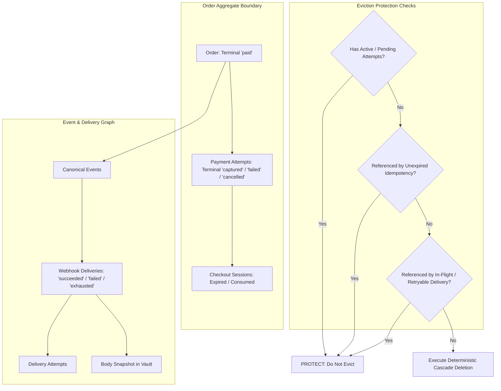

#### Deterministic Cascade Deletion Sequence:
1. Purge expired checkout session capability tokens from `TokenVault`.
2. Purge delivery body snapshots from `DeliveryBodyVault`.
3. Evict delivery attempt records, followed by webhook delivery records.
4. Evict canonical events if no other deliveries reference them.
5. Evict terminal payment attempts.
6. Evict expired idempotency records.
7. Evict the order entity.

---

## 20. Idempotency Management

### 20.1 Scope & Request Fingerprinting

Idempotency applies to all resource-creation endpoints (`POST /orders`, `POST /orders/:id/payment-attempts`, `POST /payments/:id/checkout-sessions`, and Compatibility counterparts):
- **Header:** `Idempotency-Key: <ascii_string_8_to_128_chars>`
- **Scope Key:** `hash(credentialId + ":" + routePath + ":" + idempotencyKey)`
- **Canonical Request Fingerprint:** Computed as `SHA-256(canonicalSortedJSON(requestBody))`.

### 20.2 Idempotency Lifecycle & Edge Cases

1. **Exact Replay (Identical Key & Fingerprint):**
   - Returns the identical response status code and cached response snapshot.
   - For checkout session creation, the response URL is reconstructed from the valid `TokenVault` capability if still unconsumed and unexpired.
2. **Payload Conflict (Identical Key, Different Fingerprint):**
   - Returns `409 IDEMPOTENCY_KEY_REUSED`.
3. **Session Already Consumed:**
   - If an idempotency key is replayed after the checkout token was consumed, returns `409 CHECKOUT_SESSION_ALREADY_CONSUMED`. Does not issue a duplicate token.
4. **Session Expired:**
   - If an idempotency key is replayed after the checkout session capability has expired, returns `410 CHECKOUT_SESSION_EXPIRED` with the existing `payment_id`, directing the caller to the reissue route.

---

## 21. Event Lifecycle

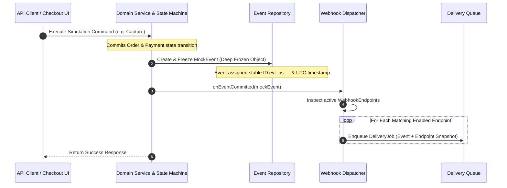

- **Canonical Immutability:** Once committed, canonical events are deep-frozen via `Object.freeze`. They contain mode-neutral payloads and are never modified by subsequent webhook retries or replays.

---

## 22. Error Handling

### 22.1 Standard Error Envelope

All API errors return a standard envelope with HTTP status codes matching PRD Section 10.11:

```json
{
  "simulated": true,
  "error": {
    "code": "INVALID_STATE_TRANSITION",
    "message": "Payment attempt pay_ps_001 in status 'captured' cannot transition to 'failed'",
    "requestId": "req_ps_88fa12",
    "details": [
      {
        "field": "status",
        "issue": "Terminal state cannot be modified"
      }
    ]
  }
}
```

### 22.2 Error Catalogue Mapping

The complete set of 26 standardized PAYSIM error codes is mapped to owning subsystems:

| Code | HTTP Status | Owning Subsystem | Description |
|---|---:|---|---|
| `VALIDATION_ERROR` | 422 | Inbound Middleware / Zod | Field constraint validation failure |
| `MALFORMED_JSON` | 400 | Inbound Middleware | Unparseable JSON body |
| `UNAUTHORIZED` | 401 | Auth Middleware | Missing/invalid API credential |
| `CONTROL_TOKEN_INVALID` | 401 | Control Controller | Invalid/consumed one-time control token |
| `CONTROL_SESSION_EXPIRED` | 401 | Control Middleware | Dashboard session timeout |
| `CSRF_INVALID` | 403 | Control Middleware | Missing or invalid `X-PaySim-CSRF` header |
| `FORBIDDEN` | 403 | Auth Middleware | Origin, host, or credential mismatch |
| `NOT_FOUND` | 404 | Domain Controllers | Resource not found in current session |
| `INVALID_STATE_TRANSITION` | 409 | State Machine | Forbidden state transition attempted |
| `ORDER_ALREADY_PAID` | 409 | Order Service | Attempt initiated on paid order |
| `ACTIVE_PAYMENT_ATTEMPT_EXISTS` | 409 | Payment Service | Multiple active attempts attempted on order |
| `IDEMPOTENCY_KEY_REUSED` | 409 | Idempotency Middleware | Same key used with altered request body |
| `IDEMPOTENCY_STORE_FULL` | 429 | Idempotency Store | Capacity full and no expired keys available |
| `CHECKOUT_SESSION_EXPIRED` | 410 | Checkout Service | Capability token expired; payment state preserved |
| `CHECKOUT_SESSION_REISSUE_NOT_ALLOWED`| 409 | Checkout Service | Reissue rejected (payment not `created` or session active) |
| `PAYSIM_UNSUPPORTED_OPTION` | 422 | Compatibility Shim | Unsupported option passed in strict mode |
| `DELIVERY_SNAPSHOT_UNAVAILABLE`| 409 | Webhook Engine | Retry rejected because secret version was purged |
| `WEBHOOK_URL_REJECTED` | 422 | Webhook Policy | Target URL violates loopback policy |
| `WEBHOOK_TARGET_CHANGED` | 422 | Webhook Policy | Destination invalidated at send time |
| `WEBHOOK_TIMEOUT` | 504 | Webhook Sender | Local receiver socket timeout |
| `WEBHOOK_CONNECTION_FAILED` | 502 | Webhook Sender | Loopback socket connection refused/reset |
| `WEBHOOK_RESPONSE_ERROR` | 502 | Webhook Sender | Receiver responded with non-success status |
| `WEBHOOK_RESPONSE_TOO_LARGE` | 502 | Webhook Sender | Receiver response exceeded 64 KB read cap |
| `DELIVERY_PAYLOAD_TOO_LARGE` | 413 | Webhook Dispatcher | Serialized outbound event exceeds 128 KB |
| `WEBHOOK_REDIRECT_REJECTED` | 502 | Webhook Sender | Receiver returned 3xx redirect (never followed) |
| `DELIVERY_QUEUE_FULL` | 429 | Webhook Queue | Dispatch queue exceeds 100 pending jobs |
| `RESOURCE_LIMIT_REACHED` | 429 | Retention Coordinator| Memory repository capacity reached |
| `RATE_LIMITED` | 429 | Rate Limiter | Request burst/minute rate exceeded |
| `COMPATIBILITY_FEATURE_NOT_SUPPORTED` | 501 | Compat Adapter | Provider API outside supported subset |
| `INTERNAL_ERROR` | 500 | Global Error Handler | Unexpected unhandled server exception |

---

## 23. Security Boundaries

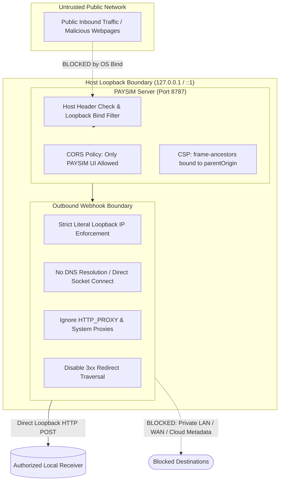

- **Loopback Enforcement:** Binds exclusively to `127.0.0.1` or `::1`. Startup strictly aborts if configured to bind to `0.0.0.0`.
- **SSRF Immunity:** Webhooks strictly prohibit private LANs (`10.0.0.0/8`, `192.168.0.0/16`, `172.16.0.0/12`), link-local IPs (`169.254.0.0/16`), cloud metadata endpoints (`169.254.169.254`), and all DNS names (`localhost`, etc.).
- **Anti-Loopback Filter:** PAYSIM detects its own port (`8787`) and Vite port (`5173`) and rejects them as webhook destinations to prevent infinite delivery loops.

---

## 24. Docker and WSL Networking

### 24.1 Architecture and Networking Model

When developers run test receiver applications inside Docker containers or Windows Subsystem for Linux (WSL2), PAYSIM enforces the following connectivity model:

```mermaid
flowchart LR
    subgraph HostMachine["Developer Host Machine (Windows / macOS / Linux)"]
        PAYSIMServer[PAYSIM Local Server\n(127.0.0.1:8787)]
        HostPublishedPort["Host Loopback Port\n(http://127.0.0.1:8080)"]
    end

    subgraph ContainerWSL["Docker Container or WSL2 VM"]
        ReceiverApp["Developer Receiver App\n(Listening on container port 3000)"]
    end

    PAYSIMServer -- "Webhook POST to 127.0.0.1:8080" --> HostPublishedPort
    HostPublishedPort -- "Port Forwarding (-p 127.0.0.1:8080:3000)" --> ReceiverApp
```

- **Literal Loopback Port Mapping:** Docker receivers must publish their container ports to host loopback using `-p 127.0.0.1:<host_port>:<container_port>`.
- **No Virtual Bridge IPs:** PAYSIM strictly rejects internal Docker bridge IPs (e.g. `172.17.0.2`) and WSL virtual switch IPs. This guarantees uniform security boundaries across bare-metal and containerized setups.

---

## 25. Application Startup and Shutdown

### 25.1 Startup Sequence

1. **Config Validation:** Load and validate environment variables via Zod.
2. **Port Conflict Check:** Probe `PAYSIM_PORT` (`8787`). If occupied, fail immediately with an actionable error.
3. **Repository & Vault Initialization:** Instantiate bounded in-memory storage maps and cryptographic vaults.
4. **Control Token Generation:** Generate 256-bit cryptographically secure one-time control token. Print once to terminal stdout.
5. **Background Timers:** Start 1-second Checkout Session Sweeper and 60-second Idempotency Expiry Sweeper.
6. **HTTP Listener:** Start Express server bound strictly to `PAYSIM_HOST` (`127.0.0.1`).

### 25.2 Graceful Shutdown Sequence (SIGINT / SIGTERM)

1. **Stop Ingress:** Close the HTTP server listener to reject new inbound connections.
2. **Halt Dispatcher:** Stop the Webhook Dispatcher from picking up new delivery jobs from the queue.
3. **Abort In-Flight Attempts:** Abort active outbound sockets. Mark running delivery attempts as `interrupted_unknown` and parent deliveries as `interrupted`.
4. **Scrub Cryptographic Vaults:** Best-effort zeroize and clear all `Buffer` instances in `WebhookSecretVault`, `CompatibilitySecretVault`, and `TokenVault`.
5. **Log & Exit:** Emit a redacted shutdown summary to stdout and exit process with code 0.

---

## 26. Logging and Monitoring

### 26.1 Structured Diagnostic Logging

PAYSIM implements a lightweight structured JSON logger:
- **Correlation Tracking:** Every request is assigned a `requestId` (`req_ps_<random>`). Every webhook send is tagged with `deliveryId` and `attemptId`.
- **Log Levels:** `error`, `warn`, `info`, `debug`.
- **Mandatory Redaction:** An automated middleware scrubs sensitive headers (`Authorization`, `Cookie`, `Set-Cookie`, `X-PaySim-Signature`, `X-Razorpay-Signature`), query parameters, and JSON secret keys (`key_secret`, `secret`, `token`) prior to formatting.
- **Zero Remote Telemetry:** No events, logs, or metrics are ever sent to remote services.

---

## 27. Testing Architecture

### 27.1 Testing Pyramid & Coverage Model

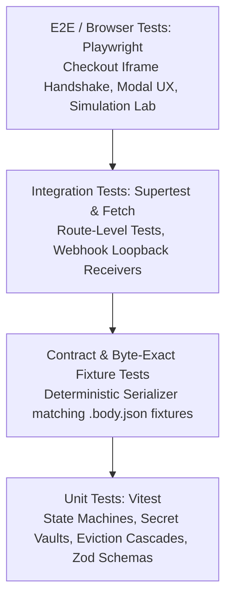

### 27.2 Traceability to PRD v2.3 & v2.2 Regression Suites

The testing framework explicitly maps test cases to normative PRD v2.3.0 requirements `V23-01` through `V23-25` (incorporating historical predecessor suite `V22-01` through `V22-22`):
- `V23-01 / V22-19`: Dual-auth iframe transport; ephemeral session access token in memory without cookie dependency.
- `V23-02`: Idempotent capability exchange enabling seamless iframe reloads and modal reopenings.
- `V23-03 / V22-08`: Checkout capability expiry preserving `created` payment state and emitting zero events.
- `V23-04 / V22-03`: Compatibility credential rotation while attempts are active; ephemeral vault retention until terminal.
- `V23-05 / V22-05`: Endpoint mode changes; retry byte preservation vs replay current mode.
- `V23-06 / V22-06`: Retry exact body byte and HMAC signature preservation (no dynamic timestamps in signed body).
- `V23-07`: Strict literal loopback rejection of private Docker bridge IPs (`172.17.x.x`).
- `V23-08 / V22-21`: Idempotency token-free snapshots and 409 consumed / 410 expired replay semantics.
- `V23-09 / V22-11`: Server-bound `parentOrigin` and CSP `frame-ancestors` enforcement.
- `V23-14 / V22-04`: Compatibility order ownership isolation via internal `ownerCredentialId`.
- `V23-18 / V23-19 / V22-13 / V22-17`: Exact byte matching against committed fixtures.

---

## 28. Configuration Management

### 28.1 Configuration Specification

All configurations are centralized in `apps/server/src/config`:

```typescript
import { z } from "zod";

export const ConfigSchema = z.object({
  PAYSIM_HOST: z.enum(["127.0.0.1", "::1"]).default("127.0.0.1"),
  PAYSIM_PORT: z.coerce.number().int().min(1024).max(65535).default(8787),
  PAYSIM_WEB_DEV_PORT: z.coerce.number().int().min(1024).max(65535).default(5173),
  PAYSIM_LOG_LEVEL: z.enum(["error", "warn", "info", "debug"]).default("info"),
  PAYSIM_DATA_LIMIT_PROFILE: z.enum(["default", "minimal", "stress"]).default("default"),
  PAYSIM_CONTROL_TOKEN: z.string().min(16).optional(),
});

export type PaySimConfig = z.infer<typeof ConfigSchema>;
```

Failures during schema validation immediately halt process startup with descriptive messages.

---

## 29. Component Dependencies

### 29.1 Strict Architectural Dependency Hierarchy

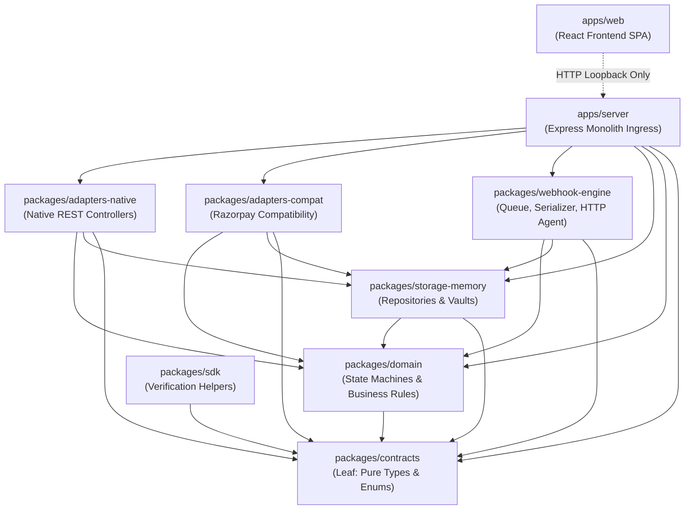

#### Enforced Dependency Rules:
1. `packages/contracts` is a pure leaf; it imports nothing.
2. `packages/domain` contains zero dependencies on HTTP frameworks (Express), browser APIs, or storage implementations.
3. Repositories in `packages/storage-memory` implement interfaces defined in `packages/domain`.
4. Circular dependencies between workspaces are strictly prohibited and verified via CI lint rules.

---

## 30. Complete Data Flow Diagrams

### 30.1 Native Payment & Webhook Delivery Flow

```mermaid
sequenceDiagram
    autonumber
    actor DevClient as Developer Application
    participant NativeAPI as Native API (/api/v1)
    participant Domain as Domain Core (Order & Payment Services)
    participant Storage as In-Memory Storage & Vaults
    participant Dispatcher as Webhook Dispatcher & Queue
    actor Receiver as Local Webhook Receiver

    DevClient->>NativeAPI: POST /api/v1/orders { amount: 129900, currency: "INR" }
    NativeAPI->>Domain: createOrder(dto)
    Domain->>Storage: Commit MockOrder (status: created)
    NativeAPI-->>DevClient: 201 Created { id: "ord_ps_001", status: "created" }

    DevClient->>NativeAPI: POST /api/v1/orders/ord_ps_001/payment-attempts { method: "mock_upi", parentOrigin }
    NativeAPI->>Domain: createPaymentAttempt(orderId, dto)
    Domain->>Storage: Commit MockPayment (status: created); Order moves to 'attempted'
    Domain->>Storage: Commit Canonical Event 'payment.created'
    Domain->>Dispatcher: enqueueEvent(payment.created)
    NativeAPI-->>DevClient: 201 Created { paymentId: "pay_ps_001", checkoutUrl }

    DevClient->>NativeAPI: POST /api/v1/payments/pay_ps_001/simulate { outcome: "success" }
    NativeAPI->>Domain: simulatePayment(paymentId, outcome)
    Domain->>Storage: Atomic commit: Payment captured; Order paid
    Domain->>Storage: Commit events: payment.authorized, payment.captured, order.paid
    Domain->>Dispatcher: enqueueEvent(payment.captured)
    NativeAPI-->>DevClient: 200 OK { status: "captured" }

    par Outbound Webhook Delivery
        Dispatcher->>Storage: Serialize Canonical Event into exact UTF-8 bytes
        Dispatcher->>Storage: Store exact bytes in DeliveryBodyVault
        Dispatcher->>Receiver: HTTP POST /webhook (X-PaySim-Signature: sha256=...)
        Receiver-->>Dispatcher: 200 OK
        Dispatcher->>Storage: Record DeliveryAttempt (outcome: succeeded)
    end
```

### 30.2 Razorpay Compatibility Checkout & Callback Verification Flow

```mermaid
sequenceDiagram
    autonumber
    actor DevBackend as Developer Backend Server
    actor Browser as Developer Browser Frontend
    participant CompatAPI as PAYSIM Compat Adapter
    participant CheckoutHost as PAYSIM Checkout Host
    actor Receiver as Developer Webhook Receiver

    DevBackend->>CompatAPI: POST /compat/razorpay/v1/orders { amount: 129900, currency: "INR" }
    CompatAPI-->>DevBackend: 200 OK { id: "order_ps_001", status: "created" }

    DevBackend->>CompatAPI: POST /compat/razorpay/v1/orders/order_ps_001/checkout-sessions { parent_origin }
    CompatAPI-->>DevBackend: 200 OK { checkout_url: "http://127.0.0.1:8787/checkout/chk_01#token" }

    DevBackend-->>Browser: Pass key_id, order_id, checkout_url
    Browser->>CheckoutHost: Load /compat/razorpay/checkout.js (window.Razorpay)
    Browser->>CheckoutHost: rzp = new Razorpay({ key, order_id, checkout_url }); rzp.open()
    CheckoutHost->>CheckoutHost: Open <iframe> pointing to checkout_url
    Note over CheckoutHost: User selects "Mock UPI" -> "Success"
    CheckoutHost-->>Browser: postMessage(paysim.checkout.complete, { razorpay_payment_id, razorpay_order_id, razorpay_signature })
    
    Browser->>DevBackend: Submit payment details for verification
    Note over DevBackend: Dev verifies signature using PAYSIM SDK / HMAC-SHA256(secret, order_id + "|" + payment_id)
    DevBackend-->>Browser: Verification Successful!

    par Compatibility Webhook
        CheckoutHost->>Receiver: HTTP POST /webhook (X-Razorpay-Signature: <hex>)
        Receiver-->>CheckoutHost: 200 OK
    end
```

---

## Document Approval & Engineering Sign-Off

This System Architecture document is formally approved as the definitive technical specification for PAYSIM Phase 02. All subsequent implementation tasks (Phase 03 onwards) must comply with the patterns, boundaries, and invariants documented herein.
